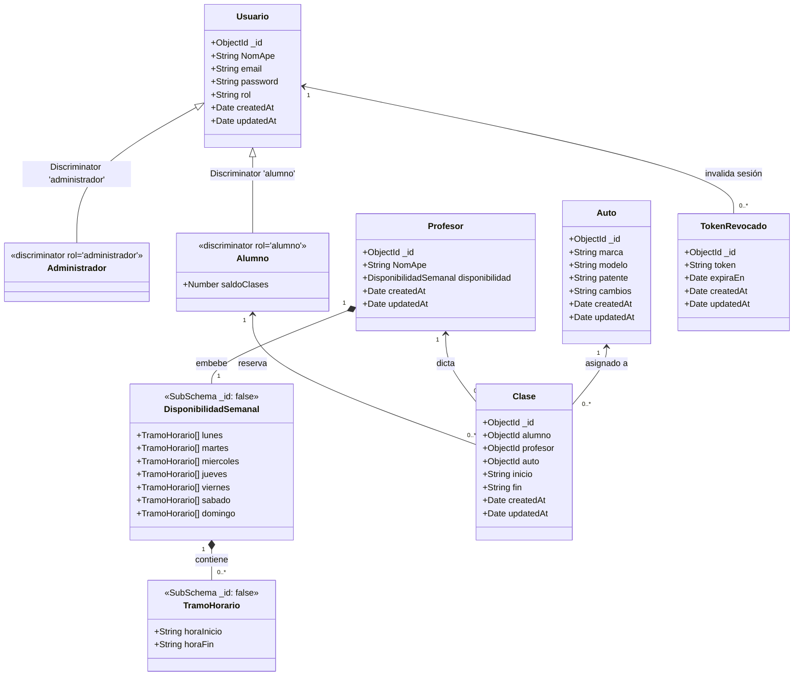

# 🚗 Drive & Learn — Backend API REST

<p align="center">
  
  
  
  
  
  
  
</p>

API REST desarrollada con Node.js, Express 5 y MongoDB/Mongoose para la gestión integral de la escuela de manejo **DriveAndLearn**. Permite administrar cuentas de usuario con roles diferenciados (`administrador` y `alumno`), autenticación *stateless* con JWT y cierre de sesión mediante lista negra con expiración automática (*TTL Index*), flota vehicular, instructores con agendas semanales dinámicas, saldo prepago de clases prácticas y agendamiento de turnos libre de solapamientos.

---

## 📑 Tabla de Contenidos

- [1. Objetivos del Proyecto](#1-objetivos-del-proyecto)
- [2. Stack Tecnológico](#2-stack-tecnol%C3%B3gico)
- [3. Arquitectura y Metodología ("La forma de hacer las cosas")](#3-arquitectura-y-metodolog%C3%ADa-la-forma-de-hacer-las-cosas)
  - [3.1. Principio de Responsabilidad Única (SRP)](#31-principio-de-responsabilidad-%C3%BAnica-srp)
  - [3.2. Ciclo de Vida: Separación entre App y Server](#32-ciclo-de-vida-separaci%C3%B3n-entre-app-y-server)
  - [3.3. DTOs y Validación Estructural de Entrada](#33-dtos-y-validaci%C3%B3n-estructural-de-entrada)
  - [3.4. Seguridad, Hashing, Autorización y Blacklist con TTL](#34-seguridad-hashing-autorizaci%C3%B3n-y-blacklist-con-ttl)
  - [3.5. Motor de Calendarización e Intervalos con Luxon](#35-motor-de-calendarizaci%C3%B3n-e-intervalos-con-luxon)
  - [3.6. Jerarquía de Errores y Manejo Centralizado](#36-jerarqu%C3%ADa-de-errores-y-manejo-centralizado)
- [4. Modelo de Dominio y Diagrama de Entidades](#4-modelo-de-dominio-y-diagrama-de-entidades)
- [5. Mapa de Enrutamiento HTTP](#5-mapa-de-enrutamiento-http)
- [6. Catálogo de Endpoints de la API](#6-cat%C3%A1logo-de-endpoints-de-la-api)
  - [6.1. Autenticación (`/api/auth`)](#61-autenticaci%C3%B3n-apiauth)
  - [6.2. Administradores (`/api/administradores`)](#62-administradores-apiadministradores)
  - [6.3. Alumnos (`/api/alumnos`)](#63-alumnos-apialumnos)
  - [6.4. Autos (`/api/autos`)](#64-autos-apiautos)
  - [6.5. Profesores (`/api/profesores`)](#65-profesores-apiprofesores)
  - [6.6. Clases (`/api/clases`)](#66-clases-apiclases)
- [7. Suite de Pruebas Automatizadas](#7-suite-de-pruebas-automatizadas)
- [8. Guía de Instalación y Puesta en Marcha](#8-gu%C3%ADa-de-instalaci%C3%B3n-y-puesta-en-marcha)

---

## 1. Objetivos del Proyecto

### 🎯 Objetivos Funcionales y de Dominio
- **Gestión de Usuarios por Discriminador:** Administración de cuentas de `Administrador` (`rol: 'administrador'`) y `Alumno` (`rol: 'alumno'`) persistidas sobre una única colección `usuarios` en MongoDB.
- **Control de Saldo de Clases (`saldoClases`):** Administración del crédito de clases prácticas disponibles para cada alumno. La edición estándar de perfil (`PUT /api/alumnos/:id`) bloquea la alteración de `saldoClases`, exigiendo el uso de operaciones específicas de suma y resta (`PATCH /api/alumnos/:id/saldo/sumar` y `/restar`) o el flujo de agendamiento/cancelación de clases.
- **Gestión de Flota Vehicular (`Auto`):** Registro, actualización y listado de vehículos con validación de patentes argentinas (formato tradicional `ABC123` y Mercosur `AB123CD`) y filtrado por tipo de transmisión (`MANUAL` o `AUTOMATICO`).
- **Agenda Semanal y Turnos Libres (`Profesor`):** Configuración de tramos horarios de disponibilidad por día de la semana (`lunes` a `domingo`), con unificación automática de bloques contiguos o superpuestos, resta de intervalos y consulta de turnos libres de 1 hora junto con la lista de autos disponibles para cada turno.
- **Reserva y Cancelación de Clases (`Clase`):** Agendamiento de clases prácticas de 1 hora exacta en punto verificando fecha futura, saldo suficiente del alumno, disponibilidad del instructor y ausencia total de superposiciones horarias (para el alumno, el profesor y el auto), descontando 1 crédito al agendar y reintegrándolo automáticamente al cancelar (`DELETE /api/clases/:id`).
- **Preservación de Entidades Maestras:** Los recursos `Administrador`, `Alumno`, `Auto` y `Profesor` no exponen operaciones de borrado (`DELETE`), garantizando la integridad referencial de las clases registradas.

### 🏛️ Objetivos de Arquitectura de Software
- Implementar una **Arquitectura en Capas** con **Principio de Responsabilidad Única (SRP)** donde las dependencias fluyen estrictamente desde la capa de transporte HTTP hacia la capa de dominio y persistencia.
- Aislar el núcleo de negocio (`src/services/`) de cualquier dependencia de Express (`req`, `res`, cabeceras o códigos de estado HTTP directo).
- Validar de forma estricta la estructura y tipos de cada petición entrante mediante DTOs antes de invocar la lógica de negocio.
- Centralizar el tratamiento de errores en un único middleware (`errorHandler`) respaldado por una jerarquía de clases de error con códigos de estado HTTP propios.

---

## 2. Stack Tecnológico

### Dependencias de Producción (`dependencies`)

| Paquete | Versión | Rol en el Proyecto |
| :--- | :--- | :--- |
| **[Node.js](https://nodejs.org/)** | `v20+` | Entorno de ejecución con soporte nativo de ES Modules (`"type": "module"` en `package.json`) y modo `--watch`. |
| **[express](https://expressjs.com/)** | `^5.2.1` | Framework HTTP para la construcción de la API REST, con captura nativa de promesas rechazadas en controladores `async` sin requerir `try/catch`. |
| **[mongoose](https://mongoosejs.com/)** | `^9.9.4` | ODM para MongoDB. Define esquemas, validaciones de modelo, referencias (`ObjectId`), subdocumentos embebidos, discriminadores e índice TTL. |
| **[bcrypt](https://github.com/kelektiv/node.bcrypt.js)** | `^6.0.0` | Hashing unidireccional de contraseñas (`SALT_ROUNDS = 10`) y verificación criptográfica durante el login. |
| **[jsonwebtoken](https://github.com/auth0/node-jsonwebtoken)** | `^9.0.3` | Emisión y verificación de tokens Bearer JWT con vigencia de `24h`. |
| **[luxon](https://moment.github.io/luxon/)** | `^3.5.0` | Manejo de fechas locales en zona horaria IANA (`ZONA_HORARIA`) y operaciones sobre intervalos (`DateTime`, `Interval.merge`, `difference`, `overlaps`, `engulfs`, `splitBy`). |
| **[cors](https://github.com/expressjs/cors)** | `^2.8.6` | Middleware para habilitar *Cross-Origin Resource Sharing*. |
| **[dotenv](https://github.com/motdotla/dotenv)** | `^17.4.2` | Carga de variables de entorno desde `.env` hacia `src/config/env.js`. |

### Dependencias de Desarrollo y Testing (`devDependencies`)

| Paquete | Versión | Rol en el Proyecto |
| :--- | :--- | :--- |
| **[vitest](https://vitest.dev/)** | `^4.1.11` | Ejecutor de pruebas unitarias y de integración compatible con ES Modules. |
| **[@vitest/ui](https://vitest.dev/guide/ui.html)** | `^4.1.11` | Interfaz gráfica para inspección de suites de pruebas. |
| **[@vitest/coverage-v8](https://vitest.dev/guide/coverage.html)** | `^4.1.11` | Generación de reportes de cobertura de código mediante el motor V8. |
| **[mongodb-memory-server](https://github.com/nodkz/mongodb-memory-server)** | `^11.2.0` | Servidor MongoDB efímero en memoria para ejecutar las pruebas de servicios y modelos en aislamiento total. |
| **[supertest](https://github.com/ladjs/supertest)** | `^7.2.2` | Cliente HTTP para pruebas de integración sobre la aplicación Express exportada en `src/app.js`. |

---

## 3. Arquitectura y Metodología ("La forma de hacer las cosas")

El proyecto organiza su código bajo `src/` siguiendo un flujo unidireccional en capas:

```text
       HTTP Request
            │
            ▼
    ┌───────────────┐
    │    ROUTES     │  ── Define verbos HTTP, paths y encadena middlewares
    └───────┬───────┘     (validarObjetoJson, autenticar, verificarSiAdmin)
            ▼
    ┌───────────────┐
    │  CONTROLLER   │  ── Extrae datos de req (params, query, body, usuario, token),
    └───────┬───────┘     ejecuta el validador DTO e invoca al Service
            ▼
    ┌───────────────┐
    │      DTO      │  ── Valida estructura, campos obligatorios/opcionales y tipos
    └───────┬───────┘     (rechaza cuerpos vacíos y claves no permitidas)
            ▼
    ┌───────────────┐
    │    SERVICE    │  ── Lógica de negocio pura y validaciones de dominio
    └───────┬───────┘     (sin acceso a req ni res; lanza clases de src/errors/)
            ▼
    ┌───────────────┐
    │  MODEL (ODM)  │  ── Esquemas de Mongoose, discriminadores y consultas a BD
    └───────┬───────┘
            ▼
        MongoDB
```

### 3.1. Principio de Responsabilidad Única (SRP)

- **Configuración (`src/config/`):**
  - `env.js`: Centraliza la lectura y validación de variables de entorno (`PORT`, `MONGODB_URI`, `NODE_ENV`, `ZONA_HORARIA`, `obtenerJwtSecret()`, `obtenerAdminInicial()`).
  - `db.js`: Gestiona la conexión (`connectDB()`, configurando `mongoose.set('strictQuery', true)`) y desconexión (`disconnectDB()`) de Mongoose con MongoDB.
- **Constantes (`src/constants/`):**
  - `roles.js`: Define `ROLES` (`ADMINISTRADOR: 'administrador'`, `ALUMNO: 'alumno'`) y `ROLES_ENUM`.
  - `cambios.js`: Define `CAMBIOS` (`AUTOMATICO: 'AUTOMATICO'`, `MANUAL: 'MANUAL'`) y `CAMBIOS_ENUM`.
  - `diasSemana.js`: Define el mapeo ISO de días `MAPA_WEEKDAY_DIA` (`1: 'lunes'` ... `7: 'domingo'`) y `DIAS_SEMANA`.
  - `constantesCalendarizacion.js`: Define las expresiones regulares de horas y fechas (`REGEX_HORA_EN_PUNTO`, `REGEX_FECHA_HORA_EN_PUNTO`, `REGEX_FECHA_DIA_YYYY_MM_DD`), la fecha base `DIA_BASE_REFERENCIA` (`2026-01-05T00:00`), `DURACION_CLASE_HORAS = 1`, `MIN_DURACION_TRAMO_HORAS = 1` y `HORA_CIERRE_DIA = '24:00'`.
- **Routes (`src/routes/`):** Solo declaran rutas y asocian middlewares y controladores (`authRoutes.js`, `administradorRoutes.js`, `alumnoRoutes.js`, `autoRoutes.js`, `profesorRoutes.js`, `claseRoutes.js`).
- **Controllers (`src/controllers/`):** Adaptan la petición HTTP llamando al DTO y al Service, y devuelven el código HTTP correspondiente (`200`, `201` o `404` cuando una consulta por ID retorna `null`).
- **DTOs (`src/dtos/` y `src/dtos/helpers/`):** Validan el formato de entrada antes de ejecutar reglas de negocio.
- **Services (`src/services/` y `src/services/helpers/`):** Contienen el 100% de las reglas de dominio (`authService.js`, `usuarioService.js`, `administradorService.js`, `alumnoService.js`, `autoService.js`, `profesorService.js`, `claseService.js`) junto con los helpers de contraseñas (`manejoDePassword.js`), validación de identificadores (`validarMongooseObjId.js`), disponibilidad (`disponibilidadHelper.js`) y turnos/fechas (`turnosYFechasHelper.js`).
- **Models (`src/models/`):** Definen la estructura de persistencia en MongoDB.

### 3.2. Ciclo de Vida: Separación entre App y Server

- **`src/app.js`:** Instancia Express, registra `cors()` y `express.json()`, monta los 6 routers bajo `/api`, declara el middleware `404` (`{ mensaje: 'Ruta no encontrada' }`) y conecta `errorHandler`. No abre puertos ni conecta a la base de datos.
- **`src/server.js`:** Valida de forma temprana la configuración de `JWT_SECRET` invocando `obtenerJwtSecret()`, conecta a MongoDB mediante `connectDB()` y, una vez establecida la conexión, pone la aplicación a escuchar en `PORT`.

### 3.3. DTOs y Validación Estructural de Entrada

1. **Filtro de Objeto Plano (`src/middlewares/validarObjetoJson.js`):** Verifica que `req.body` sea un objeto JSON válido, no nulo y no sea un array, lanzando `ErrorPeticionInvalida` (`400`) en caso contrario.
2. **Validador Genérico (`src/dtos/helpers/validarEstructuraYTipos.js`):**
   - Utilizado en todas las operaciones `POST`, `PUT`, `PATCH` y en consultas con parámetros como `GET /api/profesores/:id/turnos-libres` (`validarTurnosLibresQueryDTO`).
   - Rechaza cuerpos o queries vacíos con `ErrorCampoInvalido` (`400`).
   - Rechaza cualquier clave adicional que no figure en la lista de campos permitidos (`Campos no permitidos: ...`).
   - Verifica la presencia de todos los campos obligatorios (`Campos obligatorios faltantes: ...`).
   - Comprueba el `typeof` de cada propiedad enviada (rechazando `NaN` cuando se espera `'number'`) con `ErrorDeTipo` (`400`).
3. **Validación de `ObjectId` (`src/services/helpers/validarMongooseObjId.js`):**
   - Comprueba `mongoose.Types.ObjectId.isValid(id)` antes de realizar búsquedas o actualizaciones por ID, lanzando `ErrorMongooseObjIdInvalido` (`400`) si el formato es inválido.

### 3.4. Seguridad, Hashing, Autorización y Blacklist con TTL

1. **Contraseñas (`src/services/helpers/manejoDePassword.js`):**
   - Se exige tipo `string` y una longitud mínima de 8 caracteres (`MIN_LONGITUD_PASSWORD = 8`); de lo contrario se lanza `ErrorPasswordInvalida` (`400`).
   - Se hashea con `bcrypt.hash(password, 10)` (`SALT_ROUNDS = 10`) tanto en el alta como al actualizar la contraseña de un alumno o administrador.
   - El esquema `Usuario` elimina `password` y `__v` en su transformación `toJSON` (y el resto de los modelos principales eliminan `__v`).
2. **Autenticación y Cierre de Sesión (`src/services/authService.js` y `src/middlewares/authMiddleware.js`):**
   - `login`: Normaliza el email (`trim().toLowerCase()`), busca en `Usuario`, compara el hash con `bcrypt.compare` y firma un JWT por `24h` con `{ id, email, rol, NomApe }`. Devuelve `{ token, usuario }`.
   - `logout`: Verifica el JWT recibido, obtiene su fecha de vencimiento (`payload.exp * 1000`) y persiste el token en la colección `tokens_revocados`. Si el token ya estaba revocado (código `11000`) o ya había expirado naturalmente (`TokenExpiredError`), responde igualmente `200 OK` (`{ mensaje: 'Sesión cerrada exitosamente' }`).
   - `esTokenRevocado`: Función auxiliar exportada en `authService.js` que verifica mediante `TokenRevocado.exists` si un token se encuentra en la lista negra.
   - **Índice TTL:** `TokenRevocado` define `tokenRevocadoSchema.index({ expiraEn: 1 }, { expireAfterSeconds: 0 })`, por lo que MongoDB purga automáticamente los tokens vencidos.
   - `autenticar`: Extrae el Bearer token de `req.headers.authorization`, verifica que no exista en `TokenRevocado`, valida la firma JWT y adjunta el payload en `req.usuario` (y `req.user`) y el token crudo en `req.token`.
   - `verificarSiAdmin` (basado en la función interna `autorizarRol`): Verifica que `req.usuario.rol` sea `'administrador'`, lanzando `ErrorAutorizacion` (`403`) si no cumple (definido en `authMiddleware.js`; en `alumnoRoutes.js` se encuentra importado y comentado en los endpoints de saldo).

### 3.5. Motor de Calendarización e Intervalos con Luxon

Implementado en `src/services/helpers/disponibilidadHelper.js` y `src/services/helpers/turnosYFechasHelper.js`, fijando como zona por defecto `ZONA_HORARIA` (`America/Argentina/Buenos_Aires`):

- **Horas en punto:** Tanto los tramos de disponibilidad de los profesores (`"HH:00"`, admitiendo `"24:00"` como cierre de día) como los horarios de clases (`"YYYY-MM-DDTHH:00"`) deben expresarse en horas exactas en punto y tener una duración mínima de 1 hora (`DURACION_CLASE_HORAS = 1`).
- **Fusión y Resta de Disponibilidad:**
  - `agregarTramosADia`: Utiliza `Interval.merge()` de Luxon para fusionar automáticamente tramos superpuestos o adyacentes (ej. `08:00-12:00` + `10:00-14:00` → `08:00-14:00`).
  - `quitarTramosDeDia`: Utiliza `Interval.difference()` para recortar o partir tramos existentes (ej. quitar `10:00-12:00` de `08:00-14:00` produce `08:00-10:00` y `12:00-14:00`).
- **Continuidad en Medianoche:** `proyectarDisponibilidadEnVentana` proyecta una ventana de 3 días (anterior, actual y siguiente) y aplica `Interval.merge()` para soportar turnos en medianoche cuando un día cierra a las `24:00` y el siguiente inicia a las `00:00`.
- **Generación de Turnos Libres:** Divide los intervalos disponibles en bloques de 1 hora (`splitBy({ hours: 1 })`), descarta horarios pasados, filtra las clases ya asignadas al profesor (`seSuperponenIntervalos` con `Interval.overlaps`) y adjunta para cada turno la lista de vehículos libres (`obtenerAutosLibresEnTurno`).

### 3.6. Jerarquía de Errores y Manejo Centralizado

Todas las clases de error personalizadas se encuentran en `src/errors/`:

```text
Error
├── ErrorPeticionInvalida (400)
│   ├── ErrorCampoInvalido (400)
│   ├── ErrorDeTipo (400)
│   ├── ErrorFormatoDeFecha (400)
│   ├── ErrorLecturaCuerpo (400)
│   └── ErrorMongooseObjIdInvalido (400)
├── ErrorDeNegocio (400 por defecto)
│   ├── ErrorPasswordInvalida (400)
│   ├── ErrorSaldoClasesInsuficiente (400)
│   └── ErrorRegistroInexistente (404)
├── ErrorAutenticacion (401)
└── ErrorAutorizacion (403)
```

El middleware `src/middlewares/errorHandler.js` captura cualquier error y devuelve siempre un JSON con la forma `{ "mensaje": "..." }`:
1. Si `express.json()` falla al parsear un cuerpo malformado, `verSiErrorLecturaCuerpo` lo convierte en `ErrorLecturaCuerpo` (`400`).
2. `mongoose.Error.ValidationError` → `400` con los mensajes del esquema concatenados.
3. `CastError` de Mongoose → `400` con `{ "mensaje": "Id inválido" }`.
4. Error `code === 11000` (clave única duplicada en MongoDB, como `email` o `patente`) → `400`.
5. Instancias de `ErrorPeticionInvalida`, `ErrorDeNegocio`, `ErrorAutenticacion` o `ErrorAutorizacion` → responden con su `err.statusCode` (`400`, `401`, `403`, `404`) y `err.message`.
6. Cualquier otro error inesperado → registra por consola y responde `500` con `{ "mensaje": "Error interno del servidor" }`.

---

## 4. Modelo de Dominio y Diagrama de Entidades



### Detalle de Modelos (`src/models/`):

1. **`Usuario` (`Usuario.js` — colección `usuarios`):**
   - `NomApe`: `String`, obligatorio, `trim`, entre 4 y 50 caracteres.
   - `email`: `String`, obligatorio, `unique`, `lowercase`, `trim`, validado por regex `/^[^\s@]+@[^\s@]+\.[^\s@]+$/`.
   - `password`: `String`, obligatorio (almacenado con hash `bcrypt`).
   - `rol`: `String`, obligatorio, `discriminatorKey`, enum `['administrador', 'alumno']`.
2. **`Administrador` (`Administrador.js`):** Discriminador de `Usuario` con valor `'administrador'`.
3. **`Alumno` (`Alumno.js`):** Discriminador de `Usuario` con valor `'alumno'`. Añade `saldoClases` (`Number`, entero $\ge 0$, por defecto `0`).
4. **`Profesor` (`Profesor.js` — colección `profesores`):**
   - `NomApe`: `String`, obligatorio, entre 4 y 50 caracteres.
   - `disponibilidad`: Subdocumento embebido `disponibilidadSemanalSchema` (`disponibilidadSemanal.js`) con claves `lunes` a `domingo`, cada una compuesta por un array de `tramoSchema` (`tramoHorario.js`: `horaInicio` `00:00`-`23:59` y `horaFin` `00:00`-`24:00`).
5. **`Auto` (`Auto.js` — colección `autos`):**
   - `marca`: `String`, obligatorio.
   - `modelo`: `String`, obligatorio.
   - `patente`: `String`, obligatorio, `unique`, `uppercase`, regex `/^([A-Z]{3}\d{3}|[A-Z]{2}\d{3}[A-Z]{2})$/`.
   - `cambios`: `String`, obligatorio, `uppercase`, enum `['AUTOMATICO', 'MANUAL']`.
6. **`Clase` (`Clase.js` — colección `clases`):**
   - `alumno`: `ObjectId` (ref `'Alumno'`), obligatorio.
   - `profesor`: `ObjectId` (ref `'Profesor'`), obligatorio.
   - `auto`: `ObjectId` (ref `'Auto'`), obligatorio.
   - `inicio` y `fin`: `String`, obligatorios, formato `YYYY-MM-DDTHH:MM` (el servicio restringe el agendamiento a horas en punto `YYYY-MM-DDTHH:00`).
7. **`TokenRevocado` (`TokenRevocado.js` — colección `tokens_revocados`):**
   - `token`: `String`, obligatorio, `unique`.
   - `expiraEn`: `Date`, obligatorio, con índice TTL `{ expireAfterSeconds: 0 }`.

---

## 5. Mapa de Enrutamiento HTTP

Todos los routers se montan en `src/app.js` bajo el prefijo `/api`:

```mermaid
flowchart TD
    ROOT["API Root (/api)"]

    ROOT --> AUTH["/auth"]
    AUTH --> AUTH_LOGIN["POST /login"]
    AUTH --> AUTH_LOGOUT["POST /logout (🔒 Bearer)"]

    ROOT --> ADMIN["/administradores"]
    ADMIN --> ADMIN_LIST["GET /"]
    ADMIN --> ADMIN_GET["GET /:id"]
    ADMIN --> ADMIN_POST["POST /"]
    ADMIN --> ADMIN_PUT["PUT /:id"]

    ROOT --> ALUMNOS["/alumnos"]
    ALUMNOS --> ALUMNO_LIST["GET /"]
    ALUMNOS --> ALUMNO_GET["GET /:id"]
    ALUMNOS --> ALUMNO_POST["POST /"]
    ALUMNOS --> ALUMNO_PUT["PUT /:id"]
    ALUMNOS --> ALUMNO_SUM["PATCH /:id/saldo/sumar"]
    ALUMNOS --> ALUMNO_RES["PATCH /:id/saldo/restar"]

    ROOT --> AUTOS["/autos"]
    AUTOS --> AUTO_LIST["GET / (?cambios=...)"]
    AUTOS --> AUTO_GET["GET /:id"]
    AUTOS --> AUTO_POST["POST /"]
    AUTOS --> AUTO_PUT["PUT /:id"]

    ROOT --> PROFESORES["/profesores"]
    PROFESORES --> PROF_LIST["GET /"]
    PROFESORES --> PROF_GET["GET /:id"]
    PROFESORES --> PROF_DISP["GET /:id/disponibilidad"]
    PROFESORES --> PROF_TURNOS["GET /:id/turnos-libres (?fecha=...&cambios=...)"]
    PROFESORES --> PROF_POST["POST /"]
    PROFESORES --> PROF_PUT["PUT /:id"]
    PROFESORES --> PROF_ADD_DISP["PATCH /:id/disponibilidad/agregar"]
    PROFESORES --> PROF_REM_DISP["PATCH /:id/disponibilidad/quitar"]

    ROOT --> CLASES["/clases (🔒 Bearer)"]
    CLASES --> CLASE_LIST["GET /"]
    CLASES --> CLASE_GET["GET /:id"]
    CLASES --> CLASE_POST["POST / (Agendar)"]
    CLASES --> CLASE_DEL["DELETE /:id (Cancelar)"]

    ROOT --> NOT_FOUND["* (Catch-all 404: 'Ruta no encontrada')"]
```



---

## 6. Catálogo de Endpoints de la API

### 6.1. Autenticación (`/api/auth`)

| Método | Endpoint | Auth | Cuerpo (JSON) | Códigos HTTP | Descripción |
| :--- | :--- | :--- | :--- | :--- | :--- |
| `POST` | `/api/auth/login` | No | `{ "email": "string", "password": "string" }` | `200`, `400`, `401` | Valida credenciales y retorna `{ token, usuario: { id, NomApe, email, rol } }`. |
| `POST` | `/api/auth/logout` | **Sí (`Bearer`)** | Ninguno | `200`, `401` | Registra el token en `tokens_revocados` y retorna `{ mensaje: "Sesión cerrada exitosamente" }`. |

---

### 6.2. Administradores (`/api/administradores`)

| Método | Endpoint | Auth | Cuerpo (JSON) | Códigos HTTP | Descripción |
| :--- | :--- | :--- | :--- | :--- | :--- |
| `GET` | `/api/administradores` | **Sí (`Bearer`, rol `'administrador'`)** | Ninguno | `200`, `401`, `403` | Lista todos los administradores registrados. |
| `GET` | `/api/administradores/:id` | **Sí (`Bearer`, rol `'administrador'`)** | Ninguno | `200`, `400`, `401`, `403`, `404` | Obtiene un administrador por su `_id` de MongoDB. |
| `POST` | `/api/administradores` | **Sí (`Bearer`, rol `'administrador'`)** | `{ "NomApe": "string", "email": "string", "password": "string" }` | `201`, `400`, `401`, `403` | Crea un administrador (`password` $\ge 8$ caracteres). |
| `PUT` | `/api/administradores/:id` | **Sí (`Bearer`, rol `'administrador'`)** | `{ "NomApe"?: "string", "email"?: "string", "password"?: "string" }` | `200`, `400`, `401`, `403`, `404` | Actualiza datos de un administrador existente. |

---

### 6.3. Alumnos (`/api/alumnos`)

| Método | Endpoint | Auth | Cuerpo (JSON) | Códigos HTTP | Descripción |
| :--- | :--- | :--- | :--- | :--- | :--- |
| `GET` | `/api/alumnos` | No | Ninguno | `200` | Lista todos los alumnos junto con su `saldoClases`. |
| `GET` | `/api/alumnos/:id` | No | Ninguno | `200`, `400`, `404` | Obtiene un alumno por su `_id`. |
| `POST` | `/api/alumnos` | No | `{ "NomApe": "string", "email": "string", "password": "string", "saldoClases"?: number }` | `201`, `400` | Registro público de un alumno (`saldoClases` opcional, entero $\ge 0$, por defecto `0`). |
| `PUT` | `/api/alumnos/:id` | No | `{ "NomApe"?: "string", "email"?: "string", "password"?: "string" }` | `200`, `400`, `404` | Actualiza datos personales del alumno (no permite enviar `saldoClases`). |
| `PATCH` | `/api/alumnos/:id/saldo/sumar` | **Sí (`Bearer`, rol `'administrador'`)** | `{ "cantidad": number }` | `200`, `400`, `401`, `403`, `404` | Suma `cantidad` (entero $> 0$) al `saldoClases` del alumno. |
| `PATCH` | `/api/alumnos/:id/saldo/restar` | **Sí (`Bearer`, rol `'administrador'`)** | `{ "cantidad": number }` | `200`, `400`, `401`, `403`, `404` | Resta `cantidad` (entero $> 0$) al `saldoClases`. Falla con `400` si el saldo resultante sería negativo (`ErrorSaldoClasesInsuficiente`). |

---

### 6.4. Autos (`/api/autos`)

| Método | Endpoint | Auth | Query / Cuerpo (JSON) | Códigos HTTP | Descripción |
| :--- | :--- | :--- | :--- | :--- | :--- |
| `GET` | `/api/autos` | No | Query opcional: `?cambios=MANUAL` o `?cambios=AUTOMATICO` | `200`, `400` | Lista todos los autos, permitiendo filtrar por tipo de transmisión. |
| `GET` | `/api/autos/:id` | No | Ninguno | `200`, `400`, `404` | Obtiene un auto por su `_id`. |
| `POST` | `/api/autos` | **Sí (`Bearer`, rol `'administrador'`)** | `{ "marca": "string", "modelo": "string", "patente": "string", "cambios": "MANUAL" \| "AUTOMATICO" }` | `201`, `400`, `401`, `403` | Registra un nuevo vehículo en la flota. |
| `PUT` | `/api/autos/:id` | **Sí (`Bearer`, rol `'administrador'`)** | `{ "marca"?: "string", "modelo"?: "string", "patente"?: "string", "cambios"?: "string" }` | `200`, `400`, `401`, `403`, `404` | Actualiza los datos de un vehículo existente. |

---

### 6.5. Profesores (`/api/profesores`)

| Método | Endpoint | Auth | Query / Cuerpo (JSON) | Códigos HTTP | Descripción |
| :--- | :--- | :--- | :--- | :--- | :--- |
| `GET` | `/api/profesores` | No | Ninguno | `200` | Lista todos los profesores con su disponibilidad semanal. |
| `GET` | `/api/profesores/:id` | No | Ninguno | `200`, `400`, `404` | Obtiene un profesor por su `_id`. |
| `GET` | `/api/profesores/:id/disponibilidad` | No | Ninguno | `200`, `400`, `404` | Devuelve únicamente el objeto `disponibilidad` del profesor. |
| `GET` | `/api/profesores/:id/turnos-libres` | No | Query: `?fecha=YYYY-MM-DD` (obligatorio) y `&cambios=MANUAL\|AUTOMATICO` (opcional) | `200`, `400`, `404` | Calcula los turnos libres de 1 hora del profesor en esa fecha (futura o actual) y adjunta los autos disponibles en cada turno (`{ turnos_libres: [{ inicio, fin, autos }] }`). |
| `POST` | `/api/profesores` | **Sí (`Bearer`, rol `'administrador'`)** | `{ "NomApe": "string" }` | `201`, `400`, `401`, `403` | Crea un profesor con disponibilidad semanal vacía por defecto. |
| `PUT` | `/api/profesores/:id` | **Sí (`Bearer`, rol `'administrador'`)** | `{ "NomApe"?: "string" }` | `200`, `400`, `401`, `403`, `404` | Actualiza el nombre del profesor (la disponibilidad no se modifica por esta vía). |
| `PATCH` | `/api/profesores/:id/disponibilidad/agregar` | **Sí (`Bearer`, rol `'administrador'`)** | `{ "tramos": [{ "dia": "lunes", "tramoHorario": { "horaInicio": "08:00", "horaFin": "12:00" } }] }` | `200`, `400`, `401`, `403`, `404` | Agrega tramos horarios (en horas en punto `:00`, mínimo 1h) fusionando superposiciones o tramos contiguos. |
| `PATCH` | `/api/profesores/:id/disponibilidad/quitar` | **Sí (`Bearer`, rol `'administrador'`)** | `{ "tramos": [{ "dia": "lunes", "tramoHorario": { "horaInicio": "10:00", "horaFin": "11:00" } }] }` | `200`, `400`, `401`, `403`, `404` | Resta los intervalos indicados de la disponibilidad actual del profesor. |

---

### 6.6. Clases (`/api/clases`)

Todos los endpoints de `/api/clases` exigen autenticación mediante cabecera `Authorization: Bearer <token>`.

| Método | Endpoint | Auth | Cuerpo (JSON) | Códigos HTTP | Descripción |
| :--- | :--- | :--- | :--- | :--- | :--- |
| `GET` | `/api/clases` | **Sí (`Bearer`)** | Ninguno (soporta query filtros) | `200`, `401` | Si el usuario autenticado tiene rol `'alumno'`, filtra automáticamente para devolver solo sus propias clases. Si es `'administrador'`, devuelve todas. |
| `GET` | `/api/clases/:id` | **Sí (`Bearer`)** | Ninguno | `200`, `400`, `401`, `403`, `404` | Obtiene el detalle de una clase. Si el actor es `'alumno'` y la clase pertenece a otro alumno, responde `403 Forbidden`. |
| `POST` | `/api/clases` | **Sí (`Bearer`, rol `'alumno'`)** | `{ "profesor": "ObjectId", "auto": "ObjectId", "inicio": "YYYY-MM-DDTHH:00", "fin": "YYYY-MM-DDTHH:00" }` | `201`, `400`, `401`, `403`, `404` | Agenda una clase de 1 hora exacta en fecha futura para el alumno autenticado (`req.usuario.id`). Verifica disponibilidad del profesor, ausencia de superposiciones (alumno, profesor y auto) y descuenta `1` de `saldoClases`. |
| `DELETE` | `/api/clases/:id` | **Sí (`Bearer`)** | Ninguno | `200`, `400`, `401`, `403`, `404` | Cancela y elimina físicamente la clase. Si el actor es `'alumno'`, valida que sea el titular (`403` si no lo es). Reintegra automáticamente `1` crédito al `saldoClases` del alumno. |

---

## 7. Suite de Pruebas Automatizadas

El proyecto cuenta con pruebas automatizadas sobre DTOs, helpers de calendarización/disponibilidad y servicios utilizando **Vitest** y **mongodb-memory-server** (`tests/helpers/setupTestDB.js`):

```bash
# Ejecutar Vitest en modo observador interactivo (watch)
npm test

# Ejecutar toda la batería de pruebas una única vez
npm run test:run
```

### Cobertura de Módulos de Prueba (`tests/`):
- **DTOs (`tests/dtos/`):** `administradorDTO.test.js`, `alumnoDTO.test.js`, `authDTO.test.js`, `autoDTO.test.js`, `claseDTO.test.js`, `profesorDTO.test.js`.
- **Helpers de Dominio (`tests/services/helpers/`):** `disponibilidadHelper.test.js`, `turnosYFechasHelper.test.js`.
- **Servicios con Base de Datos en Memoria (`tests/services/`):** `administradorService.test.js`, `alumnoService.test.js`, `autoService.test.js`, `claseService.test.js`, `profesorService.test.js`, `usuarioService.test.js`.

---

## 8. Guía de Instalación y Puesta en Marcha

### Requisitos Previos
- **Node.js** `v20` o superior.
- **MongoDB** en ejecución local o remota (para levantar el servidor con `npm run dev` o `npm start`; los tests usan su propio servidor en memoria).

### Pasos de Configuración

1. **Ingresar al directorio del backend:**
   ```bash
   cd INSPT-Prog3-DriveAndLearn-backend
   ```

2. **Instalar las dependencias:**
   ```bash
   npm install
   ```

3. **Configurar las variables de entorno:**
   Crear un archivo `.env` en `INSPT-Prog3-DriveAndLearn-backend/` tomando como base `.env.example`:
   ```env
   # URI de conexión a MongoDB
   MONGODB_URI=mongodb://127.0.0.1:27017/driveandlearn

   # Puerto HTTP de la API (por defecto 3000)
   PORT=3000

   # Secreto para firma de JWT (obligatorio, mínimo 32 caracteres)
   # Se puede generar con: node -e "console.log(require('node:crypto').randomBytes(48).toString('base64url'))"
   JWT_SECRET=clave_secreta_super_segura_de_al_menos_32_caracteres

   # Credenciales del primer administrador (usadas por obtenerAdminInicial)
   ADMIN_EMAIL=admin@driveandlearn.com
   ADMIN_PASSWORD=Password123
   ADMIN_NOMAPE=Administrador

   # Zona horaria IANA oficial de la escuela (por defecto America/Argentina/Buenos_Aires)
   ZONA_HORARIA=America/Argentina/Buenos_Aires
   ```

4. **Ejecutar el servidor:**
   ```bash
   # Modo desarrollo con recarga automática (--watch)
   npm run dev

   # Modo producción
   npm start
   ```
   El servidor quedará escuchando en `http://localhost:3000`.
