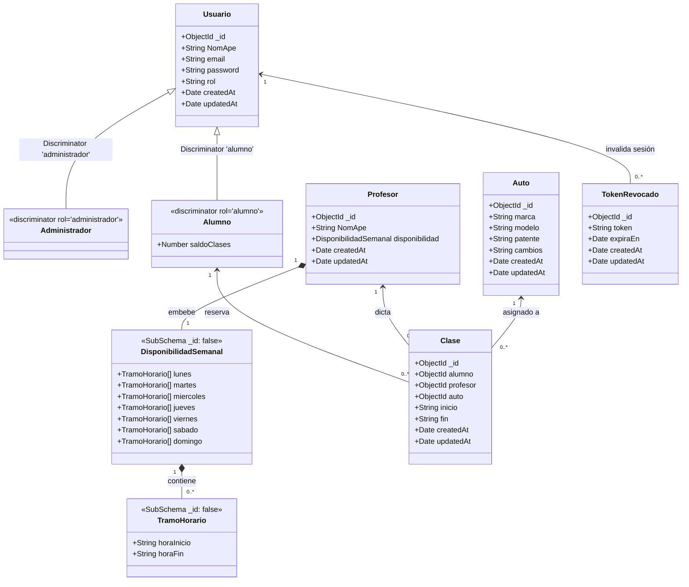

# 🚗 Drive & Learn — Backend API REST

<p align="center">
  
  
  
  
  
  
  
</p>

API REST desarrollada con Node.js, Express 5 y MongoDB/Mongoose para la gestión integral de la escuela de manejo **DriveAndLearn**. Permite administrar cuentas de usuario con roles diferenciados (`administrador` y `alumno`), autenticación *stateless* con JWT y cierre de sesión mediante lista negra con expiración automática (*TTL Index*), flota vehicular, instructores con agendas semanales dinámicas, saldo prepago de clases prácticas y agendamiento de turnos libre de solapamientos.

---

## 📑 Tabla de Contenidos

- [1. Stack Tecnológico](#1-stack-tecnol%C3%B3gico)
- [2. Arquitectura del Proyecto](#2-arquitectura-del-proyecto)
  - [2.1. Capas y Responsabilidades](#21-capas-y-responsabilidades)
  - [2.2. Estructura de Carpetas](#22-estructura-de-carpetas)
- [3. Modelo de Dominio y Diagrama de Entidades](#3-modelo-de-dominio-y-diagrama-de-entidades)
- [4. Catálogo de Endpoints de la API](#4-cat%C3%A1logo-de-endpoints-de-la-api)
  - [4.1. Autenticación (`/api/auth`)](#41-autenticaci%C3%B3n-apiauth)
  - [4.2. Administradores (`/api/administradores`)](#42-administradores-apiadministradores)
  - [4.3. Alumnos (`/api/alumnos`)](#43-alumnos-apialumnos)
  - [4.4. Autos (`/api/autos`)](#44-autos-apiautos)
  - [4.5. Profesores (`/api/profesores`)](#45-profesores-apiprofesores)
  - [4.6. Clases (`/api/clases`)](#46-clases-apiclases)
- [5. Suite de Pruebas Automatizadas](#5-suite-de-pruebas-automatizadas)
- [6. Guía de Instalación y Puesta en Marcha](#6-gu%C3%ADa-de-instalaci%C3%B3n-y-puesta-en-marcha)

---

## 1. Stack Tecnológico

### Dependencias de Producción (`dependencies`)

| Paquete | Versión | Rol en el Proyecto |
| :--- | :--- | :--- |
| **[Node.js](https://nodejs.org/)** | `v20+` | Entorno de ejecución con soporte nativo de ES Modules (`"type": "module"` en `package.json`) y modo `--watch`. |
| **[express](https://expressjs.com/)** | `^5.2.1` | Framework HTTP para la construcción de la API REST, con captura nativa de promesas rechazadas en controladores `async` sin requerir `try/catch`. |
| **[mongoose](https://mongoosejs.com/)** | `^9.9.4` | ODM para MongoDB. Define esquemas, validaciones de modelo, referencias (`ObjectId`), subdocumentos embebidos, discriminadores e índice TTL. |
| **[bcrypt](https://github.com/kelektiv/node.bcrypt.js)** | `^6.0.0` | Hashing unidireccional de contraseñas (`SALT_ROUNDS = 10`) y verificación criptográfica durante el login. |
| **[jsonwebtoken](https://github.com/auth0/node-jsonwebtoken)** | `^9.0.3` | Emisión y verificación de tokens Bearer JWT con vigencia de `24h`. |
| **[luxon](https://moment.github.io/luxon/)** | `^3.5.0` | Manejo de fechas locales en zona horaria IANA (`ZONA_HORARIA`) y operaciones sobre intervalos (`DateTime`, `Interval.merge`, `difference`, `overlaps`, `engulfs`, `splitBy`). |
| **[cors](https://github.com/expressjs/cors)** | `^2.8.6` | Middleware para habilitar *Cross-Origin Resource Sharing*. |
| **[dotenv](https://github.com/motdotla/dotenv)** | `^17.4.2` | Carga de variables de entorno desde `.env` hacia `src/config/env.js`. |

### Dependencias de Desarrollo y Testing (`devDependencies`)

| Paquete | Versión | Rol en el Proyecto |
| :--- | :--- | :--- |
| **[vitest](https://vitest.dev/)** | `^4.1.11` | Ejecutor de pruebas unitarias y de integración compatible con ES Modules. |
| **[@vitest/ui](https://vitest.dev/guide/ui.html)** | `^4.1.11` | Interfaz gráfica para inspección de suites de pruebas. |
| **[@vitest/coverage-v8](https://vitest.dev/guide/coverage.html)** | `^4.1.11` | Generación de reportes de cobertura de código mediante el motor V8. |
| **[mongodb-memory-server](https://github.com/nodkz/mongodb-memory-server)** | `^11.2.0` | Servidor MongoDB efímero en memoria para ejecutar las pruebas de servicios y modelos en aislamiento total. |
| **[supertest](https://github.com/ladjs/supertest)** | `^7.2.2` | Cliente HTTP para pruebas de integración sobre la aplicación Express exportada en `src/app.js`. |

---

## 2. Arquitectura del Proyecto

El proyecto implementa una **arquitectura en capas con flujo de dependencias estrictamente unidireccional**. Cada petición HTTP atraviesa las capas de arriba hacia abajo, donde cada nivel se comunica únicamente con el inmediato inferior y desconoce los detalles de las capas superiores:

```text
       HTTP Request
            │
            ▼
    ┌───────────────┐
    │    ROUTES     │  ── Recibe la petición HTTP y encadena los middlewares de la ruta
    └───────┬───────┘
            │
            ▼
    ┌───────────────┐
    │  MIDDLEWARES  │  ── Resuelve aspectos transversales (JSON válido, JWT y permisos)
    └───────┬───────┘
            │
            ▼
    ┌───────────────┐
    │  CONTROLLER   │  ── Extrae datos de req, invoca al DTO, llama al Service y responde HTTP
    └───────┬───────┘
            │
            ▼
    ┌───────────────┐
    │      DTO      │  ── Valida la estructura sintáctica y los tipos de datos de entrada
    └───────┬───────┘
            │
            ▼
    ┌───────────────┐
    │    SERVICE    │  ── Ejecuta la lógica de negocio y validaciones de dominio
    └───────┬───────┘
            │
            ▼
    ┌───────────────┐
    │  MODEL (ODM)  │  ── Define esquemas de Mongoose y ejecuta operaciones en la BD
    └───────┬───────┘
            │
            ▼
         MongoDB
```

### 2.1. Capas y Responsabilidades

- **Routes (`src/routes/`):** Es la puerta de entrada de cada recurso HTTP. Define los verbos y paths de la API, asocia los middlewares requeridos para cada endpoint y delega la ejecución en el controlador correspondiente.
- **Middlewares (`src/middlewares/`):** Interceptan la solicitud antes y después del controlador. Se encargan de verificar que el cuerpo sea un JSON plano (`validarObjetoJson`), autenticar el token Bearer y comprobar que no esté revocado (`autenticar`), validar permisos de rol o titularidad (`verificarSiAdmin`, `verificarSiAdminOPropioUsuario`) y capturar de forma centralizada cualquier error lanzado por las capas inferiores para transformarlo en una respuesta HTTP uniforme (`errorHandler`).
- **Controllers (`src/controllers/`):** Actúan como adaptadores delgados entre Express y el dominio. Extraen la información de `req` (`params`, `query`, `body`, `usuario`, `token`), ejecutan el validador del **DTO**, invocan al **Service** y devuelven la respuesta HTTP con el código de estado adecuado (`200`, `201` o `404`).
- **DTOs (`src/dtos/`):** Validan la estructura de los datos de entrada antes de que lleguen a la lógica de negocio. Comprueban la presencia de campos obligatorios, rechazan cuerpos vacíos o claves no permitidas y verifican los tipos de datos primitivos.
- **Services (`src/services/`):** Contienen el 100% de las reglas de negocio y validaciones de dominio, manteniéndose completamente aislados de Express (sin acceso a `req` ni `res`). Cada servicio es dueño exclusivo de su modelo y, cuando requiere interactuar con otras entidades, se comunica con los demás servicios. Ante cualquier incumplimiento de negocio o validación, lanza errores tipados (`src/errors/`) que son capturados por `errorHandler`.
- **Models (`src/models/`):** Representan la capa de persistencia mediante Mongoose. Definen la estructura de los documentos, restricciones a nivel de base de datos, discriminadores, subesquemas e índices en MongoDB.

### 2.2. Estructura de Carpetas

```text
INSPT-Prog3-DriveAndLearn-backend/
├── docs/                      # Documentación técnica, guías y colección de pruebas Postman
├── src/
│   ├── config/                # Variables de entorno (env.js) y conexión a MongoDB (db.js)
│   ├── constants/             # Constantes inmutables del dominio (roles, cambios, días y horarios)
│   ├── controllers/           # Adaptadores HTTP de entrada y salida
│   ├── dtos/                  # Validadores de estructura y tipos de entrada (+ helpers/)
│   ├── errors/                # Jerarquía de clases de error personalizadas con su código HTTP
│   ├── middlewares/           # Autenticación, autorización, validación JSON y errorHandler (+ helpers/)
│   ├── models/                # Esquemas y modelos de Mongoose
│   ├── routes/                # Definición de endpoints montados bajo el prefijo /api
│   ├── scripts/               # Scripts utilitarios CLI (creación de administrador inicial)
│   ├── services/              # Lógica de negocio y reglas de dominio (+ helpers/)
│   ├── app.js                 # Configuración de la instancia de Express (sin abrir puerto)
│   └── server.js              # Punto de entrada: valida entorno, conecta a MongoDB e inicia el servidor
└── tests/                     # Suite de pruebas automatizadas con Vitest y mongodb-memory-server
    ├── dtos/                  # Pruebas unitarias de los validadores DTO
    ├── helpers/               # Configuración de base de datos en memoria y utilidades de test
    └── services/              # Pruebas de integración de servicios y helpers de dominio
```

---

## 3. Modelo de Dominio y Diagrama de Entidades



### Detalle de Modelos (`src/models/`):

1. **`Usuario` (`Usuario.js` — colección `usuarios`):**
   - `NomApe`: `String`, obligatorio, `trim`, entre 4 y 50 caracteres.
   - `email`: `String`, obligatorio, `unique`, `lowercase`, `trim`, validado por regex `/^[^\s@]+@[^\s@]+\.[^\s@]+$/`.
   - `password`: `String`, obligatorio (almacenado con hash `bcrypt`).
   - `rol`: `String`, obligatorio, `discriminatorKey`, enum `['administrador', 'alumno']`.
2. **`Administrador` (`Administrador.js`):** Discriminador de `Usuario` con valor `'administrador'`.
3. **`Alumno` (`Alumno.js`):** Discriminador de `Usuario` con valor `'alumno'`. Añade `saldoClases` (`Number`, entero $\ge 0$, por defecto `0`).
4. **`Profesor` (`Profesor.js` — colección `profesores`):**
   - `NomApe`: `String`, obligatorio, entre 4 y 50 caracteres.
   - `disponibilidad`: Subdocumento embebido `disponibilidadSemanalSchema` (`disponibilidadSemanal.js`) con claves `lunes` a `domingo`, cada una compuesta por un array de `tramoSchema` (`tramoHorario.js`: `horaInicio` `00:00`-`23:59` y `horaFin` `00:00`-`24:00`).
5. **`Auto` (`Auto.js` — colección `autos`):**
   - `marca`: `String`, obligatorio.
   - `modelo`: `String`, obligatorio.
   - `patente`: `String`, obligatorio, `unique`, `uppercase`, regex `/^([A-Z]{3}\d{3}|[A-Z]{2}\d{3}[A-Z]{2})$/`.
   - `cambios`: `String`, obligatorio, `uppercase`, enum `['AUTOMATICO', 'MANUAL']`.
6. **`Clase` (`Clase.js` — colección `clases`):**
   - `alumno`: `ObjectId` (ref `'Alumno'`), obligatorio.
   - `profesor`: `ObjectId` (ref `'Profesor'`), obligatorio.
   - `auto`: `ObjectId` (ref `'Auto'`), obligatorio.
   - `inicio` y `fin`: `String`, obligatorios, formato `YYYY-MM-DDTHH:MM` (el servicio restringe el agendamiento a horas en punto `YYYY-MM-DDTHH:00`).
7. **`TokenRevocado` (`TokenRevocado.js` — colección `tokens_revocados`):**
   - `token`: `String`, obligatorio, `unique`.
   - `expiraEn`: `Date`, obligatorio, con índice TTL `{ expireAfterSeconds: 0 }`.

---

## 4. Catálogo de Endpoints de la API

### 4.1. Autenticación (`/api/auth`)

| Método | Endpoint | Auth | Cuerpo (JSON) | Códigos HTTP | Descripción |
| :--- | :--- | :--- | :--- | :--- | :--- |
| `POST` | `/api/auth/login` | No | `{ "email": "string", "password": "string" }` | `200`, `400`, `401` | Valida credenciales y retorna `{ token, usuario: { id, NomApe, email, rol } }`. |
| `POST` | `/api/auth/logout` | **Sí (`Bearer`)** | Ninguno | `200`, `401` | Registra el token en `tokens_revocados` y retorna `{ mensaje: "Sesión cerrada exitosamente" }`. |

---

### 4.2. Administradores (`/api/administradores`)

| Método | Endpoint | Auth | Cuerpo (JSON) | Códigos HTTP | Descripción |
| :--- | :--- | :--- | :--- | :--- | :--- |
| `GET` | `/api/administradores` | **Sí (`Bearer`, rol `'administrador'`)** | Ninguno | `200`, `401`, `403` | Lista todos los administradores registrados. |
| `GET` | `/api/administradores/:id` | **Sí (`Bearer`, rol `'administrador'`)** | Ninguno | `200`, `400`, `401`, `403`, `404` | Obtiene un administrador por su `_id` de MongoDB. |
| `POST` | `/api/administradores` | **Sí (`Bearer`, rol `'administrador'`)** | `{ "NomApe": "string", "email": "string", "password": "string" }` | `201`, `400`, `401`, `403` | Crea un administrador (`password` $\ge 8$ caracteres). |
| `PUT` | `/api/administradores/:id` | **Sí (`Bearer`, rol `'administrador'`)** | `{ "NomApe"?: "string", "email"?: "string", "password"?: "string" }` | `200`, `400`, `401`, `403`, `404` | Actualiza datos de un administrador existente. |

---

### 4.3. Alumnos (`/api/alumnos`)

| Método | Endpoint | Auth | Cuerpo (JSON) | Códigos HTTP | Descripción |
| :--- | :--- | :--- | :--- | :--- | :--- |
| `GET` | `/api/alumnos` | **Sí (`Bearer`, rol `'administrador'`)** | Ninguno | `200`, `401`, `403` | Lista todos los alumnos junto con su `saldoClases`. |
| `GET` | `/api/alumnos/:id` | **Sí (`Bearer`, `'administrador'` o propio `'alumno'`)** | Ninguno | `200`, `400`, `401`, `403`, `404` | Obtiene un alumno por su `_id` (solo accesible por un administrador o por el propio alumno). |
| `POST` | `/api/alumnos` | No | `{ "NomApe": "string", "email": "string", "password": "string", "saldoClases"?: number }` | `201`, `400` | Registro público de un alumno (`saldoClases` opcional, entero $\ge 0$, por defecto `0`). |
| `PUT` | `/api/alumnos/:id` | **Sí (`Bearer`, `'administrador'` o propio `'alumno'`)** | `{ "NomApe"?: "string", "email"?: "string", "password"?: "string" }` | `200`, `400`, `401`, `403`, `404` | Actualiza datos personales del alumno (solo por un administrador o el propio alumno; no permite enviar `saldoClases`). |
| `PATCH` | `/api/alumnos/:id/saldo/sumar` | **Sí (`Bearer`, rol `'administrador'`)** | `{ "cantidad": number }` | `200`, `400`, `401`, `403`, `404` | Suma `cantidad` (entero $> 0$) al `saldoClases` del alumno. |
| `PATCH` | `/api/alumnos/:id/saldo/restar` | **Sí (`Bearer`, rol `'administrador'`)** | `{ "cantidad": number }` | `200`, `400`, `401`, `403`, `404` | Resta `cantidad` (entero $> 0$) al `saldoClases`. Falla con `400` si el saldo resultante sería negativo (`ErrorSaldoClasesInsuficiente`). |

---

### 4.4. Autos (`/api/autos`)

| Método | Endpoint | Auth | Query / Cuerpo (JSON) | Códigos HTTP | Descripción |
| :--- | :--- | :--- | :--- | :--- | :--- |
| `GET` | `/api/autos` | No | Query opcional: `?cambios=MANUAL` o `?cambios=AUTOMATICO` | `200`, `400` | Lista todos los autos, permitiendo filtrar por tipo de transmisión. |
| `GET` | `/api/autos/:id` | No | Ninguno | `200`, `400`, `404` | Obtiene un auto por su `_id`. |
| `POST` | `/api/autos` | **Sí (`Bearer`, rol `'administrador'`)** | `{ "marca": "string", "modelo": "string", "patente": "string", "cambios": "MANUAL" \| "AUTOMATICO" }` | `201`, `400`, `401`, `403` | Registra un nuevo vehículo en la flota. |
| `PUT` | `/api/autos/:id` | **Sí (`Bearer`, rol `'administrador'`)** | `{ "marca"?: "string", "modelo"?: "string", "patente"?: "string", "cambios"?: "string" }` | `200`, `400`, `401`, `403`, `404` | Actualiza los datos de un vehículo existente. |

---

### 4.5. Profesores (`/api/profesores`)

| Método | Endpoint | Auth | Query / Cuerpo (JSON) | Códigos HTTP | Descripción |
| :--- | :--- | :--- | :--- | :--- | :--- |
| `GET` | `/api/profesores` | No | Ninguno | `200` | Lista todos los profesores con su disponibilidad semanal. |
| `GET` | `/api/profesores/:id` | No | Ninguno | `200`, `400`, `404` | Obtiene un profesor por su `_id`. |
| `GET` | `/api/profesores/:id/disponibilidad` | No | Ninguno | `200`, `400`, `404` | Devuelve únicamente el objeto `disponibilidad` del profesor. |
| `GET` | `/api/profesores/:id/turnos-libres` | No | Query: `?fecha=YYYY-MM-DD` (obligatorio) y `&cambios=MANUAL\|AUTOMATICO` (opcional) | `200`, `400`, `404` | Calcula los turnos libres de 1 hora del profesor en esa fecha (futura o actual) y adjunta los autos disponibles en cada turno (`{ turnos_libres: [{ inicio, fin, autos }] }`). |
| `POST` | `/api/profesores` | **Sí (`Bearer`, rol `'administrador'`)** | `{ "NomApe": "string" }` | `201`, `400`, `401`, `403` | Crea un profesor con disponibilidad semanal vacía por defecto. |
| `PUT` | `/api/profesores/:id` | **Sí (`Bearer`, rol `'administrador'`)** | `{ "NomApe"?: "string" }` | `200`, `400`, `401`, `403`, `404` | Actualiza el nombre del profesor (la disponibilidad no se modifica por esta vía). |
| `PATCH` | `/api/profesores/:id/disponibilidad/agregar` | **Sí (`Bearer`, rol `'administrador'`)** | `{ "tramos": [{ "dia": "lunes", "tramoHorario": { "horaInicio": "08:00", "horaFin": "12:00" } }] }` | `200`, `400`, `401`, `403`, `404` | Agrega tramos horarios (en horas en punto `:00`, mínimo 1h) fusionando superposiciones o tramos contiguos. |
| `PATCH` | `/api/profesores/:id/disponibilidad/quitar` | **Sí (`Bearer`, rol `'administrador'`)** | `{ "tramos": [{ "dia": "lunes", "tramoHorario": { "horaInicio": "10:00", "horaFin": "11:00" } }] }` | `200`, `400`, `401`, `403`, `404` | Resta los intervalos indicados de la disponibilidad actual del profesor. |

---

### 4.6. Clases (`/api/clases`)

Todos los endpoints de `/api/clases` exigen autenticación mediante cabecera `Authorization: Bearer <token>`.

| Método | Endpoint | Auth | Cuerpo (JSON) | Códigos HTTP | Descripción |
| :--- | :--- | :--- | :--- | :--- | :--- |
| `GET` | `/api/clases` | **Sí (`Bearer`)** | Ninguno (soporta query filtros) | `200`, `401` | Si el usuario autenticado tiene rol `'alumno'`, filtra automáticamente para devolver solo sus propias clases. Si es `'administrador'`, devuelve todas. |
| `GET` | `/api/clases/:id` | **Sí (`Bearer`)** | Ninguno | `200`, `400`, `401`, `403`, `404` | Obtiene el detalle de una clase. Si el actor es `'alumno'` y la clase pertenece a otro alumno, responde `403 Forbidden`. |
| `POST` | `/api/clases` | **Sí (`Bearer`, rol `'alumno'`)** | `{ "profesor": "ObjectId", "auto": "ObjectId", "inicio": "YYYY-MM-DDTHH:00", "fin": "YYYY-MM-DDTHH:00" }` | `201`, `400`, `401`, `403`, `404` | Agenda una clase de 1 hora exacta en fecha futura para el alumno autenticado (`req.usuario.id`). Verifica disponibilidad del profesor, ausencia de superposiciones (alumno, profesor y auto) y descuenta `1` de `saldoClases`. |
| `DELETE` | `/api/clases/:id` | **Sí (`Bearer`)** | Ninguno | `200`, `400`, `401`, `403`, `404` | Cancela y elimina físicamente la clase. Si el actor es `'alumno'`, valida que sea el titular (`403` si no lo es). Reintegra automáticamente `1` crédito al `saldoClases` del alumno. |

---

## 5. Suite de Pruebas Automatizadas

El proyecto cuenta con pruebas automatizadas sobre DTOs, helpers de calendarización/disponibilidad y servicios utilizando **Vitest** y **mongodb-memory-server** (`tests/helpers/setupTestDB.js`):

```bash
# Ejecutar Vitest en modo observador interactivo (watch)
npm test

# Ejecutar toda la batería de pruebas una única vez
npm run test:run
```

### Cobertura de Módulos de Prueba (`tests/`):
- **DTOs (`tests/dtos/`):** `administradorDTO.test.js`, `alumnoDTO.test.js`, `authDTO.test.js`, `autoDTO.test.js`, `claseDTO.test.js`, `profesorDTO.test.js`.
- **Helpers de Dominio (`tests/services/helpers/`):** `disponibilidadHelper.test.js`, `turnosYFechasHelper.test.js`.
- **Servicios con Base de Datos en Memoria (`tests/services/`):** `administradorService.test.js`, `alumnoService.test.js`, `autoService.test.js`, `claseService.test.js`, `profesorService.test.js`, `usuarioService.test.js`.

---

## 6. Guía de Instalación y Puesta en Marcha

### Requisitos Previos
- **Node.js** `v20` o superior.
- **MongoDB** en ejecución local o remota (para levantar el servidor con `npm run dev` o `npm start`; los tests usan su propio servidor en memoria).

### Pasos de Configuración

1. **Ingresar al directorio del backend:**
   ```bash
   cd INSPT-Prog3-DriveAndLearn-backend
   ```

2. **Instalar las dependencias:**
   ```bash
   npm install
   ```

3. **Configurar las variables de entorno:**
   Crear un archivo `.env` en `INSPT-Prog3-DriveAndLearn-backend/` tomando como base `.env.example`:
   ```env
   # URI de conexión a MongoDB
   MONGODB_URI=mongodb://127.0.0.1:27017/driveandlearn

   # Puerto HTTP de la API (por defecto 3000)
   PORT=3000

   # Secreto para firma de JWT (obligatorio, mínimo 32 caracteres)
   # Se puede generar con: node -e "console.log(require('node:crypto').randomBytes(48).toString('base64url'))"
   JWT_SECRET=clave_secreta_super_segura_de_al_menos_32_caracteres

   # Credenciales del primer administrador (usadas por obtenerAdminInicial)
   ADMIN_EMAIL=admin@driveandlearn.com
   ADMIN_PASSWORD=Password123
   ADMIN_NOMAPE=Administrador

   # Zona horaria IANA oficial de la escuela (por defecto America/Argentina/Buenos_Aires)
   ZONA_HORARIA=America/Argentina/Buenos_Aires
   ```

4. **Ejecutar el servidor:**
   ```bash
   # Modo desarrollo con recarga automática (--watch)
   npm run dev

   # Modo producción
   npm start
   ```
   El servidor quedará escuchando en `http://localhost:3000`.
