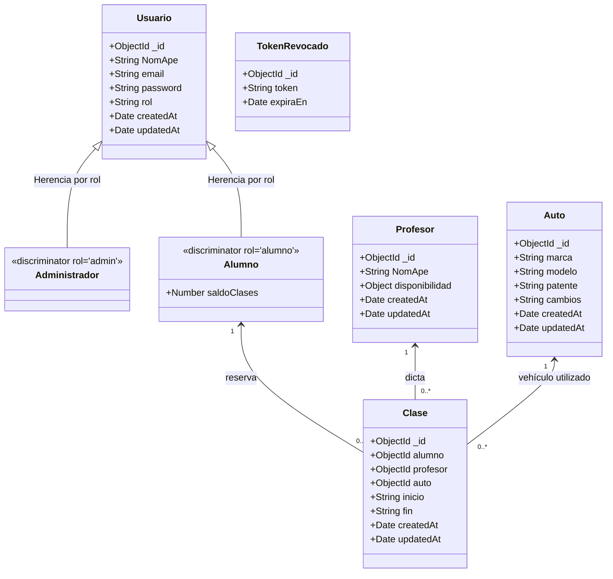
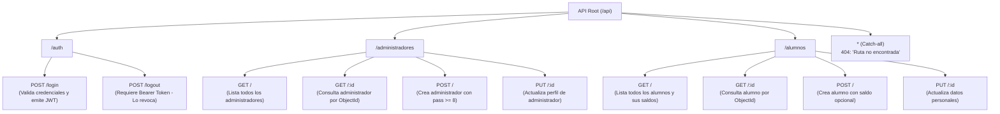

# 🚗 Drive & Learn — Backend API REST

<p align="center">
  
  
  
  
  
  
  
  
</p>

Plataforma backend robusta y modular diseñada para la gestión integral de una **autoescuela** moderna. Permite administrar usuarios con roles diferenciados (*Administrador*, *Alumno* y *Profesor*), autenticación segura con revocación de sesiones vía JWT y lista negra en base de datos (*TTL Index*), control prepago de saldo de clases prácticas y planificación de clases vehiculares.

---

## 📑 Tabla de Contenidos

- [1. Objetivos del Proyecto](#1-objetivos-del-proyecto)
- [2. Stack Tecnológico](#2-stack-tecnol%C3%B3gico)
- [3. Arquitectura y Metodología ("La forma de hacer las cosas")](#3-arquitectura-y-metodolog%C3%ADa-la-forma-de-hacer-las-cosas)
  - [3.1. Principio de Responsabilidad Única (SRP)](#31-principio-de-responsabilidad-%C3%BAnica-srp)
  - [3.2. Ciclo de Vida: Separación entre App y Server](#32-ciclo-de-vida-separaci%C3%B3n-entre-app-y-server)
  - [3.3. DTOs y Validación de Entrada](#33-dtos-y-validaci%C3%B3n-de-entrada)
  - [3.4. Seguridad, Hashing y Blacklist de Tokens con TTL](#34-seguridad-hashing-y-blacklist-de-tokens-con-ttl)
  - [3.5. Manejo Centralizado de Errores Tipados](#35-manejo-centralizado-de-errores-tipados)
- [4. Modelo de Dominio y Diagrama de Entidades](#4-modelo-de-dominio-y-diagrama-de-entidades)
- [5. Mapa de Enrutamiento HTTP](#5-mapa-de-enrutamiento-http)
- [6. Catálogo de Endpoints de la API](#6-cat%C3%A1logo-de-endpoints-de-la-api)
  - [6.1. Autenticación (`/api/auth`)](#61-autenticaci%C3%B3n-apiauth)
  - [6.2. Administradores (`/api/administradores`)](#62-administradores-apiadministradores)
  - [6.3. Alumnos (`/api/alumnos`)](#63-alumnos-apialumnos)
  - [6.4. Modelos del Dominio en Fase de Integración (`Clases`, `Autos`, `Profesores`)](#64-modelos-del-dominio-en-fase-de-integraci%C3%B3n-clases-autos-profesores)
- [7. Testing y Calidad de Código](#7-testing-y-calidad-de-c%C3%B3digo)
  - [7.1. Pruebas Unitarias con Vitest](#71-pruebas-unitarias-con-vitest)
  - [7.2. Batería Automatizada de Pruebas en Postman](#72-bater%C3%ADa-automatizada-de-pruebas-en-postman)
- [8. Guía de Instalación y Puesta en Marcha](#8-gu%C3%ADa-de-instalaci%C3%B3n-y-puesta-en-marcha)
- [9. Enlaces y Documentación Interna](#9-enlaces-y-documentaci%C3%B3n-interna)
- [10. Autor y Contexto Académico](#10-autor-y-contexto-acad%C3%A9mico)

---

## 1. Objetivos del Proyecto

El proyecto persigue dos propósitos complementarios:

### 🎯 Objetivo de Negocio (Autoescuela)
- **Gestión de Identidades:** Registro y administración de alumnos y personal administrativo bajo un modelo de herencia de datos seguro.
- **Control Financiero y Saldo de Clases:** Manejo del crédito de clases prácticas por alumno (`saldoClases`), previniendo modificaciones arbitrarias de saldo mediante operaciones estandarizadas de carga y deducción.
- **Flota Vehicular e Instructores:** Soporte para registro de automóviles (caja manual o automática, patentes oficiales argentinas) y agenda semanal de instructores.
- **Integridad Histórica:** Política de no eliminación física (*no DELETE*) para alumnos y administradores, resguardando el historial contable y académico.

### 🏛️ Objetivo de Ingeniería de Software (Cátedra Programación III)
- Aplicar una **Arquitectura en Capas Limpia (*Clean Architecture*)**, asegurando un desacoplamiento estricto entre el protocolo de transporte (HTTP / Express) y el núcleo de dominio (Servicios puros).
- Implementar **Single Responsibility Principle (SRP)** en cada archivo y módulo.
- Demostrar mecanismos profesionales de autenticación, validación de DTOs en tiempo de ejecución, revocación de tokens con índices TTL de base de datos y tratamiento uniforme de errores.

---

## 2. Stack Tecnológico

| Capa / Rol | Herramienta | Versión | Justificación Técnica |
| :--- | :--- | :--- | :--- |
| **Entorno de Ejecución** | [Node.js](https://nodejs.org/) | `v20+` | Soporte nativo y sin transpiladores de ECMAScript Modules (`"type": "module"`). |
| **Framework Web** | [Express](https://expressjs.com/) | `5.x` | Soporte nativo de funciones y middlewares asíncronos sin requerir `express-async-errors` ni bloques `try/catch` redundantes. |
| **Base de Datos NoSQL** | [MongoDB](https://www.mongodb.com/) | `6.0+` | Almacenamiento ágil de documentos JSON, índices secundarios y soporte de Time-To-Live (TTL). |
| **Modelado y ODM** | [Mongoose](https://mongoosejs.com/) | `9.x` | Modelado de datos tipado, esquemas estrictos y **discriminadores** para herencia polimórfica sobre una única colección. |
| **Criptografía** | [bcryptjs](https://github.com/dcodeIO/bcrypt.js) | `3.x` | Algoritmo de hashing robusto unidireccional con factor de sal (`salt = 10`) para almacenamiento seguro de contraseñas. |
| **Autenticación** | [jsonwebtoken](https://github.com/auth0/node-jsonwebtoken) | `9.x` | Generación y verificación criptográfica de tokens Bearer JWT con tiempo de vida determinado (`24h`). |
| **Manejo de Fechas** | [Luxon](https://moment.github.io/luxon/) | `3.x` | Manipulación inmutable de zonas horarias y validaciones de turnos en horarios en punto (`:00`). |
| **Seguridad de Red** | [CORS](https://github.com/expressjs/cors) | `2.x` | Control y autorización granular de orígenes cruzados para consumo desde clientes web/móvil. |
| **Variables de Entorno** | [dotenv](https://github.com/motdotla/dotenv) | `17.x` | Carga segura de variables de configuración local y secretos de firma. |
| **Testing Unitario** | [Vitest](https://vitest.dev/) | `4.x` | Ejecución concurrente y ultrarrápida de suites de pruebas con mocks de MongoDB en memoria. |
| **Batería de Pruebas API** | [Postman](https://www.postman.com/) | `v2.1` | Suite automatizada de pruebas funcionales y de integración con asserts dinámicos `pm.test`. |

---

## 3. Arquitectura y Metodología ("La forma de hacer las cosas")

El proyecto implementa una arquitectura en capas basada en **Clean Architecture**, donde las dependencias fluyen estrictamente hacia adentro:

```text
       HTTP Request
            │
            ▼
    ┌───────────────┐
    │    ROUTES     │  ── Define rutas, verbos y middlewares de entrada
    └───────┬───────┘
            ▼
    ┌───────────────┐
    │  CONTROLLER   │  ── Extrae parámetros HTTP (params, body, headers)
    └───────┬───────┘     y valida la entrada contra el DTO
            ▼
    ┌───────────────┐
    │  SERVICE DTO  │  ── Valida forma estricta del JSON (tipos y campos)
    └───────┬───────┘
            ▼
    ┌───────────────┐
    │    SERVICE    │  ── Núcleo de Reglas de Negocio (Puro, sin req ni res)
    └───────┬───────┘
            ▼
    ┌───────────────┐
    │  MODEL (ODM)  │  ── Mongoose: Discriminadores, Schemas y Persistencia
    └───────┬───────┘
            ▼
        MongoDB
```

### 3.1. Principio de Responsabilidad Única (SRP)

- **Routes (`src/routes/`):** Solo configuran rutas y asocian middlewares (`validarObjetoJson`, `autenticar`). No contienen lógica ni manipulación de datos.
- **Controllers (`src/controllers/`):** Adaptadores de transporte. Reciben `req` y `res`, llaman a la validación de DTO, invocan al Service y emiten respuestas HTTP uniformes (`res.status(...).json(...)`).
- **DTOs (`src/dtos/`):** Contratos de datos. Rechazan peticiones con campos no permitidos o tipos inválidos antes de que alcancen la capa de lógica.
- **Services (`src/services/`):** Núcleo agnóstico del protocolo. No conocen nada sobre Express. Validan reglas de dominio, ejecutan cálculos y lanzan excepciones de negocio (`ErrorDeNegocio`).
- **Models (`src/models/`):** Definición de esquemas de Mongoose, índices y métodos de persistencia.

### 3.2. Ciclo de Vida: Separación entre App y Server

- **[`src/app.js`](file:///c:/Users/Fabrizio/Documents/Fabri/Educación/UTN%20INSPT/2026/PROGRAMACION%20III/segundo_parcial_driveandlearn/INSPT-Prog3-DriveAndLearn-backend/src/app.js):** Configura la aplicación Express, middlewares globales (CORS, JSON parser), monta los routers y conecta el middleware de manejo global de errores. **No inicia el servidor ni conecta a base de datos**, lo que permite testearlo mediante `supertest` sin abrir puertos reales.
- **[`src/server.js`](file:///c:/Users/Fabrizio/Documents/Fabri/Educación/UTN%20INSPT/2026/PROGRAMACION%20III/segundo_parcial_driveandlearn/INSPT-Prog3-DriveAndLearn-backend/src/server.js):** Punto de entrada del proceso. Carga las variables de entorno, establece la conexión con MongoDB y levanta el listener HTTP (`app.listen()`).

### 3.3. DTOs y Validación de Entrada

Toda petición de escritura (`POST`, `PUT`) pasa por validadores funcionales que ejecutan comprobaciones rigurosas:
1. Rechazan si el cuerpo no es un objeto JSON plano (`validarObjetoJson`).
2. Validan tipos de datos (`string`, `number`, etc.).
3. Detectan campos faltantes obligatorios.
4. Rechazan **cualquier campo extra no autorizado** (prevención de asignación masiva o manipulación maliciosa de privilegios como `rol`).

### 3.4. Seguridad, Hashing y Blacklist de Tokens con TTL

1. **Hashing de Contraseñas:** Las contraseñas se validan con longitud mínima de 8 caracteres y se hashean con `bcryptjs` en la capa de servicios. Además, el método `toJSON` del esquema de Mongoose elimina automáticamente la propiedad `password` antes de serializar respuestas.
2. **Cierre de Sesión Seguro (*Logout Real*):**
   - Cuando el usuario ejecuta `POST /api/auth/logout`, el token JWT activo es extraído de la cabecera `Authorization: Bearer <token>`.
   - Se decodifica la fecha de expiración original del JWT (`exp`) y se guarda en la colección `tokens_revocados`.
   - **Índice TTL de MongoDB:** El esquema `TokenRevocado` define:
     ```javascript
     tokenRevocadoSchema.index({ expiraEn: 1 }, { expireAfterSeconds: 0 });
     ```
     MongoDB elimina físicamente el registro una vez que el token ha expirado por sí mismo, evitando el crecimiento indefinido de la base de datos.
   - El middleware `autenticar` consulta si el token entrante figura en dicha colección antes de dar por válida cualquier operación protegida.

### 3.5. Manejo Centralizado de Errores Tipados

El sistema no utiliza códigos de error dispersos ni mensajes genéricos. Cuenta con una jerarquía de clases de error derivadas de `ErrorDeNegocio`:

```text
ErrorDeNegocio (Base - 400 Bad Request)
├── ErrorPasswordInvalida (Contraseña menor a 8 caracteres)
├── ErrorSaldoClasesInsuficiente (Saldo menor al requerido)
├── ErrorHorarioInvalido (Horarios de clase no en punto :00)
└── ErrorDisponibilidadProfesor (Superposición de horarios)
```

El middleware global [`src/middlewares/errorHandler.js`](file:///c:/Users/Fabrizio/Documents/Fabri/Educación/UTN%20INSPT/2026/PROGRAMACION%20III/segundo_parcial_driveandlearn/INSPT-Prog3-DriveAndLearn-backend/src/middlewares/errorHandler.js) intercepta todas las excepciones y responde de forma estandarizada:
- `400 Bad Request`: Errores de DTO, formato de ID inválido de MongoDB o violaciones de `ErrorDeNegocio`.
- `401 Unauthorized`: Token ausente, firma inválida o token revocado.
- `403 Forbidden`: Rol insuficiente para acceder al recurso.
- `404 Not Found`: Recurso no encontrado o ruta inexistente.
- `500 Internal Server Error`: Errores no controlados de infraestructura (con log interno seguro).

---

## 4. Modelo de Dominio y Diagrama de Entidades

La persistencia de usuarios utiliza el patrón de **Discriminadores de Mongoose**: tanto administradores como alumnos residen en la colección `usuarios` compartiendo atributos comunes, pero diferenciándose por su discriminador `rol`:



### Descripción de Entidades:

1. **`Usuario` (Colección `usuarios`):** Entidad base que provee nombre (`NomApe`), correo electrónico único validado por regex, contraseña con hash bcrypt y `rol`.
2. **`Administrador`:** Extiende de `Usuario` con `rol: 'admin'`. Administra el sistema. No puede ser eliminado mediante la API.
3. **`Alumno`:** Extiende de `Usuario` con `rol: 'alumno'` e incorpora el atributo `saldoClases` (número entero $\ge 0$, por defecto `0`). No admite eliminación física.
4. **`Profesor` (Colección `profesores`):** Instructores habilitados. Define una agenda con `disponibilidadSemanal` organizada en tramos horarios por cada día de la semana.
5. **`Auto` (Colección `autos`):** Vehículos de práctica con validación estricta de formato de patente argentina tradicional (`ABC123`) o formato Mercosur (`AB123CD`), y tipo de transmisión (`MANUAL` o `AUTOMATICO`).
6. **`Clase` (Colección `clases`):** Vínculo operacional entre un Alumno, un Profesor y un Auto en una ventana temporal definida (`inicio` y `fin`). Valida que los horarios comiencen exactamente en hora en punto (`:00`).
7. **`TokenRevocado` (Colección `tokens_revocados`):** Registro de firmas JWT invalidadas con índice TTL `expireAfterSeconds: 0`.

---

## 5. Mapa de Enrutamiento HTTP

Estructura de enrutamiento jerárquica montada en la aplicación:



---

## 6. Catálogo de Endpoints de la API

### 6.1. Autenticación (`/api/auth`)

| Método | Endpoint | Cabecera Auth | Cuerpo Requerido | Códigos HTTP | Propósito |
| :--- | :--- | :--- | :--- | :--- | :--- |
| `POST` | `/api/auth/login` | No | `{ "email": "...", "password": "..." }` | `200`, `400`, `401` | Autentica usuario y emite token JWT con 24 horas de vigencia. |
| `POST` | `/api/auth/logout` | **`Bearer <token>`** | Ninguno | `200`, `401` | Cierra la sesión activa revocando el JWT en la base de datos. |

---

### 6.2. Administradores (`/api/administradores`)

| Método | Endpoint | Cabecera Auth | Cuerpo Requerido | Códigos HTTP | Propósito |
| :--- | :--- | :--- | :--- | :--- | :--- |
| `GET` | `/api/administradores` | No | Ninguno | `200` | Devuelve la lista completa de administradores registrados. |
| `GET` | `/api/administradores/:id` | No | Ninguno | `200`, `400`, `404` | Obtiene el detalle de un administrador por su `_id`. |
| `POST` | `/api/administradores` | No | `{ "NomApe", "email", "password" }` | `201`, `400` | Crea un administrador con contraseña hasheada ($\ge 8$ caracteres). |
| `PUT` | `/api/administradores/:id` | No | `{ "NomApe"?, "email"?, "password"? }` | `200`, `400`, `404` | Modifica los datos personales de un administrador. |

> [!NOTE]
> **Sin eliminación física:** `DELETE /api/administradores/:id` no está implementado intencionalmente; responderá `404 Ruta no encontrada` por diseño del dominio.

---

### 6.3. Alumnos (`/api/alumnos`)

| Método | Endpoint | Cabecera Auth | Cuerpo Requerido | Códigos HTTP | Propósito |
| :--- | :--- | :--- | :--- | :--- | :--- |
| `GET` | `/api/alumnos` | No | Ninguno | `200` | Lista los alumnos registrados junto a su `saldoClases`. |
| `GET` | `/api/alumnos/:id` | No | Ninguno | `200`, `400`, `404` | Obtiene los datos y el saldo actual de un alumno por su `_id`. |
| `POST` | `/api/alumnos` | No | `{ "NomApe", "email", "password", ["saldoClases"] }` | `201`, `400` | Crea un alumno (saldo inicial configurable, por defecto `0`). |
| `PUT` | `/api/alumnos/:id` | No | `{ "NomApe"?, "email"?, "password"? }` | `200`, `400`, `404` | Modifica datos personales del alumno. |

> [!WARNING]
> **Integridad del Saldo de Clases:** El endpoint general `PUT /api/alumnos/:id` rechaza con código `400 Bad Request` cualquier intento de modificar `saldoClases` para garantizar que el crédito solo sea alterado mediante operaciones transaccionales específicas. Los alumnos tampoco pueden ser borrados vía `DELETE`.

---

### 6.4. Modelos del Dominio en Fase de Integración (`Clases`, `Autos`, `Profesores`)

Estos componentes ya cuentan con esquemas de persistencia y lógica de dominio en el proyecto:

- **Autos (`src/models/Auto.js`):** Validador regex de patentes de Argentina y tipo de transmisión.
- **Profesores (`src/models/Profesor.js`):** Gestión de agenda y disponibilidad semanal por tramos horarios (`tramoHorario.js`).
- **Clases (`src/models/Clase.js`):** Reserva práctica vinculando alumno, profesor y vehículo, con validación de horarios en punto mediante **Luxon**.
- **Gestión de Saldo en Servicios (`src/services/alumnoService.js`):** Métodos `sumarSaldoClases` y `restarSaldoClases` con comprobación de `ErrorSaldoClasesInsuficiente` y validación de enteros positivos.

---

## 7. Testing y Calidad de Código

### 7.1. Pruebas Unitarias con Vitest

La lógica de negocio y los servicios cuentan con una cobertura rigurosa ejecutada en entorno aislado con Vitest:

```bash
# Ejecutar toda la suite de pruebas unitarias
npm test

# Ejecutar pruebas en modo observador (watch)
npm run test:watch
```

Entre las aserciones evaluadas se incluyen:
- Normalización en minúsculas y validación de formato de correos.
- Longitud mínima de contraseñas y verificación de hash con `bcryptjs`.
- Comprobación de que `DELETE` no existe en servicios de administradores ni alumnos.
- Lógica de suma y deducción de `saldoClases` con rechazo de valores negativos y decimales.

---

### 7.2. Batería Automatizada de Pruebas en Postman

El proyecto incluye una **suite completa de pruebas automatizadas de integración** lista para ejecutar en Postman:

- **Archivo de Colección:** [`DriveAndLearn.postman_collection.json`](file:///c:/Users/Fabrizio/Documents/Fabri/Educación/UTN%20INSPT/2026/PROGRAMACION%20III/segundo_parcial_driveandlearn/DriveAndLearn.postman_collection.json)
- **Archivo de Entorno:** [`DriveAndLearn.postman_environment.json`](file:///c:/Users/Fabrizio/Documents/Fabri/Educación/UTN%20INSPT/2026/PROGRAMACION%20III/segundo_parcial_driveandlearn/DriveAndLearn.postman_environment.json)
- **Guía de Uso Rápido:** Consulta [`docs/Guias/POSTMAN.md`](file:///c:/Users/Fabrizio/Documents/Fabri/Educación/UTN%20INSPT/2026/PROGRAMACION%20III/segundo_parcial_driveandlearn/INSPT-Prog3-DriveAndLearn-backend/docs/Guias/POSTMAN.md) para ver ejemplos detallados con y sin variables de entorno.

#### Cómo ejecutar el Runner en Postman:
1. Importa el archivo `DriveAndLearn.postman_collection.json` en Postman.
2. Inicia el backend (`npm run dev`) con MongoDB activo.
3. Haz clic derecho sobre la colección y selecciona **Run collection**.
4. La batería ejecutará secuencialmente más de 20 casos de prueba (creación, login, captura dinámica de tokens, actualización, validación de contraseñas cortas, logout y bloqueo de tokens revocados), verificando el paso de todas las aserciones en verde (`PASS`).

---

## 8. Guía de Instalación y Puesta en Marcha

### Requisitos Previos
- **Node.js** v20 o superior instalado.
- **MongoDB** en ejecución local (puerto predeterminado `27017`) o una instancia de MongoDB Atlas.

### Pasos de Instalación

1. **Navegar al directorio del backend:**
   ```bash
   cd INSPT-Prog3-DriveAndLearn-backend
   ```

2. **Instalar dependencias:**
   ```bash
   npm install
   ```

3. **Configurar las variables de entorno:**
   Crea un archivo `.env` en la raíz de `INSPT-Prog3-DriveAndLearn-backend/` basándote en la siguiente plantilla:
   ```env
   # Puerto de escucha del servidor
   PORT=3000

   # Conexión a MongoDB
   MONGO_URI=mongodb://127.0.0.1:27017/driveandlearn

   # Secreto para firma de JWT (mínimo 32 caracteres)
   JWT_SECRET=clave_secreta_super_segura_de_mas_de_32_caracteres_driveandlearn

   # Duración de vigencia del token
   JWT_EXPIRES_IN=24h
   ```

4. **Iniciar el servidor en modo desarrollo:**
   ```bash
   npm run dev
   ```
   *El servidor se iniciará en `http://localhost:3000` con recarga automática gracias a `--watch` de Node.js.*

---

## 9. Enlaces y Documentación Interna

En la carpeta [`docs/Guias/`](file:///c:/Users/Fabrizio/Documents/Fabri/Educación/UTN%20INSPT/2026/PROGRAMACION%20III/segundo_parcial_driveandlearn/INSPT-Prog3-DriveAndLearn-backend/docs/Guias/) se encuentran disponibles las guías técnicas detalladas del proyecto:

- [`01-STACK-TECNOLOGIAS.md`](file:///c:/Users/Fabrizio/Documents/Fabri/Educación/UTN%20INSPT/2026/PROGRAMACION%20III/segundo_parcial_driveandlearn/INSPT-Prog3-DriveAndLearn-backend/docs/Guias/01-STACK-TECNOLOGIAS.md): Justificación y desglose de librerías.
- [`02-ARQUITECTURA-CAPAS.md`](file:///c:/Users/Fabrizio/Documents/Fabri/Educación/UTN%20INSPT/2026/PROGRAMACION%20III/segundo_parcial_driveandlearn/INSPT-Prog3-DriveAndLearn-backend/docs/Guias/02-ARQUITECTURA-CAPAS.md): Convenciones de capas, DTOs y manejo de errores.
- [`CONTROLLERS.md`](file:///c:/Users/Fabrizio/Documents/Fabri/Educación/UTN%20INSPT/2026/PROGRAMACION%20III/segundo_parcial_driveandlearn/INSPT-Prog3-DriveAndLearn-backend/docs/Guias/CONTROLLERS.md): Especificación técnica de controladores.
- [`ROUTES.md`](file:///c:/Users/Fabrizio/Documents/Fabri/Educación/UTN%20INSPT/2026/PROGRAMACION%20III/segundo_parcial_driveandlearn/INSPT-Prog3-DriveAndLearn-backend/docs/Guias/ROUTES.md): Declaración y mapeo de rutas.
- [`SERVICES.md`](file:///c:/Users/Fabrizio/Documents/Fabri/Educación/UTN%20INSPT/2026/PROGRAMACION%20III/segundo_parcial_driveandlearn/INSPT-Prog3-DriveAndLearn-backend/docs/Guias/SERVICES.md): Lógica de negocio y reglas de dominio.
- [`MODELS.md`](file:///c:/Users/Fabrizio/Documents/Fabri/Educación/UTN%20INSPT/2026/PROGRAMACION%20III/segundo_parcial_driveandlearn/INSPT-Prog3-DriveAndLearn-backend/docs/Guias/MODELS.md): Esquemas de Mongoose y discriminadores.
- [`MIDDLEWARES.md`](file:///c:/Users/Fabrizio/Documents/Fabri/Educación/UTN%20INSPT/2026/PROGRAMACION%20III/segundo_parcial_driveandlearn/INSPT-Prog3-DriveAndLearn-backend/docs/Guias/MIDDLEWARES.md): Autenticación, autorización y filtros.
- [`POSTMAN.md`](file:///c:/Users/Fabrizio/Documents/Fabri/Educación/UTN%20INSPT/2026/PROGRAMACION%20III/segundo_parcial_driveandlearn/INSPT-Prog3-DriveAndLearn-backend/docs/Guias/POSTMAN.md): Guía de importación, runner y peticiones manuales con y sin variables.

---

## 10. Autor y Contexto Académico

- **Materia:** Programación III (Segundo Parcial)
- **Institución:** Instituto Nacional Superior del Profesorado Técnico — Universidad Tecnológica Nacional (UTN INSPT)
- **Año Lectivo:** 2026
- **Proyecto:** Drive & Learn — Backend API REST
