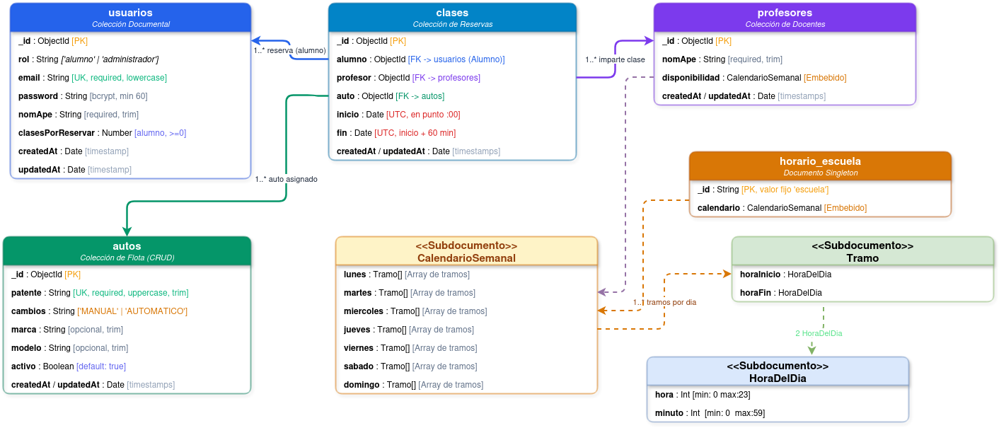

# Documentación de la API REST DriveAndLearn con Node.js y Express

| **Nombre del Proyecto** | ***DriveAndLearn (Backend)*** |
|---|---|
| **Materia** | ***Programacion III*** |
| **Profesor** | ***Carlos Cimino*** |
| **Estudiantes** | ***Santiago Nicolás Margarit***<br>***Fabrizio Manzo Peluzo*** |
| **Stack Tecnológico** | ***Node.js ,TypeScript 6, Express 5, MongoDB, Mongoose 9, JWT, bcrypt*** |

## Índice

1. [Componentes y Tecnologías Utilizadas](#1-componentes-y-tecnologías-utilizadas)
2. [Rutas de la Aplicación Web (Endpoints de la API REST)](#2-rutas-de-la-aplicación-web-endpoints-de-la-api-rest)
3. [Especificación de Endpoints](#3-especificación-de-endpoints)
4. [Arquitectura de Capas de la API REST](#4-arquitectura-de-capas-de-la-api-rest)
5. [Modelo de Datos y Colecciones de MongoDB](#5-modelo-de-datos-y-colecciones-de-mongodb)
6. [Estructura del Proyecto](#6-estructura-del-proyecto)
7. [Configuración del Entorno y Puesta en Marcha](#7-configuración-del-entorno-y-puesta-en-marcha)

## 1. Componentes y Tecnologías Utilizadas

Esta sección detalla los módulos, dependencias y herramientas tecnológicas que fueron esenciales para construir y verificar la aplicación web backend, justificando el propósito técnico de su elección en el proyecto.

| Dependencia / Herramienta | Tipo | Propósito |
|---|---|---|
| **Node.js (v24+)** | **Runtime** | Entorno de ejecución de JavaScript en el servidor. Configurado con ESM nativo ("type": "module" y resolución "nodenext"), aprovechando las últimas características de ECMAScript y máximo rendimiento. |
| **TypeScript 6** | **Lenguaje** | Proporciona tipado estático estricto, interfaces, type guards, uniones as const y comprobación en tiempo de compilación, eliminando clases enteras de bugs antes del despliegue. |
| **Express 5** | **Framework HTTP** | Núcleo de la API REST. La versión 5 deriva automáticamente las excepciones y promesas asíncronas rechazadas al middleware centralizado de errores, simplificando los controladores al prescindir de bloques try/catch repetitivos. |
| **MongoDB & Mongoose 9** | **Base de Datos & ODM** | Persistencia orientada a documentos en colecciones independientes. Mongoose gestiona esquemas tipados, subdocumentos, índices únicos y discriminators para especializar usuarios (Alumno y Administrador). |
| **jsonwebtoken** | **Seguridad / Auth** | Gestión de sesiones sin estado (stateless) mediante JSON Web Tokens firmados con algoritmo simétrico HS256, verificando emisor (issuer), audiencia (audience) y tiempo de expiración. |
| **bcrypt** | **Criptografía** | Hasheo unidireccional y robusto de contraseñas de alumnos y administradores con factor de salting, garantizando que nunca se almacenen contraseñas en texto plano. |
| **dotenv** | **Configuración** | Carga variables de entorno desde el archivo .env de forma segura y centralizada en src/config/env.ts al momento de inicializar el proceso. |
| **cors** | **Middleware HTTP** | Habilita y controla el intercambio de recursos de origen cruzado (CORS), permitiendo que la API sea consumida de forma segura por clientes web y frontends externos. |
| **Vitest 4 + Supertest** | **Testing Automático** | Suite integral de pruebas unitarias y de integración. Supertest simula llamadas HTTP directamente sobre la aplicación Express sin levantar un puerto de red físico. |
| **mongodb-memory-server** | **Testing DB** | Levanta una instancia real de MongoDB en memoria RAM para ejecutar los tests de integración en un entorno completamente aislado, limpio y veloz. |
| **tsx** | **Herramienta Dev** | Compilador y ejecutor de TypeScript sobre Node.js con recarga en caliente (watch mode) para desarrollo ágil y ejecución de scripts administrativos. |

## 2. Rutas de la Aplicación Web (Endpoints de la API REST)

A continuación se presenta el mapa exhaustivo de todos los endpoints que expone la API REST, organizados por recurso/controlador. Se especifica el método HTTP, la URL exacta, la acción funcional realizada y los permisos o roles requeridos para su invocación.

### AuthController:

| Método HTTP | Ruta (URL) | Acción / Funcionalidad | Rol Requerido |
|---|---|---|---|
| **POST** | /api/auth/login | Autentica a un usuario (alumno o admin) con email y contraseña. Retorna token JWT y perfil. | Público |

### AlumnosController:

| Método HTTP | Ruta (URL) | Acción / Funcionalidad | Rol Requerido |
|---|---|---|---|
| **POST** | /api/alumnos | Registro público de un nuevo alumno en la escuela. | Público |
| **GET** | /api/alumnos | Lista todos los alumnos registrados en el sistema. | **Administrador** |
| **GET** | /api/alumnos/:id | Obtiene el detalle y perfil de un alumno específico. | Alumno propio o Admin |
| **PUT** | /api/alumnos/:id | Modifica datos de perfil (email, password, nomApe). | Alumno propio o Admin |
| **DELETE** | /api/alumnos/:id | Da de baja la cuenta del alumno en la escuela. | Alumno propio o Admin |
| **PATCH** | /api/alumnos/:id/sumar-clases | Acredita clases disponibles al saldo del alumno (clasesPorReservar). | **Administrador** |
| **PATCH** | /api/alumnos/:id/restar-clases | Descuenta clases disponibles del saldo del alumno. | **Administrador** |

### AdministradoresController:

| Método HTTP | Ruta (URL) | Acción / Funcionalidad | Rol Requerido |
|---|---|---|---|
| **GET** | /api/administradores | Lista todos los administradores de la plataforma. | **Administrador** |
| **GET** | /api/administradores/:id | Obtiene el detalle de un administrador por ID. | Admin propio o Admin |
| **POST** | /api/administradores | Da de alta un nuevo administrador en el sistema. | **Administrador** |
| **PUT** | /api/administradores/:id | Actualiza datos de un administrador (email, password, nomApe). | Admin propio o Admin |
| **DELETE** | /api/administradores/:id | Da de baja una cuenta de administrador. | Admin propio o Admin |

### ProfesoresController:

| Método HTTP | Ruta (URL) | Acción / Funcionalidad | Rol Requerido |
|---|---|---|---|
| **POST** | /api/profesores | Registra un nuevo profesor de manejo. | **Administrador** |
| **GET** | /api/profesores | Lista todos los profesores de la escuela. | Autenticado |
| **GET** | /api/profesores/:id | Obtiene el perfil y calendario de disponibilidad del profesor. | Autenticado |
| **PATCH** | /api/profesores/:id/nom-ape | Edita el nombre y apellido de un profesor. | **Administrador** |
| **POST** | /api/profesores/:id/disponibilidad | Agrega un tramo horario (HH:MM a HH:MM) a la disponibilidad semanal. | **Administrador** |
| **DELETE** | /api/profesores/:id/disponibilidad | Elimina un tramo horario de la disponibilidad semanal. | **Administrador** |

### AutosController (CRUD Completo de Entidad):

| Método HTTP | Ruta (URL) | Acción / Funcionalidad | Rol Requerido |
|---|---|---|---|
| **GET** | /api/autos | Lista los autos (alumnos ven solo activos; admins ven toda la flota). | Autenticado |
| **GET** | /api/autos/:id | Obtiene los datos completos de un auto por su ID. | Autenticado |
| **POST** | /api/autos | Da de alta un vehículo nuevo con patente única y tipo de caja. | **Administrador** |
| **PUT** | /api/autos/:id | Modifica datos de un vehículo (patente, marca, modelo, año, caja). | **Administrador** |
| **PATCH** | /api/autos/:id/activo | Pone o saca de servicio un auto (cambio de estado operativo). | **Administrador** |

### ClasesController:

| Método HTTP | Ruta (URL) | Acción / Funcionalidad | Rol Requerido |
|---|---|---|---|
| **GET** | /api/clases | Lista clases (alumnos ven las propias; admin ve todas o filtra). | Autenticado |
| **GET** | /api/clases/:id | Obtiene el detalle de una clase agendada. | Alumno de la clase o Admin |
| **POST** | /api/clases | Agenda una clase de 1 hora en punto. Descuenta 1 crédito del saldo. | Alumno (propia) o Admin |
| **PUT** | /api/clases/:id | Reprograma una clase (nueva fecha, profesor o auto apto). | Alumno de la clase o Admin |
| **DELETE** | /api/clases/:id | Cancela la clase. Si no empezó, reintegra 1 crédito al alumno. | Alumno de la clase o Admin |

### HorarioEscuelaController:

| Método HTTP | Ruta (URL) | Acción / Funcionalidad | Rol Requerido |
|---|---|---|---|
| **GET** | /api/horario-escuela | Consulta el horario semanal oficial de apertura de la escuela. | Autenticado |
| **PUT** | /api/horario-escuela | Reemplaza el calendario semanal completo de la escuela. | **Administrador** |
| **POST** | /api/horario-escuela/agregar | Agrega un tramo horario a un día específico de la escuela. | **Administrador** |
| **POST** | /api/horario-escuela/quitar | Remueve un tramo horario de un día de la escuela. | **Administrador** |

## 3. Especificación de Endpoints

### 3.1 Autenticación: Login

<table>
<tr><th align="left">POST /api/auth/login</th></tr>
<tr><td>

**Descripción**: Inicia sesión de alumno o administrador con credenciales válidas y retorna token JWT firmado.<br>
Permisos: Público (sin token previo).

</td></tr>
<tr><td>

**Parámetros de URL / Query:** Ninguno.

</td></tr>
<tr><td>

***Request Body (JSON):***

```json
{
  "email": "alumno@example.com",
  "password": "miPasswordSegura123"
}
```

</td></tr>
<tr><td>

**Respuesta Exitosa (200 OK):**

```json
{
  "token": "eyJhbGciOiJIUzI1NiIsInR5cCI6IkpXVCJ9...",
  "usuario": {
    "_id": "673f1a2b...",
    "email": "alumno@example.com",
    "nomApe": "Juan Pérez",
    "rol": "alumno",
    "clasesPorReservar": 5
  }
}
```

</td></tr>
<tr><td>

**Errores Posibles:**

- 400 Bad Request: Cuerpo malformado o campos faltantes.
- 401 Unauthorized: Credenciales incorrectas ("Email o contraseña incorrectos").

</td></tr>
</table>

### 3.2 Autos: Alta de Vehículo (CRUD)

<table>
<tr><th align="left">POST /api/autos</th></tr>
<tr><td>

**Descripción:** Da de alta un vehículo en la flota. Valida que la patente no esté duplicada en la escuela.<br>
Permisos: Administrador (Bearer Token con rol administrador).

</td></tr>
<tr><td>

**Parámetros de URL / Query:** Ninguno.

</td></tr>
<tr><td>

***Request Body (JSON):***

```json
{
  "patente": "AB123CD",
  "marca": "Toyota",
  "modelo": "Yaris",
  "cambios": "manual"
}
```

</td></tr>
<tr><td>

**Respuesta Exitosa (201 Created):**

```json
{
  "_id": "6740b12c...",
  "patente": "AB123CD",
  "marca": "Toyota",
  "modelo": "Yaris",
  "cambios": "manual",
  "activo": true,
  "createdAt": "2026-10-27T10:00:00.000Z",
  "updatedAt": "2026-10-27T10:00:00.000Z"
}
```

</td></tr>
<tr><td>

**Errores Posibles:**

- 400 Bad Request: tipo de caja inválido o campos faltantes.
- 401 Unauthorized: Token ausente o expirado.
- 403 Forbidden: Usuario sin rol de administrador.
- 409 Conflict: Patente ya registrada ("La patente ya está en uso").

</td></tr>
</table>

### 3.4 Clases: Agendar Clase de Manejo

<table>
<tr><th align="left">POST /api/clases</th></tr>
<tr><td>

**Descripción:** Reserva una clase de 1 hora en punto. Valida disponibilidad, auto activo, no superposición y saldo disponible del alumno.<br>
Permisos: Alumno (para sí mismo) o Administrador (especificando ID del alumno).

</td></tr>
<tr><td>

**Parámetros de URL / Query:** Ninguno.

</td></tr>
<tr><td>

***Request Body (JSON):***

```jsonc
{
  "alumno": "673f1a...", // Obligatorio para admin, omitible para alumno
  "profesor": "673f2b...",
  "auto": "6740b1...",
  "inicio": "2026-11-02T12:00:00-03:00"
}
```

</td></tr>
<tr><td>

**Respuesta Exitosa (201 Created):**

```json
{
  "_id": "6741c8d...",
  "alumno": "673f1a...",
  "profesor": "673f2b...",
  "auto": "6740b1...",
  "inicio": "2026-11-02T15:00:00.000Z",
  "fin": "2026-11-02T16:00:00.000Z"
}
```

</td></tr>
<tr><td>

**Errores Posibles:**

- 400 Bad Request: Inicio no en punto (:00), profesor no disponible, auto superpuesto o alumno sin saldo.
- 401 Unauthorized: Token ausente o inválido.
- 403 Forbidden: Alumno intentando reservar para otro alumno.
- 404 Not Found: Alumno, profesor o auto inexistente.

</td></tr>
</table>

### 3.5 Clases: Cancelación y Reintegro de Crédito

<table>
<tr><th align="left">DELETE /api/clases/:id</th></tr>
<tr><td>

**Descripción:** Cancela una clase de manejo. Si la clase aún no comenzó, restituye automáticamente 1 crédito al saldo del alumno.<br>
Permisos: Alumno titular de la clase o Administrador.

</td></tr>
<tr><td>

**Parámetros de URL / Query:** :id (ObjectId de la clase)

</td></tr>
<tr><td>

***Request Body (JSON):***

*Ninguno.*

</td></tr>
<tr><td>

**Respuesta Exitosa (204 No Content):**

(Sin cuerpo de respuesta - HTTP 204)

</td></tr>
<tr><td>

**Errores Posibles:**

- 400 Bad Request: ID de clase con formato inválido.
- 401 Unauthorized: Sin credenciales.
- 403 Forbidden: Alumno intentando cancelar una clase ajena.
- 404 Not Found: Clase inexistente ("Clase no encontrada").

</td></tr>
</table>

## 4. Arquitectura de Capas de la API REST

### 4.1 Capa de Enrutamiento y Middlewares (routes/ y middlewares/)

Las rutas definen únicamente el verbo HTTP, el endpoint y la cadena de middlewares encadenados. Siguen un orden estricto de ejecución: la autenticación y autorización se procesan siempre ANTES que la validación de cuerpo, garantizando que una petición sin credenciales responda 401 Unauthorized antes de evaluar un 400 Bad Request.

**Middlewares principales:**

- **requireAuthentication:** Valida el JWT y puebla req.auth = { id, role }.<br>
  requireAdministrator: Verifica en base de datos que el usuario conserve el rol de administrador.
- **requireSelfOrAdministrator:** Fábrica que autoriza si el actor opera sobre su propio perfil o si es admin.
- **requireAlumnoDeLaClaseOAdministrador:** Asegura que solo el alumno titular o un admin modifiquen una reserva.
- **validacionDeCuerpo:** Comprueba la presencia de un cuerpo JSON válido.

### 4.2 Capa de Controladores (controllers/)

Controladores HTTP delgados y sin bloques try/catch. Gracias a Express 5, cualquier promesa rechazada o error en la cadena es transferido automáticamente al errorHandler centralizado. Su labor consiste en transformar req.body a través del DTO correspondiente y mapear el resultado del servicio al status HTTP oportuno (200, 201, 204 o 404 cuando el servicio devuelve null).

### 4.3 Capa de DTOs y Validación de Entrada (dtos/)

Los DTOs validan exclusivamente la FORMA y TIPO de los datos entrantes mediante funciones utilitarias (validarCampos y exigido). Operan bajo dos modos estrictos:

- **SIN_CAMPOS_DE_MAS:** Para altas y creaciones.
- **AL_MODIFICAR:** Para actualizaciones parciales.

Generan un objeto completamente limpio descartando cualquier propiedad extra o maliciosa (_id, $set, rol), protegiendo la persistencia.

### 4.4 Capa de Negocio y Servicios (services/)

Alojan el 100% de las reglas de negocio y el acceso a datos. No tienen conocimiento alguno de Express (req, res). Si una entidad no existe retornan null, y si se infringe una invariante de dominio lanzan excepciones tipadas (ErrorDeNegocio, ErrorClaveDuplicada) con status HTTP coherentes.

### 4.5 Capa de Modelado y Persistencia (models/)

Esquemas de Mongoose con validaciones a nivel de esquema, subdocumentos, índices únicos y discriminators para usuarios, asegurando la integridad referencial y de dominio en MongoDB.

### 4.6 Seguridad y Autenticación JWT

Sesiones sin estado basadas en JSON Web Tokens (JWT) firmados con algoritmo HS256 y clave de al menos 32 caracteres. Contraseñas protegidas mediante hasheo unidireccional con bcrypt (cost factor 10). Los profesores son entidades de servicio y NO usuarios (no inician sesión).

### 4.7 Manejo Centralizado de Errores (errorHandler.middleware.ts)

Todas las excepciones convergen en el errorHandler montado al final de la aplicación. Estandariza las respuestas en formato JSON { "mensaje": string }, traduciendo errores de validación de Mongoose a 400, CastError a 400 ("Id inválido"), errores de clave duplicada a 409, errores de dominio a su código correspondiente y cualquier imprevisto a 500 con registro seguro en consola.

## 5. Modelo de Datos y Colecciones de MongoDB

El sistema persiste su información en una base de datos orientada a documentos en MongoDB. Para cumplir con el requerimiento de al menos cuatro colecciones (punto 2 de la consigna), el modelo se organiza en 5 colecciones y documentos especializados:



### 5.1 Colección: usuarios

Almacena a todos los usuarios del sistema. Mongoose utiliza el campo discriminator "rol" para distinguir entre Alumnos y Administradores. El método toJSON excluye password y __v en las respuestas.

| Campo | Tipo Mongoose | Obligatorio | Validaciones y Reglas de Negocio |
|---|---|---|---|
| **_id** | ObjectId | **SÍ** | Identificador único generado automáticamente por MongoDB. |
| **email** | String | **SÍ** | Índice unique. Convertido a minúsculas, recortado (trim) y validado con regex estándar de email. |
| **password** | String | **SÍ** | Hash bcrypt seguro (longitud >= 60 caracteres). Nunca se expone en respuestas HTTP. |
| **nomApe** | String | **SÍ** | Nombre y apellido del usuario. Recortado de espacios. |
| **rol** | String | **SÍ** | Clave discriminadora. Enum estricto: ["alumno", "administrador"]. |
| **clasesPorReservar** | Number | NO | EXCLUSIVO de Alumno. Saldo entero >= 0 de clases disponibles para reservar. Default: 0. |
| **createdAt / updatedAt** | Date | **SÍ** | Timestamps automáticos de auditoría de creación y última modificación. |

### 5.2 Colección: profesores

Registra al personal docente de la escuela. No poseen usuario ni contraseña. Cada profesor incluye su disponibilidad horaria semanal estructurada por día.

| Campo | Tipo Mongoose | Obligatorio | Validaciones y Reglas de Negocio |
|---|---|---|---|
| **_id** | ObjectId | **SÍ** | Identificador único generado por MongoDB. |
| **nomApe** | String | **SÍ** | Nombre y apellido del profesor. Obligatorio y con trim. |
| **disponibilidad** | Subdocumento | **SÍ** | Objeto CalendarioSemanal con arrays de tramos { horaInicio, horaFin } para lunes a domingo en formato HH:MM. |
| **createdAt / updatedAt** | Date | **SÍ** | Timestamps automáticos de auditoría. |

### 5.3 Colección: autos

Flota de vehículos disponibles para las clases prácticas de manejo. Entidad sobre la que se acredita el CRUD completo con validaciones.

| Campo | Tipo Mongoose | Obligatorio | Validaciones y Reglas de Negocio |
|---|---|---|---|
| **_id** | ObjectId | **SÍ** | Identificador único de MongoDB. |
| **patente** | String | **SÍ** | Índice unique. Convertida a mayúsculas y recortada. No admite patentes duplicadas. |
| **marca** | String | **SÍ** | Marca del vehículo (ej. Toyota, Fiat). Obligatoria. |
| **modelo** | String | **SÍ** | Modelo del vehículo (ej. Yaris, Cronos). Obligatorio. |
| **anio** | Number | **SÍ** | Año de fabricación. Restricción numérica: mínimo año 2000. |
| **cambios** | String | **SÍ** | Tipo de transmisión. Enum estricto: ["manual", "automatico"]. |
| **activo** | Boolean | **SÍ** | Estado operativo del auto. Default: true. Si es false, queda fuera de servicio. |
| **createdAt / updatedAt** | Date | **SÍ** | Timestamps automáticos de auditoría. |

### 5.4 Colección: clases

Reservas de clases prácticas de manejo. Cada clase vincula un alumno, un profesor y un auto en un intervalo exacto de 1 hora en punto.

| Campo | Tipo Mongoose | Obligatorio | Validaciones y Reglas de Negocio |
|---|---|---|---|
| **_id** | ObjectId | **SÍ** | Identificador único de la clase. |
| **alumno** | ObjectId (ref) | **SÍ** | Referencia al documento de Usuario (discriminator Alumno) que toma la clase. |
| **profesor** | ObjectId (ref) | **SÍ** | Referencia al profesor asignado para impartir la instrucción. |
| **auto** | ObjectId (ref) | **SÍ** | Referencia al vehículo asignado para la práctica. |
| **inicio** | Date (UTC) | **SÍ** | Momento de inicio de la clase. Debe ser en punto (:00). |
| **fin** | Date (UTC) | **SÍ** | Momento de finalización de la clase. Calculado exactamente 1 hora después del inicio. |
| **createdAt / updatedAt** | Date | **SÍ** | Timestamps de auditoría. Cuenta con índice compuesto para búsquedas veloces de superposición. |

### 5.5 Colección: horario_escuela

Documento singleton que define los días y tramos horarios en los cuales la escuela de manejo está abierta al público para impartir clases.

| Campo | Tipo Mongoose | Obligatorio | Validaciones y Reglas de Negocio |
|---|---|---|---|
| **_id** | String | **SÍ** | Valor fijo "escuela". Garantiza que exista un único documento de configuración. |
| **calendario** | Subdocumento | **SÍ** | Estructura CalendarioSemanal con tramos { horaInicio, horaFin } en punto para cada día. |

## 6. Estructura del Proyecto

Para facilitar la comprensión del código fuente y dar cumplimiento al punto 8.d de la consigna, se resume el árbol de directorios del repositorio junto con la responsabilidad específica de cada carpeta:

| Directorio / Módulo | Responsabilidad y Contenido |
|---|---|
| **src/routes/** | Declaración de endpoints y mapeo de verbos HTTP a handlers de controladores, encadenando middlewares en orden estricto. |
| **src/middlewares/** | Interceptores de autenticación JWT (requireAuthentication), autorización de roles (requireAdministrator, requireSelfOrAdministrator), validación de cuerpo y errorHandler. |
| **src/controllers/** | Controladores HTTP delgados. Parsean la petición mediante DTOs y mapean el retorno del servicio a códigos HTTP (200, 201, 204, 404). |
| **src/dtos/** | Data Transfer Objects. Funciones aCrearDto y aActualizarDto que validan rigurosamente la forma y tipos del body descartando atributos ajenos. |
| **src/services/** | Capa central de lógica de negocio y acceso a datos. Valida disponibilidad, no superposición de horarios, saldos de alumnos e invariantes del dominio. |
| **src/models/** | Esquemas Mongoose e interfaces TypeScript de las colecciones (Usuario, Alumno, Administrador, Profesor, Auto, Clase, HorarioEscuela). |
| **src/errors/** | Jerarquía tipada de errores de dominio (ErrorDeNegocio, ErrorPeticionInvalida, ErrorAutenticacion) y traductores de errores nativos de MongoDB. |
| **src/config/** | Lectura y validación centralizada de variables de entorno (env.ts) y conexión a MongoDB con Mongoose (db.ts). |
| **src/utils/** | Utilidades transversales: operaciones seguras con fechas y zonas horarias (fechas.ts), hasheo de claves (password.ts) y validación de tipos. |
| **tests/** | Suites automatizadas con Vitest: pruebas unitarias de DTOs, servicios, modelos y pruebas de integración HTTP con Supertest y Mongo en memoria. |

## 7. Configuración del Entorno y Puesta en Marcha

Instrucciones paso a paso para que cualquier desarrollador pueda clonar el repositorio, configurar el entorno y levantar el servidor localmente:

### 7.1 Requisitos Previos de Software

- Node.js.
- Instancia local o remota de MongoDB (MongoDB Community Server local o cluster en MongoDB Atlas).

### 7.2 Instalación de Dependencias

Clonar el repositorio y ejecutar en la raíz del proyecto:

```bash
npm install
```

### 7.3 Configuración de Variables de Entorno (.env)

Copiar el archivo de plantilla .env.example como .env y configurar las siguientes variables obligatorias:

- **PORT:** Puerto TCP de escucha del servidor HTTP (por defecto: 3000).
- **MONGODB_URI:** Cadena de conexión URI a MongoDB (ej. mongodb://localhost:27017/driveandlearn).
- **JWT_SECRET:** Clave simétrica secreta para firmar los tokens JWT (longitud mínima obligatoria: 32 caracteres).
- **OFFSET_HORA_UTC:** Diferencia horaria en horas respecto a UTC de la escuela (Argentina: -3).

### 7.4 Comandos de Ejecución y Scripts

- **Modo Desarrollo (recarga automática con tsx):**

  ```bash
  npm run dev
  ```

- **Chequeo Estricto de Tipos (TypeScript sin emitir archivos):**

  ```bash
  npm run typecheck
  ```

- **Ejecución de Pruebas Automatizadas (Vitest + Supertest):**

  ```bash
  npm run test:run
  ```

- **Compilación para tranpilación (emite a la carpeta dist/):**

  ```bash
  npm run build
  ```

- **Inicio del Servidor Compilado en Producción:**

  ```bash
  npm run start
  ```

- **Bootstrap del Primer Administrador (interactivo por terminal):**

  ```bash
  npm run admin:bootstrap
  ```
