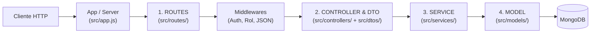

# 02 — Arquitectura en Capas (DriveAndLearn Backend)

Esta guía explica cómo está estructurado el código del backend de **DriveAndLearn**, el flujo unidireccional que sigue cada petición HTTP (`ROUTES → MIDDLEWARES → CONTROLLER & DTO → SERVICE → MODEL → MongoDB`) y la responsabilidad estricta de cada capa.

---

## 1. Flujo General de una Petición



> [!IMPORTANT]
> **Regla de dependencia estrictamente unidireccional:** Cada capa solo se comunica con la capa inmediata inferior. Por ejemplo, un `Controller` nunca consulta directamente un `Model` de Mongoose, y un `Service` nunca conoce los objetos `req` ni `res` de Express ni maneja cabeceras o códigos HTTP directos.

---

## 2. Responsabilidad de Cada Capa

| Capa | Directorio | Responsabilidad Principal | Qué NUNCA debe hacer |
| :--- | :--- | :--- | :--- |
| **1. Routes** | `src/routes/` | Declarar los endpoints REST (`GET`, `POST`, `PUT`, `PATCH`, `DELETE`) y encadenar los middlewares previos (`autenticar`, `verificarSiAdmin`, `verificarSiAdminOPropioUsuario`, `validarObjetoJson`) antes de invocar al controlador. | Procesar parámetros, validar estructuras, ejecutar lógica de negocio o consultar la base de datos. |
| **2. Controller & DTO** | `src/controllers/`<br/>`src/dtos/` | **DTO:** Verificar sintácticamente que el JSON recibido contenga únicamente campos permitidos y con tipos primitivos válidos (`string`, `number`).<br/>**Controller:** Extraer datos de `req` (`params`, `query`, `body`, `usuario`, `token`), delegar validación al DTO, invocar al `Service` y emitir la respuesta HTTP (`200`, `201`, o `404` si el servicio retorna `null`). | Usar bloques `try/catch` manuales (Express 5 captura y deriva excepciones `async` a `errorHandler`), importar modelos de Mongoose ni contener lógica de dominio. |
| **3. Service** | `src/services/` | Contener el 100% de la lógica de negocio y reglas de dominio (validación y hasheo de contraseñas, cálculo de créditos de clases, algoritmos de calendarización y disponibilidad con Luxon, control de solapamientos) y coordinar operaciones sobre su propio modelo o consumir otros servicios. | Acceder a `req`, `res`, cabeceras HTTP o responder códigos de estado directamente (para cortar el flujo arroja instancias tipadas de `src/errors/`). Tampoco debe importar modelos de otras entidades. |
| **4. Model** | `src/models/` | Definir los esquemas de Mongoose (`mongoose.Schema`), tipos de persistencia en MongoDB, restricciones declarativas (`required`, `unique`, `match`, `min`, `enum`), serialización (`toJSON`), subdocumentos (`{ _id: false }`) y discriminadores (`Usuario` $\rightarrow$ `Alumno`, `Administrador`). | Contener orquestación de casos de uso complejos o depender de servicios externos. |

---

## 3. Capas y Módulos Transversales

Además de las 4 capas principales, el proyecto cuenta con módulos transversales bien delimitados:

### 3.1. Organización de `helpers/` Aislados por Capa
Para evitar carpetas genéricas donde se mezclen responsabilidades, **cada capa posee su propia subcarpeta `helpers/`** para sus funciones auxiliares internas:
- **`src/dtos/helpers/`**: [validarEstructuraYTipos.js](file:///home/wolf753/Proyectos/sandbox-docker/agy-env/INSPT-Prog3-DriveAndLearn-backend/src/dtos/helpers/validarEstructuraYTipos.js) (utilidad central usada por todos los DTOs para escanear campos requeridos, prohibidos y tipos primitivos).
- **`src/services/helpers/`**:
  - [validarMongooseObjId.js](file:///home/wolf753/Proyectos/sandbox-docker/agy-env/INSPT-Prog3-DriveAndLearn-backend/src/services/helpers/validarMongooseObjId.js): validación de identificadores ObjectId de 24 caracteres hexadecimales.
  - [manejoDePassword.js](file:///home/wolf753/Proyectos/sandbox-docker/agy-env/INSPT-Prog3-DriveAndLearn-backend/src/services/helpers/manejoDePassword.js): validación de longitud mínima ($\ge 8$) y hasheo con `bcrypt`.
  - [disponibilidadHelper.js](file:///home/wolf753/Proyectos/sandbox-docker/agy-env/INSPT-Prog3-DriveAndLearn-backend/src/services/helpers/disponibilidadHelper.js): proyección sobre `DIA_BASE_REFERENCIA`, fusión de tramos (`Interval.merge`) y recorte (`interval.difference`).
  - [turnosYFechasHelper.js](file:///home/wolf753/Proyectos/sandbox-docker/agy-env/INSPT-Prog3-DriveAndLearn-backend/src/services/helpers/turnosYFechasHelper.js): validación de fechas ISO locales en punto, fechas futuras, intervalos de clases, filtros de superposición y división de turnos de 1 hora.
- **`src/middlewares/helpers/`**:
  - [verSiErrorLecturaCuerpo.js](file:///home/wolf753/Proyectos/sandbox-docker/agy-env/INSPT-Prog3-DriveAndLearn-backend/src/middlewares/helpers/verSiErrorLecturaCuerpo.js): traducción de errores de sintaxis JSON de `express.json()` a `ErrorLecturaCuerpo`.
  - [formatearErrorClaveDuplicada.js](file:///home/wolf753/Proyectos/sandbox-docker/agy-env/INSPT-Prog3-DriveAndLearn-backend/src/middlewares/helpers/formatearErrorClaveDuplicada.js): extracción del campo duplicado del error 11000 de MongoDB.

---

### 3.2. Middlewares (`src/middlewares/`)
- **[validarObjetoJson.js](file:///home/wolf753/Proyectos/sandbox-docker/agy-env/INSPT-Prog3-DriveAndLearn-backend/src/middlewares/validarObjetoJson.js)**: Garantiza que `req.body` sea un objeto JSON plano antes de transferir el control a DTOs o controladores.
- **[authMiddleware.js](file:///home/wolf753/Proyectos/sandbox-docker/agy-env/INSPT-Prog3-DriveAndLearn-backend/src/middlewares/authMiddleware.js)**: Módulo de seguridad que expone:
  - `autenticar(req, _res, next)`: Comprueba la cabecera `Authorization: Bearer <token>`, valida contra la lista negra (`tokens_revocados`), valida el JWT con `validarJWT` e inyecta `req.usuario`, `req.user` y `req.token`.
  - `verificarSiAdmin(req, res, next)`: Exige que el usuario autenticado tenga el rol `ROLES.ADMINISTRADOR` (basado en la fábrica interna `autorizarRol`).
  - `verificarSiAdminOPropioUsuario(req, _res, next)`: Permite la operación si el usuario es administrador o si coincide su ID con `req.params.id` (utilizado en la lectura y edición individual de alumnos).
- **[errorHandler.js](file:///home/wolf753/Proyectos/sandbox-docker/agy-env/INSPT-Prog3-DriveAndLearn-backend/src/middlewares/errorHandler.js)**: Salida centralizada de excepciones para toda la aplicación Express, traduciendo errores de validación de Mongoose, conversiones `CastError`, duplicados de índice único (11000), jerarquía de errores tipados y errores imprevistos (500) a un formato canónico `{ "mensaje": "..." }`.

---

### 3.3. Jerarquía de Errores (`src/errors/`)
Los errores extienden clases tipadas para que el middleware `errorHandler` determine el código de estado HTTP automáticamente:
- **`ErrorPeticionInvalida` (`400`)**: Clase base para errores sintácticos de entrada:
  - `ErrorCampoInvalido` (`400`): campos faltantes, campos no permitidos o cuerpo vacío.
  - `ErrorDeTipo` (`400`): tipo primitivo inválido.
  - `ErrorMongooseObjIdInvalido` (`400`): ID que no cumple con el formato ObjectId de MongoDB.
  - `ErrorFormatoDeFecha` (`400`): fecha u hora que no respeta el formato en punto o fecha inexistente.
  - `ErrorLecturaCuerpo` (`400`): JSON malformado detectado en el body parser.
- **`ErrorDeNegocio` (`400`)**: Clase base para violaciones de reglas del dominio:
  - `ErrorPasswordInvalida` (`400`): contraseña menor a 8 caracteres.
  - `ErrorSaldoClasesInsuficiente` (`400`): saldo resultante negativo o insuficiente ($< 1$).
  - **`ErrorRegistroInexistente` (`404`)**: Entidad relacionada o recurso no encontrado en casos de uso de negocio (subclase de `ErrorDeNegocio` con `statusCode = 404`).
- **`ErrorAutenticacion` (`401`)**: Token ausente, adulterado, expirado o revocado en sesión cerrada.
- **`ErrorAutorizacion` (`403`)**: Rol no permitido o intento de acceder/modificar recursos de otro usuario.

---

### 3.4. Constantes y Configuración (`src/constants/` y `src/config/`)
- **`src/constants/`**: Objetos inmutables congelados (`Object.freeze`) compartidos entre capas para evitar *magic strings* y magic numbers:
  - [roles.js](file:///home/wolf753/Proyectos/sandbox-docker/agy-env/INSPT-Prog3-DriveAndLearn-backend/src/constants/roles.js): `ROLES` (`ADMINISTRADOR`, `ALUMNO`) y `ROLES_ENUM`.
  - [cambios.js](file:///home/wolf753/Proyectos/sandbox-docker/agy-env/INSPT-Prog3-DriveAndLearn-backend/src/constants/cambios.js): `CAMBIOS` (`MANUAL`, `AUTOMATICO`) y `CAMBIOS_ENUM`.
  - [diasSemana.js](file:///home/wolf753/Proyectos/sandbox-docker/agy-env/INSPT-Prog3-DriveAndLearn-backend/src/constants/diasSemana.js): `DIAS_SEMANA` y `MAPA_WEEKDAY_DIA`.
  - [constantesCalendarizacion.js](file:///home/wolf753/Proyectos/sandbox-docker/agy-env/INSPT-Prog3-DriveAndLearn-backend/src/constants/constantesCalendarizacion.js): `DIA_BASE_REFERENCIA`, `REGEX_HORA_EN_PUNTO`, `REGEX_FECHA_HORA_EN_PUNTO`, `REGEX_FECHA_DIA_YYYY_MM_DD`, `MIN_DURACION_TRAMO_HORAS`, `DURACION_CLASE_HORAS`, `HORA_CIERRE_DIA`.
- **`src/config/`**:
  - [env.js](file:///home/wolf753/Proyectos/sandbox-docker/agy-env/INSPT-Prog3-DriveAndLearn-backend/src/config/env.js): lectura y validación centralizada de variables de entorno (`dotenv`).
  - [db.js](file:///home/wolf753/Proyectos/sandbox-docker/agy-env/INSPT-Prog3-DriveAndLearn-backend/src/config/db.js): configuración de `strictQuery: true`, conexión (`connectDB`) y desconexión (`disconnectDB`) con Mongoose.

---

## 4. Estructura del Árbol de Directorios

```text
src/
├── config/                  # Configuración de entorno (env.js) y conexión a MongoDB (db.js)
├── constants/               # Constantes y enums de dominio (roles.js, cambios.js, diasSemana.js, constantesCalendarizacion.js)
├── controllers/             # Controladores HTTP delgados (alumno, profesor, auto, clase, auth, administrador)
├── dtos/                    # Validadores de estructura y tipos de entrada JSON
│   └── helpers/             # Helpers exclusivos de DTOs (validarEstructuraYTipos.js)
├── errors/                  # Jerarquía de excepciones tipadas con statusCode (ErrorDeNegocio, ErrorPeticionInvalida, etc.)
├── middlewares/             # Middlewares HTTP (errorHandler.js, validarObjetoJson.js, authMiddleware.js)
│   └── helpers/             # Helpers exclusivos de middlewares (verSiErrorLecturaCuerpo.js, formatearErrorClaveDuplicada.js)
├── models/                  # Modelos y esquemas de Mongoose (Clase, Profesor, Alumno, Auto, Usuario, TokenRevocado, etc.)
├── routes/                  # Definición de rutas Express (/api/auth, /api/alumnos, /api/clases, /api/autos, etc.)
├── scripts/                 # Scripts auxiliares de base de datos (bootstrapAdminDesdeEnv.js)
├── services/                # Lógica de negocio y casos de uso (claseService, alumnoService, autoService, etc.)
│   └── helpers/             # Helpers exclusivos de Services (disponibilidadHelper.js, turnosYFechasHelper.js, manejoDePassword.js, validarMongooseObjId.js)
├── app.js                   # Configuración y montaje de middlewares y rutas de Express (sin app.listen)
└── server.js                # Bootstrap de JWT_SECRET, conexión a MongoDB y apertura del puerto HTTP
```
