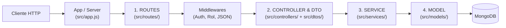

# 02 — Arquitectura en Capas (DriveAndLearn Backend)

Esta guía explica cómo está estructurado el código del backend de **DriveAndLearn**, el flujo que sigue cada petición HTTP (`ROUTES → CONTROLLER & DTO → SERVICE → MODEL`) y la responsabilidad estricta de cada capa.

---

## 1. Flujo General de una Petición



> [!IMPORTANT]
> **Regla de dependencia unidireccional:** Cada capa solo se comunica con la capa inmediata inferior. Por ejemplo, un `Controller` nunca consulta directamente un `Model` de Mongoose, y un `Service` nunca conoce los objetos `req` ni `res` de Express.

---

## 2. Responsabilidad de Cada Capa

| Capa | Directorio | Responsabilidad Principal | Qué NO debe hacer |
| :--- | :--- | :--- | :--- |
| **1. Routes** | `src/routes/` | Definir los endpoints REST (`GET`, `POST`, `PUT`, `PATCH`, `DELETE`) y encadenar los middlewares previos antes de invocar al controlador. | Contener lógica de validación, reglas de negocio o consultas a la base de datos. |
| **2. Controller & DTO** | `src/controllers/`<br/>`src/dtos/` | **DTO:** Verificar que el JSON recibido del cliente contenga únicamente los campos permitidos para la operación y con los tipos de datos correctos (`string`, `number`, etc.).<br/>**Controller:** Extraer datos de `req`, validarlos con el DTO, invocar al `Service` y devolver el status HTTP adecuado (`200`, `201`, `204`, `404`). | Usar bloques `try/catch` manuales (Express 5 propaga rechazos `async` automáticamente al `errorHandler`), ni aplicar reglas de negocio. |
| **3. Service** | `src/services/` | Contener toda la lógica de negocio del dominio (validación de longitud y hasheo de contraseñas, cálculo de saldo de clases, validación de horarios en punto y disponibilidad con Luxon) y coordinar las operaciones sobre los modelos. | Acceder a `req`, `res`, cabeceras HTTP o devolver códigos de estado directamente (para cortar la ejecución lanza instancias de `src/errors/`). |
| **4. Model** | `src/models/` | Definir los esquemas de Mongoose (`Schema`), tipos persistidos en MongoDB, restricciones estructurales (`required`, `unique`, `match`, `min`, `enum`), `toJSON` y discriminadores (`Usuario` → `Alumno`, `Administrador`). | Contener lógica de casos de uso complejos o depender de servicios externos. |

---

## 3. Capas y Módulos Transversales

Además de las 4 capas principales, el proyecto cuenta con módulos de soporte bien delimitados:

### 3.1. Organización de `helpers/` por Capa
Para evitar una carpeta genérica donde se mezclen funciones de distintas capas, **cada capa posee su propia subcarpeta `helpers/`** para sus funciones auxiliares internas:
- **`src/dtos/helpers/`**: ej. `validarEstructuraYTipos.js` (usado exclusivamente por los DTOs para escanear campos permitidos, faltantes y tipos).
- **`src/services/helpers/`**: ej. `validarMongooseObjId.js`, `manejoDePassword.js`, `calendario.js` (usados exclusivamente por los Services).
- **`src/middlewares/helpers/`**: ej. `verSiErrorLecturaCuerpo.js` (usado por `errorHandler.js`).

### 3.2. Middlewares (`src/middlewares/`)
- **`validarObjetoJson.js`**: Garantiza que `req.body` sea un objeto JSON plano antes de pasar al DTO/Controller.
- **`authMiddleware.js`**: Verifica el token JWT y los permisos según el rol del usuario.
- **`errorHandler.js`**: Punto único de salida para todos los errores lanzados en cualquier capa, traduciéndolos a una respuesta JSON uniforme `{ "mensaje": "..." }` con su código HTTP correspondiente.

### 3.3. Jerarquía de Errores (`src/errors/`)
Los errores están tipados en clases para que el `errorHandler` determine automáticamente el código HTTP:
- **`ErrorPeticionInvalida` (`400`)**: Clase base para errores de formato de entrada (`ErrorCampoInvalido`, `ErrorDeTipo`, `ErrorMongooseObjIdInvalido`, `ErrorLecturaCuerpo`).
- **`ErrorDeNegocio` (`400`)**: Clase base para violaciones a reglas del dominio (`ErrorPasswordInvalida`, `ErrorSaldoClasesInsuficiente`, etc.).
- **`ErrorAutenticacion` (`401`)** y **`ErrorAutorizacion` (`403`)**: Errores de sesión y permisos.

### 3.4. Constantes y Configuración (`src/constants/` y `src/config/`)
- **`src/constants/`**: Enumeraciones inmutables compartidas entre capas (`roles.js`, `cambios.js`, `diasSemana.js`) para evitar *magic strings* y no acoplar controladores o DTOs a los modelos.
- **`src/config/`**: Lectura centralizada de variables de entorno (`env.js`) y conexión a MongoDB (`db.js`).

---

## 4. Estructura del Árbol de Directorios

```text
src/
├── config/                  # Configuración de entorno (env.js) y conexión a MongoDB (db.js)
├── constants/               # Constantes y enums de dominio (roles.js, cambios.js, etc.)
├── errors/                  # Clases de error personalizadas (ErrorDeNegocio, ErrorPeticionInvalida, etc.)
├── middlewares/             # Middlewares HTTP (errorHandler.js, validarObjetoJson.js, auth)
│   └── helpers/             # Helpers exclusivos de middlewares
├── routes/                  # Definición de rutas Express (/api/*)
├── controllers/             # Controladores HTTP delgados
├── dtos/                    # Validadores de estructura y tipos de entrada JSON
│   └── helpers/             # Helpers exclusivos de DTOs (validarEstructuraYTipos.js)
├── services/                # Lógica de negocio y casos de uso
│   └── helpers/             # Helpers exclusivos de Services (manejoDePassword.js, validarMongooseObjId.js)
├── models/                  # Modelos y esquemas de Mongoose
├── app.js                   # Configuración de la aplicación Express
└── server.js                # Punto de entrada que conecta la BD y levanta el servidor HTTP
```
