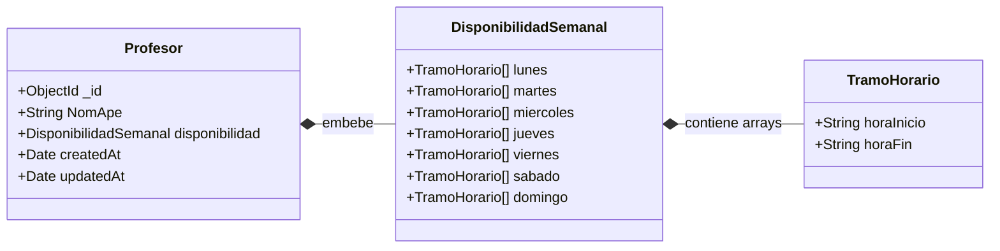
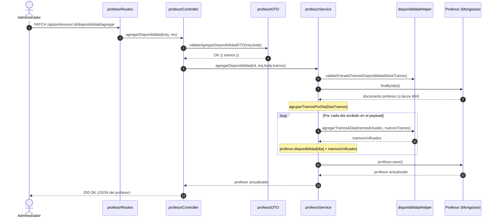

# 03 — Calendarización y Gestión de Disponibilidad (DriveAndLearn Backend)

Esta guía explica en detalle cómo opera el motor de calendarización de **DriveAndLearn**, las reglas de negocio de horarios e intervalos implementadas con **Luxon**, la división modular de sus helpers ([disponibilidadHelper.js](file:///home/wolf753/Proyectos/sandbox-docker/agy-env/INSPT-Prog3-DriveAndLearn-backend/src/services/helpers/disponibilidadHelper.js), [turnosYFechasHelper.js](file:///home/wolf753/Proyectos/sandbox-docker/agy-env/INSPT-Prog3-DriveAndLearn-backend/src/services/helpers/turnosYFechasHelper.js) y [constantesCalendarizacion.js](file:///home/wolf753/Proyectos/sandbox-docker/agy-env/INSPT-Prog3-DriveAndLearn-backend/src/constants/constantesCalendarizacion.js)), y su integración en [profesorService.js](file:///home/wolf753/Proyectos/sandbox-docker/agy-env/INSPT-Prog3-DriveAndLearn-backend/src/services/profesorService.js) y [claseService.js](file:///home/wolf753/Proyectos/sandbox-docker/agy-env/INSPT-Prog3-DriveAndLearn-backend/src/services/claseService.js).

---

## 1. Principios de Dominio y Decisiones de Diseño

La escuela de manejo requiere sincronizar agendas cíclicas semanales (profesores) con reservas concretas en fechas de calendario (clases prácticas). Para evitar desfasajes horarios y ambigüedades de cálculo, el proyecto sigue dos directrices arquitectónicas:

1. **Almacenamiento en Hora Local (Sin Conversión a UTC):**
   - Las clases prácticas se almacenan en MongoDB como `String` en formato ISO local en horas en punto: **`"YYYY-MM-DDTHH:00"`** (ejemplo: `"2026-11-20T10:00"` a `"2026-11-20T11:00"`).
   - Este formato lexicográfico preserva el orden cronológico directo en consultas de MongoDB y permite a **Luxon** parsear fechas locales con `DateTime.fromISO(...)` sin sufrir desplazamientos arbitrarios por huso horario.
   - La zona horaria oficial del sistema está centralizada en [env.js](file:///home/wolf753/Proyectos/sandbox-docker/agy-env/INSPT-Prog3-DriveAndLearn-backend/src/config/env.js) (`ZONA_HORARIA = America/Argentina/Buenos_Aires`) y se fija como predeterminada mediante `Settings.defaultZone = ZONA_HORARIA`.
2. **Disponibilidad Semanal Cíclica y Desacoplada:**
   - La disponibilidad de un profesor es una plantilla semanal recurrente que abarca de `lunes` a `domingo`.
   - Cada día contiene un array de tramos `{ horaInicio, horaFin }` expresados en horas en punto (formato `"HH:00"`).

---

## 2. Reglas de Negocio de Horarios e Intervalos

| Regla | Parámetro / Restricción | Explicación en el Dominio |
| :--- | :--- | :--- |
| **Horas en punto** | `REGEX_HORA_EN_PUNTO`<br/>`/^(?:[01]\d\|2[0-3]):00$\|^24:00$/` | Toda hora de inicio o fin debe ser en punto (`:00`) entre `"00:00"` y `"24:00"`. No se admiten minutos parciales (ej. `"08:30"` es inválido). |
| **Cierre de día (`24:00`)** | `HORA_CIERRE_DIA = '24:00'` | Convención adoptada para representar la medianoche de cierre del día calendario, permitiendo tramos que cubran hasta el último minuto del día sin saltar a `"00:00"` de forma ambigua. |
| **Duración mínima de tramo** | `MIN_DURACION_TRAMO_HORAS = 1` | Todo tramo de disponibilidad debe durar al menos **1 hora completa**. Esto impide tramos de 0 minutos (`horaInicio === horaFin`) o tramos invertidos (`horaInicio > horaFin`), bloqueando inicios a las `"24:00"` o cierres a las `"00:00"`. |
| **Duración fija de clase** | `DURACION_CLASE_HORAS = 1` | Toda clase práctica dura exactamente **1 hora** (`60 minutos`). |
| **Fechas de clase en punto** | `REGEX_FECHA_HORA_EN_PUNTO`<br/>`/^\d{4}-\d{2}-\d{2}T(?:[01]\d\|2[0-3]):00$/` | `inicio` y `fin` de una clase deben ser cadenas ISO locales válidas en el calendario real y en horas en punto. |
| **Formato fecha consulta** | `REGEX_FECHA_DIA_YYYY_MM_DD`<br/>`/^\d{4}-(?:0[1-9]\|1[0-2])-(?:0[1-9]\|[12]\d\|3[01])$/` | La fecha para consultar turnos libres debe ser una fecha gregoriana válida `"YYYY-MM-DD"`. |

---

## 3. Modelo de Disponibilidad del Profesor

La disponibilidad semanal está modelada en Mongoose mediante dos esquemas anidados sin `_id`:

1. **`tramoHorarioSchema` ([src/models/tramoHorario.js](file:///home/wolf753/Proyectos/sandbox-docker/agy-env/INSPT-Prog3-DriveAndLearn-backend/src/models/tramoHorario.js)):** Subdocumento con los campos `horaInicio` y `horaFin` (`String`, `required: true`).
2. **`disponibilidadSemanalSchema` ([src/models/disponibilidadSemanal.js](file:///home/wolf753/Proyectos/sandbox-docker/agy-env/INSPT-Prog3-DriveAndLearn-backend/src/models/disponibilidadSemanal.js)):** Subdocumento que contiene las propiedades `lunes`, `martes`, `miercoles`, `jueves`, `viernes`, `sabado` y `domingo`, cada una tipada como un array de `tramoHorarioSchema` inicializado en `[]`.



> [!IMPORTANT]
> **Aislamiento en altas y modificaciones generales:**
> Un profesor **no puede** recibir ni modificar su `disponibilidad` mediante las funciones `crear` ni `actualizar` del servicio (si el cuerpo incluye la propiedad `disponibilidad`, el servicio lanza inmediatamente `ErrorDeNegocio`).
> La disponibilidad se inicializa siempre vacía (`[]` para cada día) y su gestión se realiza exclusivamente mediante endpoints semánticos dedicados:
> - `GET /api/profesores/:id/disponibilidad` (`verDisponibilidad` — público)
> - `GET /api/profesores/:id/turnos-libres` (`verTurnosLibres` — público)
> - `PATCH /api/profesores/:id/disponibilidad/agregar` (`agregarDisponibilidad` — administrador)
> - `PATCH /api/profesores/:id/disponibilidad/quitar` (`quitarDisponibilidad` — administrador)

---

## 4. El Motor de Disponibilidad Semanal (`disponibilidadHelper.js`)

El helper [src/services/helpers/disponibilidadHelper.js](file:///home/wolf753/Proyectos/sandbox-docker/agy-env/INSPT-Prog3-DriveAndLearn-backend/src/services/helpers/disponibilidadHelper.js) encapsula la matemática de intervalos cíclicos semanales utilizando **Luxon** (`Interval`, `DateTime`).

### 4.1. Proyección sobre el Día Base de Referencia (`DIA_BASE_REFERENCIA`)

Los tramos de disponibilidad semanal son abstractos (no tienen una fecha de calendario fija). Para operar sobre ellos con Luxon, se proyectan sobre una fecha real arbitraria que comienza un lunes:

```javascript
// constantesCalendarizacion.js
export const DIA_BASE_REFERENCIA = DateTime.fromISO('2026-01-05T00:00'); // Lunes real
```

#### Conversión Bidireccional Tramo ⇄ Interval:

1. **`crearIntervaloDeTramo(diaBaseDateTime, tramo)`:**
   - Toma `diaBaseDateTime.startOf('day')` y suma `horasInicio` y `horasFin`.
   - Si `horaFin` es `"24:00"`, Luxon avanza 24 horas exactas y coloca el fin del intervalo a las `"00:00"` del día siguiente sin fallar.
   - Retorna una instancia `Interval.fromDateTimes(fechaInicio, fechaFin)`.

2. **`convertirIntervaloATramo(diaBaseDateTime, intervalo)`:**
   - Convierte el `Interval` de vuelta a un objeto plano `{ horaInicio, horaFin }`.
   - **Restitución de medianoche:** Si el final del intervalo coincide exactamente con el inicio del día siguiente (`diaBaseDateTime.startOf('day').plus({ days: 1 })`), se restituye como `"24:00"`.

---

### 4.2. Validación de Entrada (`validarEntradaTramosDisponibilidad`)

Verifica los tramos enviados desde el DTO antes de alterar cualquier entidad:
- Comprueba que la entrada sea un array con al menos un elemento (`ErrorPeticionInvalida`).
- Comprueba que cada elemento tenga un `dia` válido perteneciente a `DIAS_SEMANA`.
- Valida cada `tramoHorario` mediante `validarTramoHorario`:
  - `horaInicio` y `horaFin` deben cumplir `REGEX_HORA_EN_PUNTO`.
  - La duración resultante en `Interval` debe ser mayor o igual a `MIN_DURACION_TRAMO_HORAS` (`1 hora`).

---

### 4.3. Unificación al Agregar: `agregarTramosADia` (`Interval.merge`)

Cuando se asignan nuevos tramos a un día determinado, no se guardan como franjas fragmentadas. Se combinan con los tramos existentes utilizando `Interval.merge()` de Luxon:

```javascript
export function agregarTramosADia(tramosExistentes, nuevosTramos) {
  const todosLosTramos = [...tramosExistentes, ...nuevosTramos];
  const intervalos = todosLosTramos.map((tramo) =>
    crearIntervaloDeTramo(DIA_BASE_REFERENCIA, tramo)
  );

  const intervalosUnificados = Interval.merge(intervalos);

  return intervalosUnificados.map((intervalo) =>
    convertirIntervaloATramo(DIA_BASE_REFERENCIA, intervalo)
  );
}
```

#### Comportamiento de `Interval.merge()`:
- **Tramos superpuestos:** Se funden en un único intervalo continuo (ej. `08:00–12:00` + `10:00–14:00` $\rightarrow$ `08:00–14:00`).
- **Tramos contiguos:** Al tocarse exactamente en el borde, se unifican (ej. `08:00–12:00` + `12:00–16:00` $\rightarrow$ `08:00–16:00`).
- **Tramos disjuntos:** Se conservan separados y quedan automáticamente ordenados por hora de inicio (ej. `18:00–22:00` + `08:00–12:00` $\rightarrow$ `[08:00–12:00, 18:00–22:00]`).

---

### 4.4. Sustracción y División al Quitar: `quitarTramosDeDia` (`interval.difference`)

Permite recortar o dar de baja tramos horarios utilizando el método `difference()` de Luxon:

```javascript
export function quitarTramosDeDia(tramosExistentes, tramosAQuitar) {
  const intervalosExistentes = tramosExistentes.map((tramo) =>
    crearIntervaloDeTramo(DIA_BASE_REFERENCIA, tramo)
  );
  const intervalosAQuitar = tramosAQuitar.map((tramo) =>
    crearIntervaloDeTramo(DIA_BASE_REFERENCIA, tramo)
  );

  const intervalosResultantes = intervalosExistentes.flatMap(
    (intervaloExistente) => intervaloExistente.difference(...intervalosAQuitar)
  );

  return Interval.merge(intervalosResultantes).map((intervalo) =>
    convertirIntervaloATramo(DIA_BASE_REFERENCIA, intervalo)
  );
}
```

#### Comportamiento de `interval.difference()`:
- **Recorte en los extremos:** Reduce el inicio o el fin del tramo (ej. de `08:00–14:00` se quita `12:00–14:00` $\rightarrow$ `08:00–12:00`).
- **Eliminación total:** Si el tramo a quitar cubre por completo al tramo existente, desaparece (ej. de `08:00–12:00` se quita `07:00–13:00` $\rightarrow$ `[]`).
- **División intermedia (*split*):** Si se sustrae una franja central, el tramo original se divide automáticamente en dos (ej. de `08:00–14:00` se quita `10:00–12:00` $\rightarrow$ `08:00–10:00` y `12:00–14:00`).

---

### 4.5. Continuidad en Medianoche y Ventana de 3 Días (`proyectarDisponibilidadEnVentana`)

Para resolver casos donde una clase inicia a las `23:00` y finaliza a las `00:00` del día siguiente, o donde el profesor tiene disponibilidad desde las `20:00` a `24:00` y el día siguiente de `00:00` a `04:00`, la función auxiliar `proyectarDisponibilidadEnVentana` proyecta los tramos sobre una ventana de tres días:
`[diaCentral.minus({ days: 1 }), diaCentral, diaCentral.plus({ days: 1 })]`.

Al aplicar `Interval.merge()` sobre esta ventana, Luxon une automáticamente los tramos contiguos a través de la medianoche, permitiendo que `bloque.engulfs(intervaloClase)` funcione sin cortes artificiales.

---

## 5. El Motor de Fechas y Turnos de Clases (`turnosYFechasHelper.js`)

El helper [src/services/helpers/turnosYFechasHelper.js](file:///home/wolf753/Proyectos/sandbox-docker/agy-env/INSPT-Prog3-DriveAndLearn-backend/src/services/helpers/turnosYFechasHelper.js) gestiona las operaciones temporales con fechas reales del calendario:

### 5.1. `validarIntervaloDeClase(inicioStr, finStr)`
- Parsea ambos strings con `parsearFechaHoraClase` (garantizando formato `"YYYY-MM-DDTHH:00"` y fecha válida en el calendario real).
- Crea un `Interval` con las dos fechas y valida que su duración en horas sea exactamente igual a `DURACION_CLASE_HORAS` (`1`).

### 5.2. `verificarFechaFutura(fechaHoraStr, fechaReferencia = DateTime.now())`
- Parsea la fecha de inicio con `parsearFechaHoraClase` y comprueba que sea estrictamente posterior al momento actual (`fechaHora > fechaReferencia`).
- Si la fecha u hora ya pasó, arroja `ErrorDeNegocio('No se pueden agendar clases en fechas u horarios pasados')`. Admite `fechaReferencia` opcional para pruebas unitarias deterministas.

### 5.3. `estaDentroDeDisponibilidad(disponibilidad, inicioStr, finStr)`
- Comprueba si el intervalo de la clase queda totalmente contenido (`bloque.engulfs(intervaloClase)`) dentro de algún tramo de disponibilidad proyectado en la ventana de 3 días.

### 5.4. `seSuperponenIntervalos(inicioA, finA, inicioB, finB)`
- Evalúa si dos rangos temporales se intersectan en algún punto mediante `Interval.overlaps`.

### 5.5. `crearFiltroSuperposicion(inicio, fin, filtroBase = {})`
- Genera la consulta optimizada para MongoDB `{ ...filtroBase, inicio: { $lt: fin }, fin: { $gt: inicio } }`, permitiendo evaluar en base de datos si existen clases solapadas en el mismo rango horario.

### 5.6. `parsearFechaConsulta(fechaStr)` y `generarTurnosDeFecha(fechaDateTime, tramosDelDia)`
- `parsearFechaConsulta`: comprueba formato `"YYYY-MM-DD"`, valida fecha real y asegura que no sea una fecha pasada.
- `generarTurnosDeFecha`: divide los tramos horarios del día en bloques de 1 hora mediante `splitBy({ hours: 1 })`. Si la consulta corresponde al día actual (`DateTime.now()`), descarta automáticamente los turnos cuyas horas ya hayan transcurrido.

### 5.7. `validarFechaCalendario(fechaStr)`
- Comprueba que el parámetro recibido sea un `string` con formato `"YYYY-MM-DD"` y corresponda a un día real y válido en el calendario gregoriano mediante `DateTime.fromISO` de Luxon.
- Es agnóstica de tiempo (admite tanto fechas pasadas como futuras), sirviendo como validador para el filtrado de clases históricas en `GET /api/clases?fecha=...` y como base interna reutilizada por `parsearFechaConsulta`. Lanza `ErrorFormatoDeFecha` si no cumple.

---

## 6. Integración en `profesorService.js`

El servicio [profesorService.js](file:///home/wolf753/Proyectos/sandbox-docker/agy-env/INSPT-Prog3-DriveAndLearn-backend/src/services/profesorService.js) actúa como orquestador de negocio para la agenda del docente y la consulta de turnos libres.

### 6.1. Flujo de Ejecución al Asignar Disponibilidad



### 6.2. Motor de Turnos Libres (`obtenerTurnosLibres`)
Para responder a `GET /api/profesores/:id/turnos-libres?fecha=YYYY-MM-DD&cambios=...`:
1. Valida `fecha` con `parsearFechaConsulta` (asegura formato y fecha no pasada).
2. Obtiene el profesor desde la base de datos (lanza `ErrorRegistroInexistente` si no existe).
3. Obtiene el nombre del día (`obtenerDiaDeLaSemana`) y genera los bloques de 1 hora con `generarTurnosDeFecha`.
4. Consulta las clases dictadas ese día mediante `claseService.listarPorFecha(fecha)`.
5. Filtra los turnos ocupados del profesor evaluando solapamiento con `seSuperponenIntervalos`.
6. Cruza los turnos restantes con la flota de autos libres llamando a `autoService.adjuntarAutosATurnos(turnosLibresProfesor, cambios)`.
7. Retorna `{ turnos_libres: [...] }`.

---

## 7. Integración en `claseService.js`

El servicio de clases consume [turnosYFechasHelper.js](file:///home/wolf753/Proyectos/sandbox-docker/agy-env/INSPT-Prog3-DriveAndLearn-backend/src/services/helpers/turnosYFechasHelper.js) en cuatro momentos críticos del agendamiento ([claseService.agendar](file:///home/wolf753/Proyectos/sandbox-docker/agy-env/INSPT-Prog3-DriveAndLearn-backend/src/services/claseService.js#L121)):

1. **`verificarFechaFutura(inicio)`**: Comprueba que la clase no se programe en fechas u horarios pasados.
2. **`validarIntervaloDeClase(inicio, fin)`**: Verifica el formato en punto `"YYYY-MM-DDTHH:00"`, la validez en el calendario y que la duración sea de exactamente 1 hora.
3. **`estaDentroDeDisponibilidad(profesor.disponibilidad, inicio, fin)`**: Proyecta la disponibilidad semanal del profesor sobre la ventana de 3 días (`proyectarDisponibilidadEnVentana`), resuelve la continuidad en medianoche mediante `Interval.merge()` y evalúa si el bloque cubre totalmente la clase con `bloque.engulfs(intervaloClase)`.
4. **`crearFiltroSuperposicion(inicio, fin, ...)`**: Ejecuta en paralelo con `Promise.all` la comprobación de que ni el alumno, ni el profesor, ni el auto tengan solapamientos de clases en ese horario.

---

## 8. Casos Prácticos de Transformación de Tramos

| Operación | Disponibilidad Previa del Día | Tramo(s) Enviado(s) | Resultado Final en la Base de Datos |
| :--- | :--- | :--- | :--- |
| **Agregar (nuevo día)** | `[]` | `{ horaInicio: "08:00", horaFin: "14:00" }` | `[{ horaInicio: "08:00", horaFin: "14:00" }]` |
| **Agregar (superposición parcial)** | `[{ horaInicio: "08:00", horaFin: "14:00" }]` | `{ horaInicio: "06:00", horaFin: "10:00" }` | `[{ horaInicio: "06:00", horaFin: "14:00" }]` |
| **Agregar (tramo contiguo)** | `[{ horaInicio: "08:00", horaFin: "12:00" }]` | `{ horaInicio: "12:00", horaFin: "18:00" }` | `[{ horaInicio: "08:00", horaFin: "18:00" }]` |
| **Agregar (disjunto)** | `[{ horaInicio: "08:00", horaFin: "12:00" }]` | `{ horaInicio: "16:00", horaFin: "20:00" }` | `[{ horaInicio: "08:00", horaFin: "12:00" }, { horaInicio: "16:00", horaFin: "20:00" }]` |
| **Agregar (hasta medianoche)** | `[{ horaInicio: "18:00", horaFin: "20:00" }]` | `{ horaInicio: "20:00", horaFin: "24:00" }` | `[{ horaInicio: "18:00", horaFin: "24:00" }]` |
| **Quitar (recorte de inicio)** | `[{ horaInicio: "08:00", horaFin: "14:00" }]` | `{ horaInicio: "08:00", horaFin: "10:00" }` | `[{ horaInicio: "10:00", horaFin: "14:00" }]` |
| **Quitar (recorte de fin)** | `[{ horaInicio: "08:00", horaFin: "14:00" }]` | `{ horaInicio: "12:00", horaFin: "14:00" }` | `[{ horaInicio: "08:00", horaFin: "12:00" }]` |
| **Quitar (división intermedia / split)** | `[{ horaInicio: "08:00", horaFin: "14:00" }]` | `{ horaInicio: "10:00", horaFin: "12:00" }` | `[{ horaInicio: "08:00", horaFin: "10:00" }, { horaInicio: "12:00", horaFin: "14:00" }]` |
| **Quitar (cobertura total)** | `[{ horaInicio: "08:00", horaFin: "12:00" }]` | `{ horaInicio: "06:00", horaFin: "14:00" }` | `[]` |

---

## 9. Guías de Flujo Relacionadas

Para consultar los diagramas de secuencia completos, el tratamiento de errores y la interacción con controladores y rutas, referirse a:
- [disponibilidad-profesor.md](file:///home/wolf753/Proyectos/sandbox-docker/agy-env/INSPT-Prog3-DriveAndLearn-backend/docs/Guias/Flujos/disponibilidad-profesor.md) *(Flujo de Gestión de Disponibilidad y Turnos Libres de Profesores)*
- [clases.md](file:///home/wolf753/Proyectos/sandbox-docker/agy-env/INSPT-Prog3-DriveAndLearn-backend/docs/Guias/Flujos/clases.md) *(Flujo de Asignación y Eliminación de Clases)*
