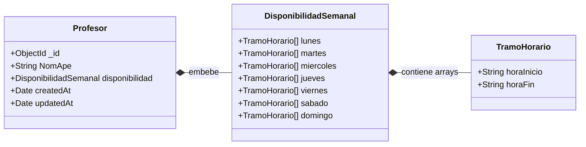
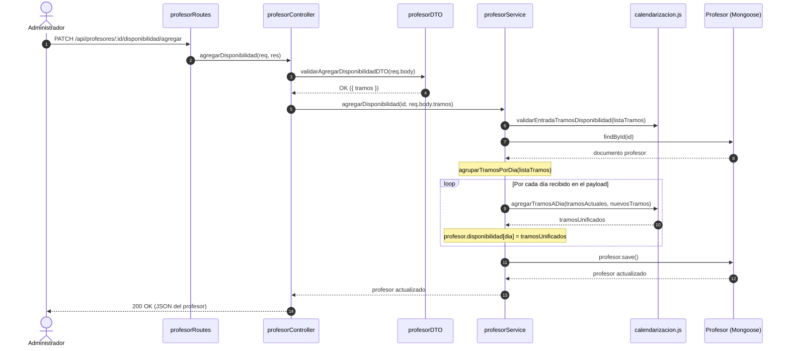

# 03 — Calendarización y Gestión de Disponibilidad (DriveAndLearn Backend)

Esta guía explica en detalle cómo opera el motor de calendarización de **DriveAndLearn**, las reglas de negocio de horarios e intervalos implementadas con **Luxon** en `src/services/helpers/calendarizacion.js`, y su integración en `src/services/profesorService.js` para administrar la disponibilidad semanal de los profesores.

---

## 1. Principios de Dominio y Decisiones de Diseño

La escuela de manejo requiere sincronizar agendas cíclicas semanales (profesores) con reservas concretas en fechas de calendario (clases prácticas). Para evitar problemas de zonas horarias y ambigüedades de cálculo, el proyecto sigue dos directrices arquitectónicas:

1. **Almacenamiento en Hora Local (Sin Conversión a UTC):**
   - Las clases prácticas se almacenan en MongoDB como `String` en formato ISO local en horas en punto: **`"YYYY-MM-DDTHH:00"`** (ejemplo: `"2026-11-03T10:00"` a `"2026-11-03T11:00"`).
   - Este formato lexicográfico preserva el orden cronológico directo en consultas de MongoDB y permite a **Luxon** parsear fechas locales con `DateTime.fromISO(...)` sin sufrir desplazamientos arbitrarios por huso horario.
2. **Disponibilidad Semanal Cíclica y Desacoplada:**
   - La disponibilidad de un profesor es una plantilla semanal recurrente que abarca de `lunes` a `domingo`.
   - Cada día contiene un array de tramos `{ horaInicio, horaFin }` expresados en horas en punto (formato `"HH:00"`).

---

## 2. Reglas de Negocio de Horarios e Intervalos

| Regla | Parámetro / Restricción | Explicación en el Dominio |
| :--- | :--- | :--- |
| **Horas en punto** | `REGEX_HORA_EN_PUNTO`<br/>`/^(?:[01]\d\|2[0-3]):00$\|^24:00$/` | Toda hora de inicio o fin debe ser en punto (`:00`) entre `"00:00"` y `"24:00"`. No se admiten minutos parciales (ej. `"08:30"` es inválido). |
| **Cierre de día (`24:00`)** | `HORA_CIERRE_DIA = '24:00'` | Convención adoptada para representar la medianoche de cierre del día calendario, permitiendo tramos que cubran hasta el último minuto del día sin saltar a `"00:00"` de forma ambigua. |
| **Duración mínima de tramo** | `MIN_DURACION_TRAMO_HORAS = 1` | Todo tramo de disponibilidad debe durar al menos **1 hora completa**. Esto impide tramos de 0 minutos (`horaInicio === horaFin`) o tramos invertidos (`horaInicio > horaFin`), bloqueando inicios a las `"24:00"` o cierres a las `"00:00"`. |
| **Duración fija de clase** | `DURACION_CLASE_HORAS = 1` | Toda clase práctica dura exactamente **1 hora** (`60 minutos`). |
| **Fechas de clase en punto** | `REGEX_FECHA_HORA_EN_PUNTO`<br/>`/^\d{4}-\d{2}-\d{2}T(?:[01]\d\|2[0-3]):00$/` | `inicio` y `fin` de una clase deben ser cadenas ISO locales válidas en el calendario real y en horas en punto. |

---

## 3. Modelo de Disponibilidad del Profesor

La disponibilidad semanal está modelada en Mongoose mediante dos esquemas anidados:

1. **`tramoHorarioSchema` (`src/models/tramoHorario.js`):** Subdocumento con los campos `horaInicio` y `horaFin` (`String`, `required: true`).
2. **`disponibilidadSemanalSchema` (`src/models/disponibilidadSemanal.js`):** Subdocumento que contiene las propiedades `lunes`, `martes`, `miercoles`, `jueves`, `viernes`, `sabado` y `domingo`, cada una tipada como un array de `tramoHorarioSchema` inicializado en `[]`.



> [!IMPORTANT]
> **Aislamiento en altas y modificaciones generales:**
> Un profesor **no puede** recibir ni modificar su `disponibilidad` mediante las funciones `crear` ni `actualizar` del servicio (si el cuerpo incluye la propiedad `disponibilidad`, el servicio lanza inmediatamente `ErrorDeNegocio`).
> La disponibilidad se inicializa siempre vacía (`[]` para cada día) y su gestión se realiza exclusivamente mediante endpoints semánticos dedicados:
> - `GET /api/profesores/:id/disponibilidad` (`verDisponibilidad`)
> - `PATCH /api/profesores/:id/disponibilidad/agregar` (`agregarDisponibilidad`)
> - `PATCH /api/profesores/:id/disponibilidad/quitar` (`quitarDisponibilidad`)

---

## 4. El Motor de Calendarización (`src/services/helpers/calendarizacion.js`)

Este archivo encapsula toda la matemática de intervalos utilizando la librería **Luxon** (`DateTime`, `Interval`).

### 4.1. Proyección sobre el Día Base de Referencia (`DIA_BASE_REFERENCIA`)

Los tramos de disponibilidad semanal son abstractos (no tienen una fecha fija asociada). Para operar sobre ellos con Luxon, se proyectan sobre una fecha real arbitraria:

```javascript
const DIA_BASE_REFERENCIA = DateTime.fromISO('2026-01-05T00:00'); // Lunes real
```

#### Conversión Bidireccional Tramo ⇄ Interval:

1. **`crearIntervaloDeTramo(diaBaseDateTime, tramo)`:**
   - Toma `diaBaseDateTime.startOf('day')` y suma `horasInicio` y `horasFin`.
   - Si `horaFin` es `"24:00"`, Luxon avanza 24 horas exactas y coloca el fin del intervalo a las `"00:00"` del día siguiente sin fallar.
   - Retorna una instancia `Interval.fromDateTimes(fechaInicio, fechaFin)`.

2. **`convertirIntervaloATramo(diaBaseDateTime, intervalo)`:**
   - Convierte el `Interval` de vuelta a un objeto plano `{ horaInicio, horaFin }`.
   - **Restitución de medianoche:** Si el final del intervalo coincide exactamente con el inicio del día siguiente (`diaBaseDateTime.startOf('day').plus({ days: 1 })`), se restituye como `"24:00"`.

---

### 4.2. Validación de Entrada (`validarEntradaTramosDisponibilidad`)

Verifica los tramos enviados desde el DTO antes de alterar cualquier entidad:
- Comprueba que la entrada sea un array con al menos un elemento.
- Comprueba que cada elemento tenga un `dia` válido perteneciente a `DIAS_SEMANA`.
- Valida cada `tramoHorario` mediante `validarTramoHorario`:
  - `horaInicio` y `horaFin` deben cumplir el regex en punto.
  - La duración resultante en `Interval` debe ser mayor o igual a `MIN_DURACION_TRAMO_HORAS` (`1 hora`).

---

### 4.3. Unificación al Agregar: `agregarTramosADia` (`Interval.merge`)

Cuando se asignan nuevos tramos a un día determinado, no se guardan como franjas fragmentadas. Se combinan con los tramos existentes utilizando `Interval.merge()` de Luxon:

```javascript
export function agregarTramosADia(tramosExistentes, nuevosTramos) {
  const todosLosTramos = [...tramosExistentes, ...nuevosTramos];
  const intervalos = todosLosTramos.map((tramo) =>
    crearIntervaloDeTramo(DIA_BASE_REFERENCIA, tramo)
  );

  const intervalosUnificados = Interval.merge(intervalos);

  return intervalosUnificados.map((intervalo) =>
    convertirIntervaloATramo(DIA_BASE_REFERENCIA, intervalo)
  );
}
```

#### Comportamiento de `Interval.merge()`:
- **Tramos superpuestos:** Se funden en un único intervalo continuo.
  - *Ejemplo:* `08:00–12:00` + `10:00–14:00` → `08:00–14:00`.
- **Tramos contiguos:** Al tocarse exactamente en el borde, se unifican.
  - *Ejemplo:* `08:00–12:00` + `12:00–16:00` → `08:00–16:00`.
- **Tramos disjuntos:** Se conservan separados y quedan automáticamente ordenados por hora de inicio.
  - *Ejemplo:* `18:00–22:00` + `08:00–12:00` → `[08:00–12:00, 18:00–22:00]`.

---

### 4.4. Sustracción y División al Quitar: `quitarTramosDeDia` (`interval.difference`)

Permite recortar o dar de baja tramos horarios utilizando el método `difference()` de Luxon:

```javascript
export function quitarTramosDeDia(tramosExistentes, tramosAQuitar) {
  const intervalosExistentes = tramosExistentes.map((tramo) =>
    crearIntervaloDeTramo(DIA_BASE_REFERENCIA, tramo)
  );
  const intervalosAQuitar = tramosAQuitar.map((tramo) =>
    crearIntervaloDeTramo(DIA_BASE_REFERENCIA, tramo)
  );

  const intervalosResultantes = intervalosExistentes.flatMap(
    (intervaloExistente) => intervaloExistente.difference(...intervalosAQuitar)
  );

  return Interval.merge(intervalosResultantes).map((intervalo) =>
    convertirIntervaloATramo(DIA_BASE_REFERENCIA, intervalo)
  );
}
```

#### Comportamiento de `interval.difference()`:
- **Recorte en los extremos:** Reduce el inicio o el fin del tramo.
  - *Ejemplo:* De `08:00–14:00` se quita `12:00–14:00` → Queda `08:00–12:00`.
- **Eliminación total:** Si el tramo a quitar cubre por completo al tramo existente, este desaparece.
  - *Ejemplo:* De `08:00–12:00` se quita `07:00–13:00` → Queda vacío `[]`.
- **División intermedia (*split*):** Si se sustrae una franja central, el tramo original se divide automáticamente en dos.
  - *Ejemplo:* De `08:00–14:00` se quita `10:00–12:00` → Quedan `08:00–10:00` y `12:00–14:00`.

---

### 4.5. Validación de Clases y Verificación de Disponibilidad

El helper también contiene las funciones requeridas para la reserva de clases:

#### 1. `validarIntervaloDeClase(inicioStr, finStr)`
- Parsea ambos strings con `parsearFechaHoraClase` (garantizando formato `"YYYY-MM-DDTHH:00"` y fecha válida en el calendario real).
- Crea un `Interval` con las dos fechas y valida que su duración en horas sea exactamente igual a `DURACION_CLASE_HORAS` (`1`).

#### 2. `estaDentroDeDisponibilidad(disponibilidad, inicioStr, finStr)`
Verifica si el intervalo de la clase solicitada queda totalmente cubierto (`engulfs`) por la disponibilidad del profesor asignado.

> [!NOTE]
> **Continuidad en Medianoche y Ventana de 3 Días:**
> Para resolver casos donde una clase inicia a las `23:00` y finaliza a las `00:00` del día siguiente, o donde el profesor tiene disponibilidad desde las `20:00` a `24:00` y el día siguiente de `00:00` a `04:00`, la función auxiliar `proyectarDisponibilidadEnVentana` proyecta los tramos sobre una ventana de tres días:
> `[diaCentral.minus({ days: 1 }), diaCentral, diaCentral.plus({ days: 1 })]`.
> Al aplicar `Interval.merge()` sobre esta ventana, Luxon une automáticamente los tramos contiguos a través de la medianoche, permitiendo que `bloque.engulfs(intervaloClase)` funcione sin importar el límite de día.

#### 3. `obtenerTurnosDeUnaHora(intervalo)`
Divide un intervalo cualquiera en bloques discretos de 1 hora mediante `intervalo.splitBy({ hours: DURACION_CLASE_HORAS })`.

---

## 5. Integración en `profesorService.js`

El servicio `src/services/profesorService.js` actúa como orquestador de negocio: valida el estado del profesor, agrupa los tramos recibidos y delega la matemática al helper `calendarizacion.js`.

### 5.1. Flujo de Ejecución al Asignar / Quitar Disponibilidad



### 5.2. Métodos Clave del Servicio

#### `agruparTramosPorDia(listaTramos)`
Convierte el array plano recibido desde la API en un mapa indexado por nombre de día:
```javascript
function agruparTramosPorDia(listaTramos) {
  return listaTramos.reduce((acumulador, { dia, tramoHorario }) => {
    if (!acumulador[dia]) {
      acumulador[dia] = [];
    }
    acumulador[dia].push(tramoHorario);
    return acumulador;
  }, {});
}
```

#### `agregarDisponibilidad(id, listaTramos)`
1. Valida el formato y horas con `validarEntradaTramosDisponibilidad(listaTramos)`.
2. Busca al profesor con `obtenerProfesorExistente(id)` (lanza `ErrorRegistroInexistente` si no existe).
3. Agrupa los tramos por día con `agruparTramosPorDia`.
4. Itera sobre cada día afectado, invoca `agregarTramosADia(tramosActuales, nuevosTramos)` y asigna el resultado a `profesor.disponibilidad[dia]`.
5. Ejecuta `await profesor.save()` para persistir el subdocumento en MongoDB y devuelve el documento actualizado.

#### `quitarDisponibilidad(id, listaTramos)`
1. Valida con `validarEntradaTramosDisponibilidad(listaTramos)`.
2. Busca al profesor con `obtenerProfesorExistente(id)`.
3. Agrupa los tramos con `agruparTramosPorDia`.
4. Itera sobre cada día afectado, invoca `quitarTramosDeDia(tramosActuales, tramosAQuitar)` y reasigna `profesor.disponibilidad[dia]`.
5. Ejecuta `await profesor.save()` y devuelve el documento actualizado.

---

## 6. Casos Prácticos de Transformación de Tramos

| Operación | Disponibilidad Previa del Día | Tramo(s) Enviado(s) | Resultado Final en la Base de Datos |
| :--- | :--- | :--- | :--- |
| **Agregar (nuevo día)** | `[]` | `{ horaInicio: "08:00", horaFin: "14:00" }` | `[{ horaInicio: "08:00", horaFin: "14:00" }]` |
| **Agregar (superposición parcial)** | `[{ horaInicio: "08:00", horaFin: "14:00" }]` | `{ horaInicio: "06:00", horaFin: "10:00" }` | `[{ horaInicio: "06:00", horaFin: "14:00" }]` |
| **Agregar (tramo contiguo)** | `[{ horaInicio: "08:00", horaFin: "12:00" }]` | `{ horaInicio: "12:00", horaFin: "18:00" }` | `[{ horaInicio: "08:00", horaFin: "18:00" }]` |
| **Agregar (disjunto)** | `[{ horaInicio: "08:00", horaFin: "12:00" }]` | `{ horaInicio: "16:00", horaFin: "20:00" }` | `[{ horaInicio: "08:00", horaFin: "12:00" }, { horaInicio: "16:00", horaFin: "20:00" }]` |
| **Agregar (hasta medianoche)** | `[{ horaInicio: "18:00", horaFin: "20:00" }]` | `{ horaInicio: "20:00", horaFin: "24:00" }` | `[{ horaInicio: "18:00", horaFin: "24:00" }]` |
| **Quitar (recorte de inicio)** | `[{ horaInicio: "08:00", horaFin: "14:00" }]` | `{ horaInicio: "08:00", horaFin: "10:00" }` | `[{ horaInicio: "10:00", horaFin: "14:00" }]` |
| **Quitar (recorte de fin)** | `[{ horaInicio: "08:00", horaFin: "14:00" }]` | `{ horaInicio: "12:00", horaFin: "14:00" }` | `[{ horaInicio: "08:00", horaFin: "12:00" }]` |
| **Quitar (división intermedia / split)** | `[{ horaInicio: "08:00", horaFin: "14:00" }]` | `{ horaInicio: "10:00", horaFin: "12:00" }` | `[{ horaInicio: "08:00", horaFin: "10:00" }, { horaInicio: "12:00", horaFin: "14:00" }]` |
| **Quitar (cobertura total)** | `[{ horaInicio: "08:00", horaFin: "12:00" }]` | `{ horaInicio: "06:00", horaFin: "14:00" }` | `[]` |
