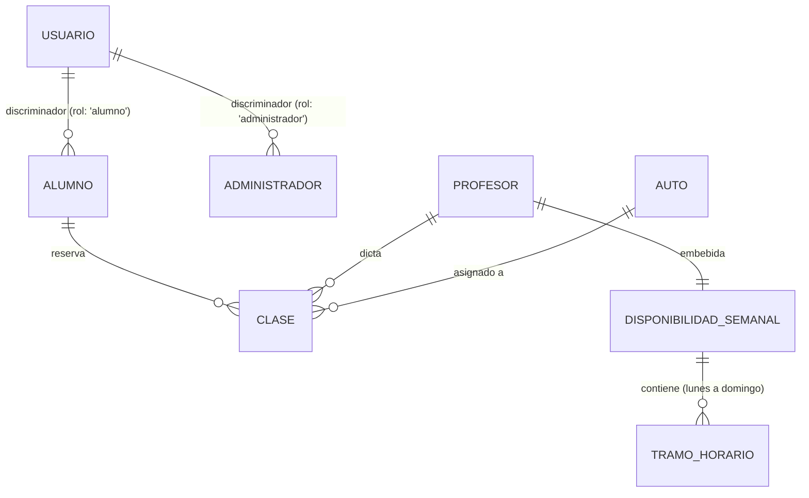

# Guía de Modelos (DriveAndLearn Backend)

Esta guía documenta la capa **Model** dentro de la arquitectura de **DriveAndLearn**, sus principios de diseño, esquemas de persistencia en MongoDB/Mongoose, validaciones declarativas, subdocumentos y el detalle técnico de cada modelo implementado.

---

## 1. Principios de Diseño de la Capa Model

1. **Responsabilidad Única (SRP):** Define exclusivamente los esquemas de Mongoose (`mongoose.Schema`), tipos de datos almacenados en MongoDB, restricciones estructurales (`required`, `unique`, `match`, `min`, `enum`), índices y transformaciones de serialización (`toJSON`).
2. **Sin lógica de aplicación:** Un modelo nunca orquesta casos de uso de negocio ni se acopla a peticiones HTTP. La lógica de negocio reside estrictamente en los **Services**.
3. **Herencia mediante Discriminadores:** Permite modelar jerarquías sobre una única colección física (`Usuario` como esquema base en `usuarios`, con discriminadores para `Alumno` y `Administrador` distinguidos por la clave `rol`).
4. **Sanitización Automática (`toJSON`):** Todos los esquemas configuran la función `toJSON.transform` para omitir propiedades técnicas internas de MongoDB (`__v`) y credenciales confidenciales (`password`).
5. **Subdocumentos sin `_id`:** Los esquemas anidados de calendarización (`tramoHorario.js` y `disponibilidadSemanal.js`) se configuran con `{ _id: false }` para evitar identificadores innecesarios y optimizar el almacenamiento.
6. **Purga Automática mediante Índices TTL:** Se aprovecha el hilo de monitoreo TTL de MongoDB para eliminar documentos expirados de forma desatendida (`TokenRevocado`).

---

## 2. Modelos y Subesquemas Implementados

### 2.1. `Usuario.js` (Modelo Base)

- **Colección en MongoDB:** `usuarios`
- **Discriminator Key:** `rol`
- **Archivo:** `src/models/Usuario.js`

Esquema base que nuclea la información común de cuentas de usuario en el sistema.

| Campo | Tipo | Restricciones / Validaciones | Descripción |
| :--- | :--- | :--- | :--- |
| **`NomApe`** | `String` | `required`, `trim`, `minlength: 4`, `maxlength: 50` | Nombre y apellido del usuario. |
| **`email`** | `String` | `required`, `lowercase`, `unique`, `trim`, `match: /^[^\s@]+@[^\s@]+\.[^\s@]+$/` | Correo electrónico único para inicio de sesión. |
| **`password`** | `String` | `required` | Contraseña hasheada con `bcrypt` (10 rondas de salt). |
| **`rol`** | `String` | `required`, `enum: ROLES_ENUM` (`'administrador'`, `'alumno'`) | Clave discriminadora del tipo de usuario. |
| **`createdAt`** | `Date` | Automático (`timestamps: true`) | Fecha de registro. |
| **`updatedAt`** | `Date` | Automático (`timestamps: true`) | Fecha de última modificación. |

- **Serialización (`toJSON`):** Elimina automáticamente `ret.password` y `ret.__v`.

---

### 2.2. `Administrador.js` (Discriminador)

- **Colección en MongoDB:** `usuarios` (discriminador sobre `Usuario`)
- **Rol Asignado:** `ROLES.ADMINISTRADOR` (`'administrador'`)
- **Archivo:** `src/models/Administrador.js`

Extiende el modelo `Usuario` para representar las cuentas con privilegios administrativos (gestión de flota, profesores, asignación de créditos de clases y auditoría de clases).

```javascript
const Administrador = Usuario.discriminator(
  'Administrador',
  administradorSchema,
  ROLES.ADMINISTRADOR
);
```

---

### 2.3. `Alumno.js` (Discriminador)

- **Colección en MongoDB:** `usuarios` (discriminador sobre `Usuario`)
- **Rol Asignado:** `ROLES.ALUMNO` (`'alumno'`)
- **Archivo:** `src/models/Alumno.js`

Extiende el modelo `Usuario` incorporando el control del saldo prepago de clases prácticas de manejo.

| Campo Adicional | Tipo | Restricciones / Validaciones | Descripción |
| :--- | :--- | :--- | :--- |
| **`saldoClases`** | `Number` | `required`, `default: 0`, `min: 0`, validador `Number.isInteger` | Créditos disponibles para agendar clases prácticas. Debe ser un número entero mayor o igual a cero. |

---

### 2.4. `Auto.js`

- **Colección en MongoDB:** `autos`
- **Archivo:** `src/models/Auto.js`

Representa los vehículos de la flota de la escuela de manejo utilizados en las clases prácticas.

| Campo | Tipo | Restricciones / Validaciones | Descripción |
| :--- | :--- | :--- | :--- |
| **`marca`** | `String` | `required`, `trim` | Marca del vehículo (ej. `"Toyota"`, `"Chevrolet"`). |
| **`modelo`** | `String` | `required`, `trim` | Modelo del vehículo (ej. `"Etios"`, `"Onix"`). |
| **`patente`** | `String` | `required`, `unique`, `uppercase`, `trim`, `match: /^([A-Z]{3}\d{3}\|[A-Z]{2}\d{3}[A-Z]{2})$/` | Patente oficial argentina: formato tradicional (`ABC123`) o Mercosur (`AB123CD`). |
| **`cambios`** | `String` | `required`, `uppercase`, `trim`, `enum: CAMBIOS_ENUM` (`'MANUAL'`, `'AUTOMATICO'`) | Tipo de transmisión del vehículo. |
| **`createdAt`** | `Date` | Automático (`timestamps: true`) | Fecha de alta en la flota. |
| **`updatedAt`** | `Date` | Automático (`timestamps: true`) | Última modificación. |

- **Serialización (`toJSON`):** Elimina `ret.__v`.
- **Preservación Histórica:** La entidad no contiene campos de borrado lógico ni expone eliminación física para salvaguardar las clases pasadas.

---

### 2.5. `Profesor.js`

- **Colección en MongoDB:** `profesores`
- **Archivo:** `src/models/Profesor.js`

Representa a los instructores de manejo y su disponibilidad horaria semanal.

| Campo | Tipo | Restricciones / Validaciones | Descripción |
| :--- | :--- | :--- | :--- |
| **`NomApe`** | `String` | `required`, `trim`, `minlength: 4`, `maxlength: 50` | Nombre y apellido del profesor. |
| **`disponibilidad`** | `disponibilidadSemanalSchema` | `required`, `default: () => ({})` | Subdocumento embebido con la disponibilidad semanal cíclica de `lunes` a `domingo`. |
| **`createdAt`** | `Date` | Automático (`timestamps: true`) | Fecha de registro. |
| **`updatedAt`** | `Date` | Automático (`timestamps: true`) | Última modificación. |

- **Serialización (`toJSON`):** Elimina `ret.__v`.

---

### 2.6. Subesquemas de Calendarización (`tramoHorario.js` y `disponibilidadSemanal.js`)

#### A. `tramoHorario.js`
- **Archivo:** `src/models/tramoHorario.js`
- **Configuración:** `{ _id: false }`

Subdocumento que define un bloque continuo de disponibilidad horaria dentro de un día:

| Campo | Tipo | Restricciones / Validaciones | Descripción |
| :--- | :--- | :--- | :--- |
| **`horaInicio`** | `String` | `required`, `trim`, `match: /^([01]\d\|2[0-3]):[0-5]\d$/` | Hora de inicio en formato `"HH:MM"` (`00:00` a `23:59`). |
| **`horaFin`** | `String` | `required`, `trim`, `match: /^(([01]\d\|2[0-3]):[0-5]\d\|24:00)$/` | Hora de fin en formato `"HH:MM"` (`00:00` a `24:00`). |

#### B. `disponibilidadSemanal.js`
- **Archivo:** `src/models/disponibilidadSemanal.js`
- **Configuración:** `{ _id: false }`

Subdocumento que agrupa los tramos de cada día de la semana como arrays de `tramoHorarioSchema`:
- **Propiedades:** `lunes`, `martes`, `miercoles`, `jueves`, `viernes`, `sabado`, `domingo`.
- **Tipo de cada propiedad:** `[tramoSchema]`, con valor por defecto `[]`.

---

### 2.7. `Clase.js`

- **Colección en MongoDB:** `clases`
- **Archivo:** `src/models/Clase.js`

Representa una clase práctica de manejo reservada para un día y horario concreto, vinculando a un alumno, un profesor y un auto.

| Campo | Tipo | Restricciones / Validaciones | Descripción |
| :--- | :--- | :--- | :--- |
| **`alumno`** | `mongoose.Schema.Types.ObjectId` | `required`, `ref: 'Alumno'` | Identificador del alumno que toma la clase. |
| **`profesor`** | `mongoose.Schema.Types.ObjectId` | `required`, `ref: 'Profesor'` | Identificador del profesor que dicta la clase. |
| **`auto`** | `mongoose.Schema.Types.ObjectId` | `required`, `ref: 'Auto'` | Identificador del vehículo asignado a la clase. |
| **`inicio`** | `String` | `required`, `trim`, `match: /^\d{4}-(0[1-9]\|1[0-2])-(0[1-9]\|[12]\d\|3[01])T([01]\d\|2[0-3]):[0-5]\d$/` | Fecha y hora local de inicio de la clase en formato `"YYYY-MM-DDTHH:MM"` (ej. `"2026-11-20T10:00"`). |
| **`fin`** | `String` | `required`, `trim`, `match: /^\d{4}-(0[1-9]\|1[0-2])-(0[1-9]\|[12]\d\|3[01])T([01]\d\|2[0-3]):[0-5]\d$/` | Fecha y hora local de fin de la clase en formato `"YYYY-MM-DDTHH:MM"` (ej. `"2026-11-20T11:00"`). |
| **`createdAt`** | `Date` | Automático (`timestamps: true`) | Marca temporal de reserva. |
| **`updatedAt`** | `Date` | Automático (`timestamps: true`) | Marca temporal de última modificación. |

- **Serialización (`toJSON`):** Elimina `ret.__v`.
- **Formato ISO Local:** Persistir `inicio` y `fin` como cadenas ISO locales preserva el orden lexicográfico directo y permite consultas rápidas por día (`$regex: '^YYYY-MM-DDT'`) o por intervalos sin sufrir corrimientos por husos horarios UTC.

---

### 2.8. `TokenRevocado.js`

- **Colección en MongoDB:** `tokens_revocados`
- **Archivo:** `src/models/TokenRevocado.js`

Almacena los tokens JWT invalidados activamente durante el cierre de sesión (`POST /api/auth/logout`) para impedir su reutilización.

| Campo | Tipo | Restricciones / Validaciones | Descripción |
| :--- | :--- | :--- | :--- |
| **`token`** | `String` | `required`, `unique: true`, `trim: true` | Cadena de texto del token JWT revocado. |
| **`expiraEn`** | `Date` | `required` | Fecha exacta en la que el token expira naturalmente (extraída del claim `exp` del JWT). |
| **`createdAt`** | `Date` | Automático (`timestamps: true`) | Momento en el que se efectuó el logout. |
| **`updatedAt`** | `Date` | Automático (`timestamps: true`) | Última modificación. |

#### Optimización con Índice TTL (*Time-To-Live*):

```javascript
tokenRevocadoSchema.index({ expiraEn: 1 }, { expireAfterSeconds: 0 });
```

- **Mecanismo:** El hilo de fondo de MongoDB (*TTL background thread*) inspecciona el índice y elimina automáticamente los documentos en cuanto la fecha actual del sistema supera el valor de `expiraEn`.
- **Beneficio:** Garantiza una lista negra libre de fugas de memoria o crecimiento descontrolado de la base de datos sin requerir cron jobs ni scripts adicionales.
- **Serialización (`toJSON`):** Elimina `ret.__v`.

---

## 3. Diagrama de Relaciones de Dominio


