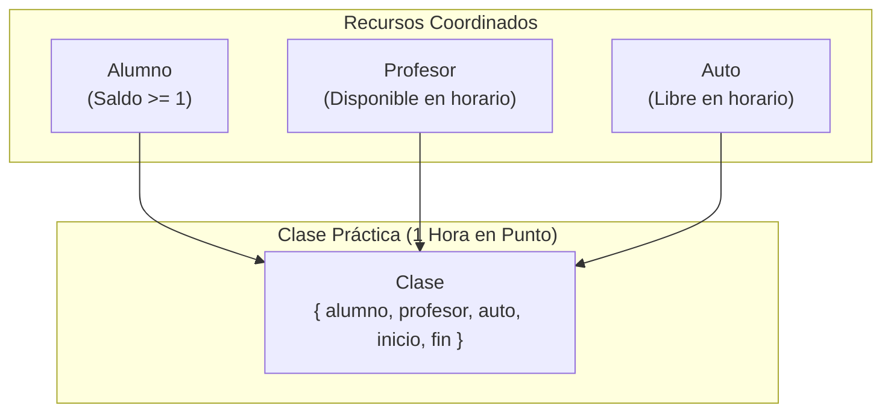
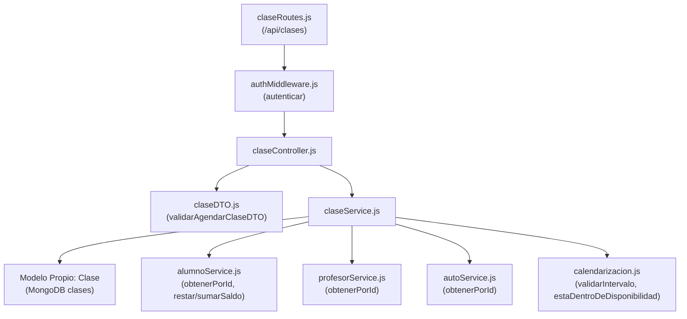
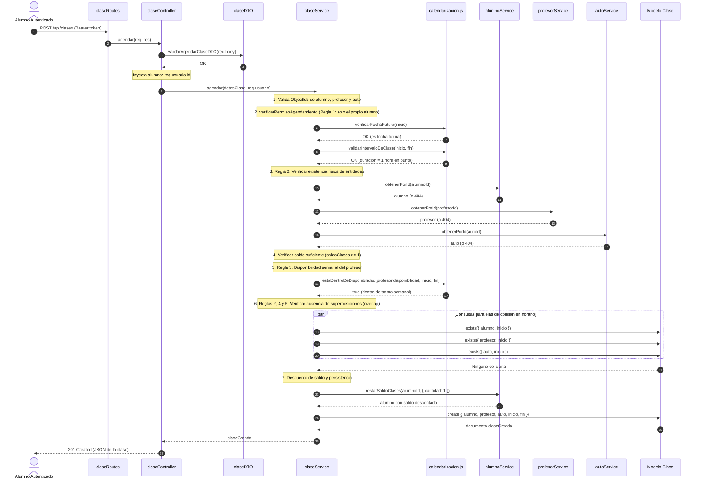
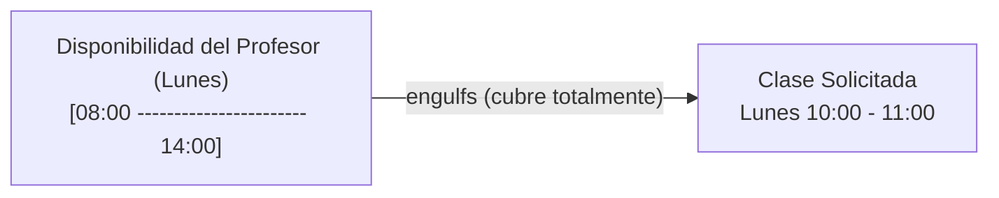

# Flujo de Asignación y Eliminación de Clases

Esta guía describe exhaustivamente el ciclo de vida de las **clases prácticas de manejo** en **DriveAndLearn**, detallando el proceso de reserva (*agendamiento*), la política de cancelación y restitución de saldo, el control de acceso basado en roles (RBAC), el desacoplamiento entre servicios y el funcionamiento del motor de **calendarización** en hora local con **Luxon**.

---

## 1. Visión General y Reglas de Negocio

Una clase práctica representa una sesión de instrucción de manejo de **exactamente 1 hora en punto** que coordina tres recursos fundamentales del sistema:
- Un **Alumno** (quien toma la clase y consume un crédito de su saldo).
- Un **Profesor** (quien imparte la clase según su disponibilidad semanal).
- Un **Auto** de la flota (vehículo asignado para la práctica).



### 1.1. Principios Clave de Diseño

1. **Almacenamiento en Hora Local (Sin Desplazamiento UTC):**
   - Los campos `inicio` y `fin` se almacenan en MongoDB como `String` en formato ISO local: **`"YYYY-MM-DDTHH:00"`** (ej. `"2026-11-09T10:00"` a `"2026-11-09T11:00"`).
   - Evita desfasajes arbitrarios provocados por conversiones a UTC o cambios de huso horario/horario de verano.
   - Permite búsquedas directas y comparaciones lexicográficas exactas en la base de datos.
2. **Duración Fija y Fechas Futuras:**
   - Toda clase dura obligatoriamente **60 minutos exactos** (`DURACION_CLASE_HORAS = 1`).
   - La fecha y hora de inicio debe ser estrictamente posterior al momento actual (`verificarFechaFutura`). Está prohibido agendar clases en el pasado.
3. **Aislamiento e Inyección de Identidad (Seguridad):**
   - El cliente **no envía** el campo `alumno` en el cuerpo JSON de la petición.
   - El DTO `validarAgendarClaseDTO` rechaza explícitamente el campo `alumno` para impedir suplantación de identidad.
   - El controlador inyecta el ID verificado a partir del token JWT (`req.usuario.id`).
4. **Desacoplamiento Absoluto entre Servicios (SRP):**
   - `claseService.js` **no interactúa directamente** con las colecciones ni modelos Mongoose `Alumno`, `Profesor` ni `Auto`.
   - Toda consulta de existencia física, disponibilidad semanal o modificación de saldo se delega a `alumnoService`, `profesorService` y `autoService`.
5. **Transaccionalidad Lógica de Créditos:**
   - Agendar una clase resta de inmediato `1` crédito del `saldoClases` del alumno.
   - Cancelar una clase reintegra de inmediato `1` crédito al alumno.

---

## 2. Modelo de Datos Mongoose (`Clase.js`)

El modelo `Clase` (`src/models/Clase.js`) define la persistencia de las reservas en la colección `clases`:

```javascript
const claseSchema = new mongoose.Schema(
  {
    alumno: {
      type: mongoose.Schema.Types.ObjectId,
      ref: 'Alumno',
      required: [true, 'El alumno es obligatorio'],
    },
    profesor: {
      type: mongoose.Schema.Types.ObjectId,
      ref: 'Profesor',
      required: [true, 'El profesor es obligatorio'],
    },
    auto: {
      type: mongoose.Schema.Types.ObjectId,
      ref: 'Auto',
      required: [true, 'El auto es obligatorio'],
    },
    inicio: {
      type: String,
      required: [true, 'La fecha y hora de inicio es obligatoria'],
      match: [/^\d{4}-\d{2}-\d{2}T(?:[01]\d|2[0-3]):00$/, 'Formato de inicio inválido'],
    },
    fin: {
      type: String,
      required: [true, 'La fecha y hora de fin es obligatoria'],
      match: [/^\d{4}-\d{2}-\d{2}T(?:[01]\d|2[0-3]):00$/, 'Formato de fin inválido'],
    },
  },
  { timestamps: true }
);
```

> [!NOTE]
> Al serializar a JSON, el modelo renombra `_id` a `id` y elimina automáticamente `__v`.

---

## 3. Arquitectura en Capas y Desacoplamiento

El caso de uso de agendamiento y cancelación involucra múltiples subsistemas coordinados por `claseService`:



---

## 4. Flujo de Asignación / Agendamiento (`agendar`)

El agendamiento orquesta un conjunto riguroso de reglas de negocio antes de persistir cualquier cambio en la base de datos.

### 4.1. Contrato HTTP

- **Método y Ruta:** `POST /api/clases`
- **Autenticación Requerida:** Sí (`Bearer <token_jwt>`)
- **Rol Autorizado:** `alumno` (para sí mismo)
- **Cuerpo JSON Enviado por el Cliente:**
  ```json
  {
    "profesor": "6727be05a3e14f828a2b5e01",
    "auto": "6727be05a3e14f828a2b5e02",
    "inicio": "2026-11-09T10:00",
    "fin": "2026-11-09T11:00"
  }
  ```

> [!IMPORTANT]
> **El campo `alumno` está prohibido en el JSON de entrada:**
> Si un cliente envía `"alumno": "..."` en el cuerpo de la solicitud, `validarAgendarClaseDTO` arroja de inmediato `ErrorCampoInvalido('Campos no permitidos: alumno')` (**`400 Bad Request`**).
> La identidad del alumno se inyecta de forma segura en `claseController.js`:
> ```javascript
> const datosClase = { ...req.body, alumno: req.usuario?.id };
> ```

---

### 4.2. Diagrama de Secuencia de Agendamiento



---

### 4.3. Las 6 Reglas de Negocio en la Asignación

Para consolidar una reserva, el servicio ejecuta la siguiente secuencia inquebrantable:

| Orden | Regla de Negocio | Función Responsable | Excepción en Caso de Fallo |
| :---: | :--- | :--- | :--- |
| **0** | **Validación Sintáctica de IDs:** `alumno`, `profesor` y `auto` deben ser ObjectId válidos. | `validarMongooseObjId` | `ErrorMongooseObjIdInvalido` (`400`) |
| **1** | **Autorización del Solicitante:** Solo un alumno puede agendar para sí mismo (`usuarioActual.id === alumnoId`). Un administrador u otro alumno no pueden agendar en esta etapa. | `verificarPermisoAgendamiento` | `ErrorAutorizacion` (`403`) |
| **2** | **Fecha Futura e Integridad Horaria:** La fecha/hora debe ser posterior a `DateTime.now()` y durar exactamente 1 hora en punto (`:00`). | `verificarFechaFutura`<br/>`validarIntervaloDeClase` | `ErrorDeNegocio` (`400`)<br/>`ErrorFormatoDeFecha` (`400`) |
| **3** | **Existencia Física de Entidades (SRP):** Alumno, profesor y auto deben existir previamente en la base de datos. | `verificarEntidadesExistentes` | `ErrorRegistroInexistente` (`404`) |
| **4** | **Saldo Disponible:** El alumno debe poseer `saldoClases >= 1`. | `verificarSaldoSuficiente` | `ErrorSaldoClasesInsuficiente` (`400`) |
| **5** | **Disponibilidad Semanal del Profesor:** El horario solicitado debe estar totalmente contenido en la disponibilidad semanal del profesor asignado. | `verificarDisponibilidadProfesor`<br/>(`estaDentroDeDisponibilidad`) | `ErrorDeNegocio` (`400`) |
| **6** | **Ausencia de Superposiciones (Overlap):** Ni el alumno, ni el profesor, ni el vehículo pueden tener otra clase agendada a esa misma fecha y hora. | `verificarSuperposiciones` | `ErrorDeNegocio` (`400`) |

---

## 5. Flujo de Cancelación y Eliminación (`eliminar`)

La cancelación permite liberar los recursos asignados (profesor y auto) y restituir automáticamente el saldo consumido al alumno.

### 5.1. Contrato HTTP

- **Método y Ruta:** `DELETE /api/clases/:id`
- **Autenticación Requerida:** Sí (`Bearer <token_jwt>`)
- **Roles Autorizados:**
  - `alumno`: Solo si la clase le pertenece (`clase.alumno.toString() === usuarioActual.id`).
  - `administrador`: Puede cancelar cualquier clase del sistema.

### 5.2. Diagrama de Secuencia de Cancelación

```mermaid
sequenceDiagram
    autonumber
    actor Actor as Alumno o Administrador
    participant Route as claseRoutes
    participant Ctrl as claseController
    participant Svc as claseService
    participant SAlum as alumnoService
    participant MClase as Modelo Clase

    Actor->>Route: DELETE /api/clases/:id (Bearer token)
    Route->>Ctrl: eliminar(req, res)
    Ctrl->>Svc: eliminar(id, req.usuario)

    Note over Svc: 1. validarMongooseObjId(id)
    Svc->>MClase: findById(id)
    MClase-->>Svc: documento clase (o null)
    
    alt Si la clase no existe
        Note over Svc: Lanza ErrorRegistroInexistente (404)
    end

    Note over Svc: 2. verificarActorValido(clase.alumno, usuarioActual)
    alt Si el actor es Alumno pero la clase es de otro alumno
        Note over Svc: Lanza ErrorAutorizacion (403)
    end

    Note over Svc: 3. Reintegro de saldo al alumno
    Svc->>SAlum: sumarSaldoClases(clase.alumno, { cantidad: 1 })
    SAlum-->>Svc: alumno actualizado (saldo + 1)

    Note over Svc: 4. Eliminación física del registro
    Svc->>MClase: findByIdAndDelete(id)
    MClase-->>Svc: documento eliminado

    Svc-->>Ctrl: clase
    Ctrl-->>Actor: 200 OK (JSON de la clase eliminada)
```

### 5.3. Reutilización con `verificarActorValido`

Para evitar código repetido y garantizar el cumplimiento estricto de los permisos de acceso en `eliminar` y `obtenerPorId`, se encapsula la validación en el helper interno:

```javascript
function verificarActorValido(
  alumnoIdClase,
  usuarioActual,
  mensaje = 'No tiene permisos para acceder a esta clase'
) {
  if (
    usuarioActual?.rol === ROLES.ALUMNO &&
    alumnoIdClase.toString() !== usuarioActual?.id?.toString()
  ) {
    throw new ErrorAutorizacion(mensaje);
  }
}
```

---

## 6. Flujos de Consulta y Lectura

### 6.1. Listado de Clases (`listar`)

- **Ruta:** `GET /api/clases`
- **Comportamiento según Rol:**
  - **Si el actor es `ALUMNO`:** El servicio intercepta la consulta y fuerza el filtro `{ alumno: usuarioActual.id }`. Un alumno **nunca puede ver clases de otros compañeros**.
  - **Si el actor es `ADMINISTRADOR`:** Puede visualizar la totalidad de las clases agendadas y aplicar filtros opcionales recibidos por query parameters (`req.query`).

### 6.2. Detalle de Clase (`obtenerPorId`)

- **Ruta:** `GET /api/clases/:id`
- **Comportamiento:**
  - Valida el `id` con `validarMongooseObjId`.
  - Si la clase no existe, devuelve `null` y el controlador responde `404 Not Found` (`{ mensaje: 'Clase no encontrada' }`).
  - Si la clase existe:
    - Aplica `verificarActorValido`: si quien consulta es un alumno y la clase pertenece a otro alumno, arroja `ErrorAutorizacion` (**`403 Forbidden`**).
    - Si es el propio alumno o un administrador, responde `200 OK` con el documento completo.

---

## 7. Calendarización: Evaluación de Disponibilidad y Superposición

El agendamiento depende críticamente de dos comprobaciones temporales calculadas por el motor de calendarización:

### 7.1. Comprobación de Disponibilidad Semanal (`estaDentroDeDisponibilidad`)



1. La clase solicita un intervalo puntual (ej. lunes de `10:00` a `11:00`).
2. Se extrae el día de la semana correspondiente a esa fecha mediante `DateTime.weekday`.
3. Se proyecta la disponibilidad semanal del profesor sobre una **ventana de 3 días** (`[diaAnterior, diaActual, diaSiguiente]`) utilizando `Interval.merge()`.
4. Se verifica si el intervalo de la clase queda totalmente contenido (`bloque.engulfs(intervaloClase)`) dentro de algún tramo unificado del profesor. Si no está cubierto, la clase es rechazada con `ErrorDeNegocio`.

### 7.2. Comprobación de Conflictos de Horario (Overlap)

Dado que cada clase dura exactamente 1 hora en punto, un conflicto de agenda se reduce matemáticamente a buscar cualquier clase preexistente que comparta el mismo valor exacto de `inicio`:

```javascript
const [claseAlumno, claseProfesor, claseAuto] = await Promise.all([
  Clase.exists({ alumno: alumnoId, inicio }),
  Clase.exists({ profesor: profesorId, inicio }),
  Clase.exists({ auto: autoId, inicio }),
]);
```

- Si `claseAlumno` existe → *"El alumno ya posee una clase agendada en ese horario"*
- Si `claseProfesor` existe → *"El profesor ya posee una clase asignada en ese horario"*
- Si `claseAuto` existe → *"El auto seleccionado ya se encuentra asignado a otra clase en ese horario"*

---

## 8. Matriz de Errores y Códigos de Respuesta HTTP

| Causa del Rechazo | Tipo de Error | Código HTTP | Mensaje de Respuesta |
| :--- | :--- | :---: | :--- |
| Enviar campo `alumno` en el cuerpo JSON | `ErrorCampoInvalido` | `400` | `"Campos no permitidos: alumno"` |
| Enviar tipos no string en `profesor`, `auto`, etc. | `ErrorDeTipo` | `400` | `"Tipos de datos incorrectos en: ..."` |
| ID con formato Mongoose inválido | `ErrorMongooseObjIdInvalido` | `400` | `"El id proporcionado no es un ObjectId válido de Mongoose"` |
| Alumno inexistente en MongoDB | `ErrorRegistroInexistente` | `404` | `"El alumno solicitado no existe"` |
| Profesor inexistente en MongoDB | `ErrorRegistroInexistente` | `404` | `"El profesor solicitado no existe"` |
| Auto inexistente en MongoDB | `ErrorRegistroInexistente` | `404` | `"El auto solicitado no existe"` |
| Saldo de clases insuficiente (`saldoClases < 1`) | `ErrorSaldoClasesInsuficiente` | `400` | `"El alumno no posee saldo de clases suficiente para agendar"` |
| Alumno intentando agendar para otro alumno | `ErrorAutorizacion` | `403` | `"Solo un alumno puede agendar clases para sí mismo"` |
| Administrador intentando agendar | `ErrorAutorizacion` | `403` | `"Solo un alumno puede agendar clases para sí mismo"` |
| Intentar agendar en fecha u hora pasada | `ErrorDeNegocio` | `400` | `"No se pueden agendar clases en fechas u horarios pasados"` |
| Fecha u hora no en punto (ej. `"10:30"`) | `ErrorFormatoDeFecha` | `400` | `"La fecha y hora de la clase debe tener el formato YYYY-MM-DDTHH:00 en punto"` |
| Duración distinta a 1 hora (ej. 2 horas) | `ErrorDeNegocio` | `400` | `"La clase debe durar exactamente 1 hora"` |
| Fuera de la disponibilidad semanal del profesor | `ErrorDeNegocio` | `400` | `"El horario seleccionado no se encuentra dentro de la disponibilidad del profesor"` |
| Superposición de horario en el alumno | `ErrorDeNegocio` | `400` | `"El alumno ya posee una clase agendada en ese horario"` |
| Superposición de horario en el profesor | `ErrorDeNegocio` | `400` | `"El profesor ya posee una clase asignada en ese horario"` |
| Superposición de horario en el vehículo | `ErrorDeNegocio` | `400` | `"El auto seleccionado ya se encuentra asignado a otra clase en ese horario"` |
| Alumno intentando cancelar clase ajena | `ErrorAutorizacion` | `403` | `"No tiene permisos para eliminar esta clase"` |
| Clase a eliminar o consultar no encontrada | `ErrorRegistroInexistente` / `null` | `404` | `"La clase solicitada no existe"` / `"Clase no encontrada"` |
