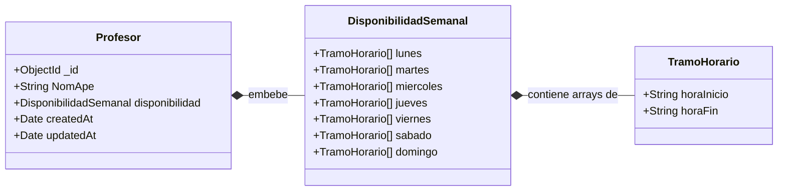
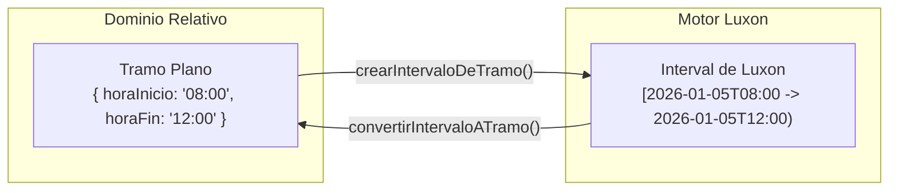
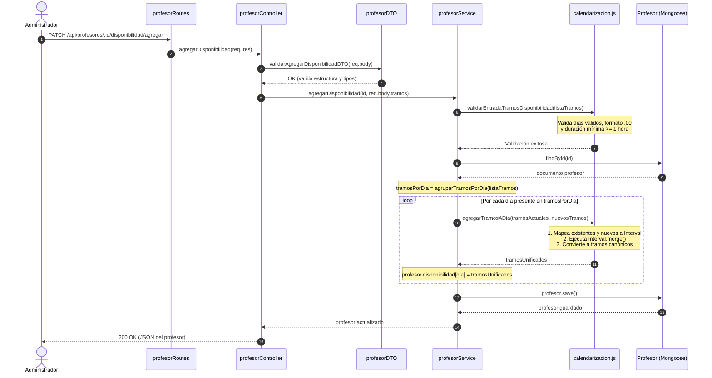
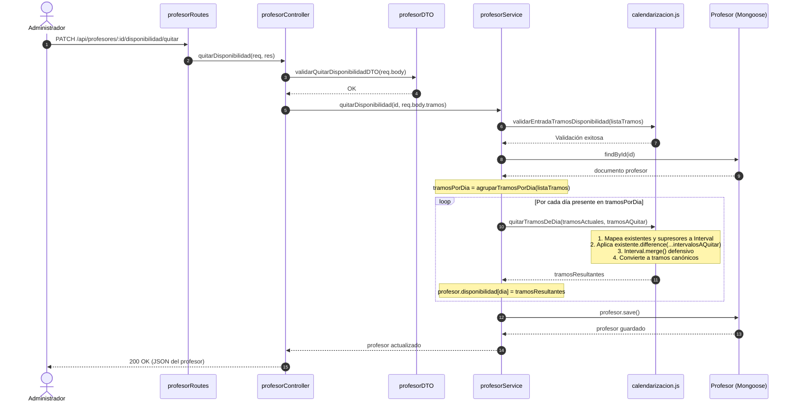
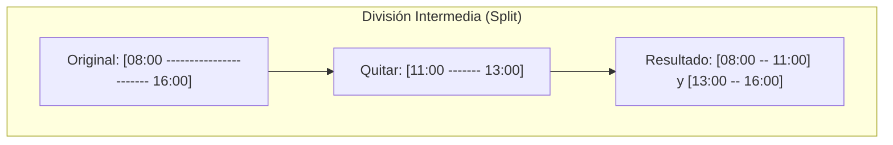

# Flujo de Asignación y Eliminación de Disponibilidad de Profesores

Esta guía describe en profundidad el flujo completo de gestión de la **disponibilidad semanal de los profesores** en **DriveAndLearn**, detallando el diseño de dominio, el contrato de la API REST, la arquitectura en capas y el funcionamiento matemático del motor de **calendarización** basado en **Luxon** (`src/services/helpers/calendarizacion.js`).

---

## 1. Visión General y Modelo de Dominio

En una escuela de manejo, los profesores no definen su trabajo por fechas concretas de calendario gregoriano (ej. "el 12 de noviembre de 2026"), sino a través de una **plantilla recurrente semanal** que abarca de **lunes a domingo**.

### 1.1. Principios de Diseño
1. **Disponibilidad Cíclica y Desacoplada:**
   - La disponibilidad representa el horario habitual de trabajo del profesor.
   - Cada día de la semana (`lunes`, `martes`, `miercoles`, `jueves`, `viernes`, `sabado`, `domingo`) almacena una lista ordenada de tramos horarios (`horaInicio` y `horaFin`).
   - Sirve como plantilla contra la cual se validan las reservas puntuales de clases prácticas (`clases`).
2. **Inmutabilidad en Altas y Modificaciones Generales:**
   - La disponibilidad **no puede asignarse ni modificarse** en los métodos generales `crear` ni `actualizar` del profesor (ambos rechazan la petición con `ErrorDeNegocio` si el cuerpo incluye la propiedad `disponibilidad`).
   - Al dar de alta un profesor, su disponibilidad se inicializa siempre vacía (`[]` para cada día).
   - La disponibilidad se administra exclusivamente mediante tres endpoints semánticos dedicados:
     - `GET /api/profesores/:id/disponibilidad` (`verDisponibilidad`)
     - `PATCH /api/profesores/:id/disponibilidad/agregar` (`agregarDisponibilidad`)
     - `PATCH /api/profesores/:id/disponibilidad/quitar` (`quitarDisponibilidad`)
3. **Formato Canónico y Horas en Punto (`:00`):**
   - Todos los tramos se configuran estrictamente en horas en punto (formato `"HH:00"`).
   - La duración mínima de cualquier tramo es de **1 hora completa** (`MIN_DURACION_TRAMO_HORAS = 1`).
   - El cierre del día calendario se representa con la convención canónica **`"24:00"`**, permitiendo cubrir hasta el último minuto de la jornada sin saltar ambiguamente a las `"00:00"`.

---

## 2. Esquema de Datos y Persistencia Mongoose

La disponibilidad está embebida en el documento del profesor a través de dos esquemas anidados:



### 2.1. Estructura de Subdocumentos

- **`tramoHorarioSchema` (`src/models/tramoHorario.js`):**
  ```javascript
  {
    horaInicio: { type: String, required: true },
    horaFin:    { type: String, required: true }
  }
  ```
- **`disponibilidadSemanalSchema` (`src/models/disponibilidadSemanal.js`):**
  Posee siete propiedades (de `lunes` a `domingo`), cada una definida como `[tramoHorarioSchema]` con valor predeterminado `[]`.

---

## 3. El Motor de Calendarización (`calendarizacion.js`)

La lógica matemática de cálculo, fusión y recorte de horarios reside exclusivamente en `src/services/helpers/calendarizacion.js`, apoyándose en las clases `DateTime` e `Interval` de **Luxon**.

### 3.1. Proyección sobre el Día Base de Referencia (`DIA_BASE_REFERENCIA`)

Los tramos semanales son relativos y no poseen una fecha gregoriana. Sin embargo, para operar matemáticamente con la librería Luxon (detectar superposiciones, calcular diferencias o unir franjas), se requiere proyectar los horarios sobre una fecha calendario real.

Para esto se define una fecha arbitraria que comienza un lunes:

```javascript
const DIA_BASE_REFERENCIA = DateTime.fromISO('2026-01-05T00:00'); // Lunes real
```

#### Conversión Bidireccional: Tramo ⇄ `Interval`



1. **`crearIntervaloDeTramo(diaBaseDateTime, tramo)`:**
   - Obtiene el inicio del día: `diaBaseDateTime.startOf('day')`.
   - Extrae las horas de inicio y fin como enteros numéricos.
   - Suma las horas a la fecha base:
     - `fechaInicio = inicioDia.plus({ hours: horasInicio })`
     - `fechaFin = inicioDia.plus({ hours: horasFin })`
   - Si `horaFin` es `"24:00"`, Luxon avanza 24 horas y sitúa el final en las `"00:00"` del día siguiente sin errores de validación.
   - Retorna una instancia de `Interval.fromDateTimes(fechaInicio, fechaFin)`.

2. **`convertirIntervaloATramo(diaBaseDateTime, intervalo)`:**
   - Formatea el inicio como `"HH:mm"`.
   - **Regla de Cierre de Día:** Si el final del intervalo coincide exactamente con las `"00:00"` del día siguiente (`diaBaseDateTime.startOf('day').plus({ days: 1 })`), se restituye como `"24:00"`.
   - De lo contrario, se formatea el fin como `"HH:mm"`.
   - Devuelve el objeto canónico `{ horaInicio, horaFin }`.

---

## 4. Flujo Detallado de Asignación (`agregarDisponibilidad`)

El objetivo de la asignación es incorporar nuevos tramos de trabajo a uno o más días de la semana, garantizando que el resultado final quede siempre unificado, ordenado cronológicamente y sin solapamientos redundantes.

### 4.1. Contrato HTTP

- **Método y Ruta:** `PATCH /api/profesores/:id/disponibilidad/agregar`
- **Autenticación / Roles:** Administrador
- **Cuerpo JSON Esperado:**
  ```json
  {
    "tramos": [
      {
        "dia": "lunes",
        "tramoHorario": {
          "horaInicio": "08:00",
          "horaFin": "12:00"
        }
      },
      {
        "dia": "lunes",
        "tramoHorario": {
          "horaInicio": "14:00",
          "horaFin": "18:00"
        }
      },
      {
        "dia": "miercoles",
        "tramoHorario": {
          "horaInicio": "10:00",
          "horaFin": "16:00"
        }
      }
    ]
  }
  ```

### 4.2. Diagrama de Secuencia de Asignación



### 4.3. Algoritmo de Unificación con `Interval.merge()` (`agregarTramosADia`)

La función `agregarTramosADia` combina los tramos preexistentes del día con los tramos nuevos:

```javascript
export function agregarTramosADia(tramosExistentes, nuevosTramos) {
  const todosLosTramos = [...tramosExistentes, ...nuevosTramos];
  const intervalos = todosLosTramos.map((tramo) =>
    crearIntervaloDeTramo(DIA_BASE_REFERENCIA, tramo)
  );

  const intervalosUnificados = Interval.merge(intervalos);

  return intervalosUnificados.map((intervalo) =>
    convertirIntervaloATramo(DIA_BASE_REFERENCIA, intervalo)
  );
}
```

#### Tipos de Comportamiento al Fusionar

1. **Tramos Superpuestos (Overlap):**
   - Cuando el nuevo tramo interseca total o parcialmente a uno existente, se funden en un único intervalo continuo.
   - *Ejemplo:* Si ya existía `08:00–12:00` y se agrega `10:00–14:00`, el resultado es `08:00–14:00`.
2. **Tramos Contiguos (Adyacentes):**
   - Cuando el fin de un tramo coincide exactamente con el inicio del siguiente, se elimina la frontera artificial.
   - *Ejemplo:* `08:00–12:00` + `12:00–16:00` → `08:00–16:00`.
3. **Tramos Disjuntos (Separados):**
   - Si no hay intersección ni contacto, se preservan de forma independiente y quedan **automáticamente ordenados cronológicamente** por hora de inicio.
   - *Ejemplo:* `18:00–22:00` + `08:00–12:00` → `[ { horaInicio: '08:00', horaFin: '12:00' }, { horaInicio: '18:00', horaFin: '22:00' } ]`.

---

## 5. Flujo Detallado de Eliminación y Recorte (`quitarDisponibilidad`)

El endpoint de sustracción permite recortar, dividir o suprimir tramos horarios de la agenda del profesor. No requiere que el tramo a quitar coincida exactamente con un tramo existente; puede abarcar sólo una fracción, cruzar varios tramos o abarcar más tiempo del asignado.

### 5.1. Contrato HTTP

- **Método y Ruta:** `PATCH /api/profesores/:id/disponibilidad/quitar`
- **Autenticación / Roles:** Administrador
- **Cuerpo JSON Esperado:**
  ```json
  {
    "tramos": [
      {
        "dia": "lunes",
        "tramoHorario": {
          "horaInicio": "10:00",
          "horaFin": "12:00"
        }
      }
    ]
  }
  ```

### 5.2. Diagrama de Secuencia de Eliminación



### 5.3. Algoritmo de Sustracción con `interval.difference()` (`quitarTramosDeDia`)

La función `quitarTramosDeDia` utiliza el método `difference()` de Luxon sobre cada intervalo existente:

```javascript
export function quitarTramosDeDia(tramosExistentes, tramosAQuitar) {
  const intervalosExistentes = tramosExistentes.map((tramo) =>
    crearIntervaloDeTramo(DIA_BASE_REFERENCIA, tramo)
  );
  const intervalosAQuitar = tramosAQuitar.map((tramo) =>
    crearIntervaloDeTramo(DIA_BASE_REFERENCIA, tramo)
  );

  const intervalosResultantes = intervalosExistentes.flatMap(
    (intervaloExistente) => intervaloExistente.difference(...intervalosAQuitar)
  );

  return Interval.merge(intervalosResultantes).map((intervalo) =>
    convertirIntervaloATramo(DIA_BASE_REFERENCIA, intervalo)
  );
}
```

#### Comportamientos de `difference()` según la Posición del Recorte



1. **Recorte en Extremo Inicial:**
   - Si el tramo a quitar cubre el inicio del tramo actual, el inicio se desplaza hacia adelante.
   - *Ejemplo:* De `08:00–14:00` se quita `08:00–10:00` → Queda `10:00–14:00`.
2. **Recorte en Extremo Final:**
   - Si el tramo a quitar cubre el final del tramo actual, el fin se adelanta.
   - *Ejemplo:* De `08:00–14:00` se quita `12:00–14:00` → Queda `08:00–12:00`.
3. **División Intermedia (*Split*):**
   - Si la franja a suprimir se ubica en el centro del tramo preexistente, el intervalo original **se divide automáticamente en dos tramos separados**.
   - *Ejemplo:* De `08:00–16:00` se quita `11:00–13:00` → Quedan dos tramos: `08:00–11:00` y `13:00–16:00`.
4. **Cobertura Total:**
   - Si el tramo a quitar cubre por completo al tramo existente (o lo desborda), el tramo desaparece íntegramente.
   - *Ejemplo:* De `08:00–12:00` se quita `07:00–13:00` → Queda vacío `[]`.
5. **Inexistencia de Superposición:**
   - Si se solicita quitar un tramo que no coincide con ningún horario del profesor, la operación no falla: simplemente se preserva el horario intacto sin alterar los datos.

---

## 6. Matriz de Casos Prácticos de Transformación

La siguiente tabla resume cómo reacciona el motor ante distintos escenarios en un mismo día:

| Operación | Estado Previo del Día | Tramo Enviado en la Petición | Resultado Persistido en MongoDB | Descripción del Comportamiento |
| :--- | :--- | :--- | :--- | :--- |
| **Agregar** | `[]` | `08:00–12:00` | `[08:00–12:00]` | Inserción en día sin turnos previos. |
| **Agregar** | `[08:00–12:00]` | `10:00–14:00` | `[08:00–14:00]` | **Fusión por solapamiento:** se expande el fin. |
| **Agregar** | `[08:00–12:00]` | `06:00–10:00` | `[06:00–12:00]` | **Fusión por solapamiento:** se adelanta el inicio. |
| **Agregar** | `[08:00–12:00]` | `12:00–16:00` | `[08:00–16:00]` | **Fusión contigua:** unión de bordes exactos sin salto. |
| **Agregar** | `[08:00–12:00]` | `16:00–20:00` | `[08:00–12:00, 16:00–20:00]` | **Tramos disjuntos:** se mantienen separados y ordenados. |
| **Agregar** | `[18:00–20:00]` | `20:00–24:00` | `[18:00–24:00]` | **Cierre nocturno:** uso de `"24:00"` como fin de jornada. |
| **Quitar** | `[08:00–14:00]` | `08:00–10:00` | `[10:00–14:00]` | **Recorte izquierdo:** inicio retrasado a las 10:00. |
| **Quitar** | `[08:00–14:00]` | `12:00–14:00` | `[08:00–12:00]` | **Recorte derecho:** fin adelantado a las 12:00. |
| **Quitar** | `[08:00–16:00]` | `11:00–13:00` | `[08:00–11:00, 13:00–16:00]` | **División (*split*):** fraccionamiento en dos bloques independientes. |
| **Quitar** | `[08:00–12:00]` | `06:00–14:00` | `[]` | **Cobertura total:** vaciado completo del día. |
| **Quitar** | `[08:00–12:00]` | `15:00–18:00` | `[08:00–12:00]` | **Sin efecto:** la franja a quitar no intersecta al tramo actual. |

---

## 7. Interacción con el Sistema de Clases Prácticas

La disponibilidad semanal del profesor es el elemento central de validación que consume el servicio de reservas [`claseService.js`](file:///home/owl64/Proyectos/docker-sandbox/agy-env/workspace/INSPT-Prog3-DriveAndLearn-backend/src/services/claseService.js#L140-L142) antes de confirmar cualquier turno.

### 7.1. Verificación de Inclusión: `estaDentroDeDisponibilidad`

Para que una clase pueda agendarse:
1. La clase debe durar exactamente 1 hora en punto (ej. `"2026-11-09T10:00"` a `"2026-11-09T11:00"`).
2. El intervalo completo de la clase debe quedar **íntegramente contenido** dentro de algún bloque de disponibilidad del profesor mediante el método `engulfs` de Luxon:

```javascript
export function estaDentroDeDisponibilidad(disponibilidad, inicioStr, finStr) {
  const intervaloClase = validarIntervaloDeClase(inicioStr, finStr);
  const bloquesDisponibles = proyectarDisponibilidadEnVentana(
    disponibilidad,
    intervaloClase.start
  );

  return bloquesDisponibles.some((bloque) => bloque.engulfs(intervaloClase));
}
```

### 7.2. Continuidad a través de Medianoche y la Ventana de 3 Días

> [!NOTE]
> **Resolución de Continuidad en Medianoche (`proyectarDisponibilidadEnVentana`):**
> Un profesor podría tener disponibilidad configurada los domingos de `20:00` a `24:00` y los lunes de `00:00` a `04:00`.
> Para que una clase reservada en la frontera (o para unificar la disponibilidad sin cortes arbitrarios de día), la función `proyectarDisponibilidadEnVentana` proyecta los tramos sobre una ventana compuesta por:
> - El día anterior (`diaCentral.minus({ days: 1 })`).
> - El día solicitado (`diaCentral`).
> - El día posterior (`diaCentral.plus({ days: 1 })`).
>
> Al ejecutar `Interval.merge()` sobre esta ventana de tres días, Luxon detecta que las `24:00` del domingo tocan las `00:00` del lunes, unificándolos en un único bloque continuo. De este modo, `bloque.engulfs(intervaloClase)` evalúa correctamente la cobertura independientemente de los límites de medianoche.

---

## 8. Tratamiento de Errores y Validaciones de Entrada

Toda petición que intente registrar tramos no conformes o interactúe con entidades inexistentes es rechazada tempranamente:

| Situación Detectada | Clase de Error | Código HTTP | Mensaje de Error Típico |
| :--- | :--- | :--- | :--- |
| Formato de ID de MongoDB inválido | `ErrorMongooseObjIdInvalido` | `400 Bad Request` | `"El id proporcionado no es un ObjectId válido de Mongoose"` |
| Profesor no encontrado en la base | `ErrorRegistroInexistente` | `404 Not Found` | `"El profesor solicitado no existe"` |
| Cuerpo JSON sin campo `tramos` o con tipo erróneo | `ErrorCampoInvalido` / `ErrorDeTipo` | `400 Bad Request` | `"Campos obligatorios faltantes: tramos"` / `"Tipos de datos incorrectos..."` |
| Array `tramos` vacío (`[]`) | `ErrorPeticionInvalida` | `400 Bad Request` | `"Se debe enviar una lista no vacía de tramos de disponibilidad"` |
| Día no reconocido (ej. `"sabadooo"`) | `ErrorPeticionInvalida` | `400 Bad Request` | `"El día debe ser uno de los siguientes: lunes, martes, miercoles, ..."` |
| Horas no en punto (ej. `"08:30"`) | `ErrorFormatoDeFecha` | `400 Bad Request` | `"Las horas del tramo deben ser horas en punto válidas entre 00:00 y 24:00"` |
| Duración menor a 1 hora (ej. `08:00–08:00` o `10:00–09:00`) | `ErrorDeNegocio` | `400 Bad Request` | `"Debe existir al menos 1 hora de distancia entre horaInicio y horaFin"` |
| Envío de `disponibilidad` en `crear` o `actualizar` | `ErrorDeNegocio` | `400 Bad Request` | `"La disponibilidad solo puede modificarse mediante agregarDisponibilidad y quitarDisponibilidad"` |

---

## 9. Resumen de Buenas Prácticas de Implementación

1. **Inmutabilidad y Canonicidad:** Los tramos nunca se persisten desordenados o solapados. Cualquier mutación pasa forzosamente por `Interval.merge()`, dejando siempre la lista reducida a su mínima expresión canónica.
2. **Aislamiento en Servicios (SRP):** El controlador solo recibe y responde; el DTO solo valida tipos y estructuras; el helper `calendarizacion.js` solo calcula intervalos; y el servicio `profesorService.js` orquesta la persistencia y reglas de negocio.
3. **Manejo Seguro del Cierre de Día:** Al emplear `"24:00"` en lugar de `"00:00"` para el final de jornada, se evitan intervalos invertidos (`08:00` a `00:00` sería un intervalo negativo de -8 horas), facilitando la matemática temporal sin ambigüedades.
