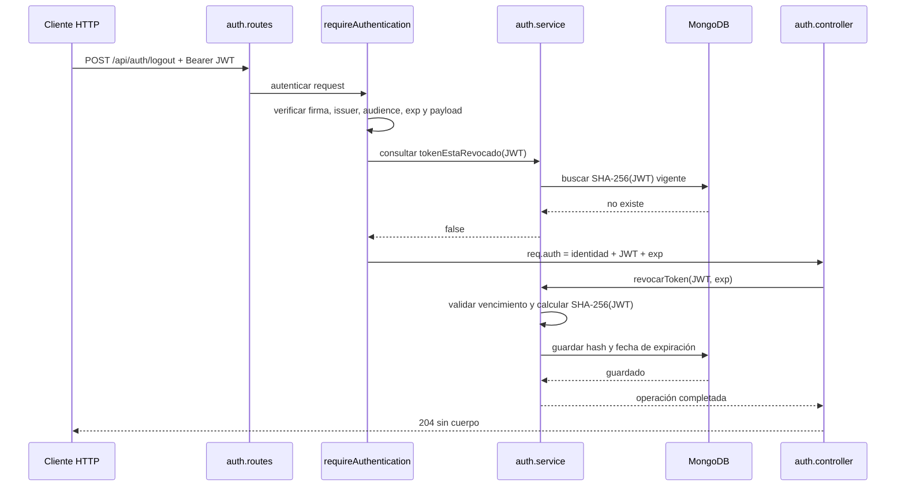

# Flujo: cerrar sesión (logout)

## Qué resuelve

La API usa JWT. Un JWT válido se puede verificar sin consultar una sesión en
la base, así que borrar una copia del token no invalida otras copias. Para que
el logout cierre la sesión también del lado del backend, la API registra una
revocación asociada al token presentado.

El logout revoca **una sesión**, no todas las sesiones del usuario. Si Ana
inició sesión dos veces, cada login emite un JWT distinto; cerrar uno no
invalida el otro. Esto vale igual para alumnos y administradores.

## Contrato HTTP

```http
POST /api/auth/logout
Authorization: Bearer <token>
```

No lleva body. Cualquier usuario autenticado puede usarlo; no se distingue por
rol y no se necesita un DTO. Si el token es válido y aún no estaba revocado,
la respuesta es `204 No Content`, sin cuerpo. Un token ausente, inválido,
vencido o ya revocado responde `401` con el error de autenticación usual.

## Recorrido del pedido



### 1. La ruta exige autenticación

`POST /api/auth/logout` pasa por `requireAuthentication` antes del controller.
No pasa por autorización de administrador ni validación de body: tanto alumno
como administrador pueden cerrar su propia sesión.

### 2. El middleware identifica y consulta el JWT

`requireAuthentication` comprueba el formato `Bearer`, verifica firma,
algoritmo, audiencia y emisor con `jwt.verify`, y confirma que el payload
contenga `sub`, un rol conocido y `exp`. Después le pide al service que
consulte si ese token ya fue revocado. Si lo fue, lanza `ErrorAutenticacion`
y el pedido termina en `401` antes de llegar al controller.

Si sigue vigente, deja en `req.auth` el id, rol, JWT y vencimiento verificados.
El JWT completo solo vive en el contexto de ese request; no se persiste.

### 3. El controller delega y responde

`auth.controller.logout` toma el JWT y `exp` de `req.auth`, llama a
`auth.service.revocarToken` y responde `204`. No calcula hashes, valida reglas
de vigencia, consulta modelos ni decide si la operación está permitida: esas
responsabilidades no pertenecen al controller.

### 4. El service registra la revocación

`auth.service.revocarToken` comprueba que `exp` sea un número finito y que el
token todavía no haya vencido. Calcula `SHA-256(JWT)` y guarda ese hash junto
con la fecha de vencimiento en `tokens_revocados`. El JWT original no se
guarda. El hash tiene índice único y la operación es idempotente en la base.

`TokenRevocado` tiene un índice TTL para que MongoDB elimine los registros
cuando ya vencieron. La consulta además exige `expiraEn > ahora`: la limpieza
TTL de MongoDB es periódica, no inmediata.

## Qué pasa después

En cualquier ruta protegida, `requireAuthentication` vuelve a calcular el
hash del Bearer recibido y consulta al service. Si encuentra una revocación
vigente, responde `401`; no se ejecutan los siguientes middlewares ni el
controller. El mismo token ya no puede usarse en ninguna ruta protegida.

Un token distinto emitido en otro login tiene otro `jti` y otro hash. Por eso
permanece válido hasta que venza o se revoque también. El `jti` aleatorio se
agrega al firmar el JWT para que dos logins del mismo usuario, incluso dentro
del mismo segundo, no produzcan el mismo token.

## Persistencia y disponibilidad

La revocación requiere MongoDB y añade una consulta a la base en cada request
autenticado. Si esa consulta falla, el middleware no deja pasar el pedido: el
error llega al `errorHandler` como error interno. No se debe convertir un
fallo de persistencia en una autorización aceptada, porque eso permitiría
reutilizar tokens revocados.

Los tokens emitidos antes de incorporar `jti` siguen pudiendo autenticarse
hasta su vencimiento, pero también pueden revocarse: la revocación se vincula
al hash del JWT completo y no depende de que el claim exista.

## Pruebas del comportamiento

- Alumno y administrador pueden cerrar sesión con su propio token.
- El endpoint responde `401` sin token válido.
- Después de un logout, el token recibe `401` en cualquier ruta protegida.
- Revocar una sesión no invalida otro token del mismo usuario.
- El service guarda el hash, no el JWT, rechaza vencimientos inválidos y no
  duplica revocaciones concurrentes.

Las pruebas automatizadas están en `tests/services/auth.service.test.ts` y
`tests/middlewares/auth.http.test.ts`.